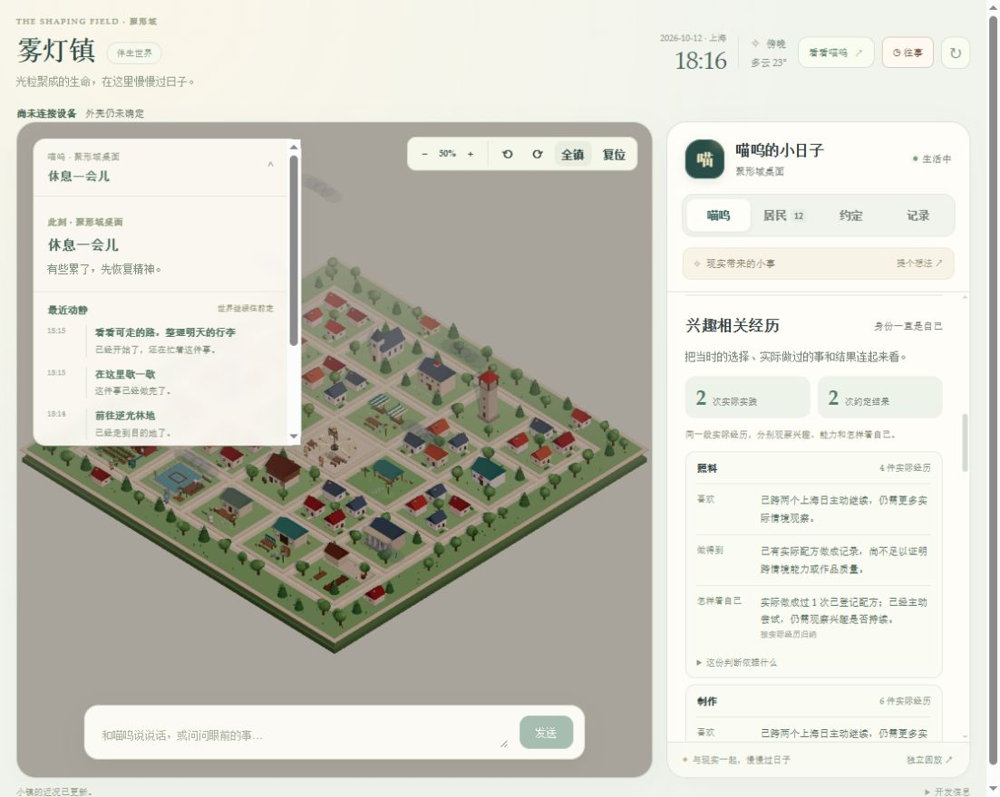
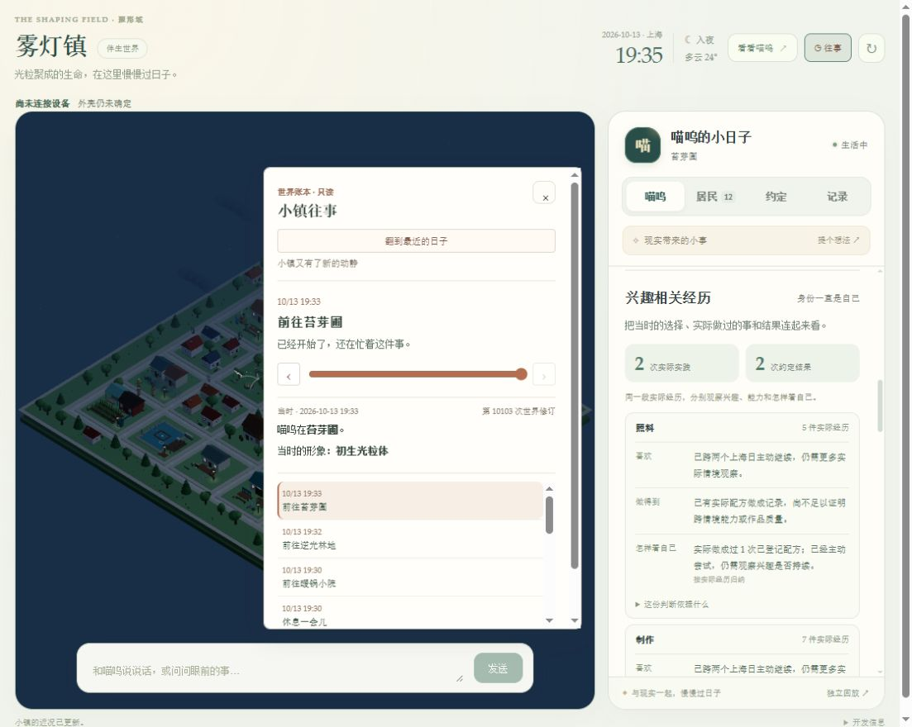
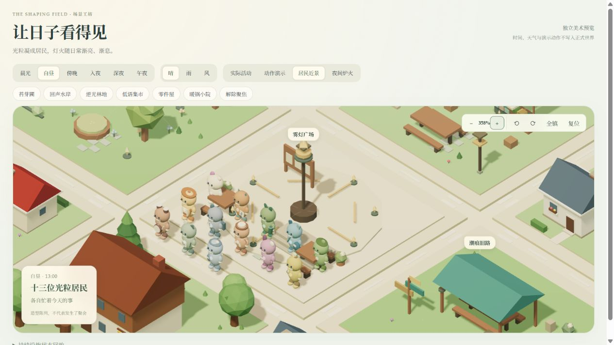
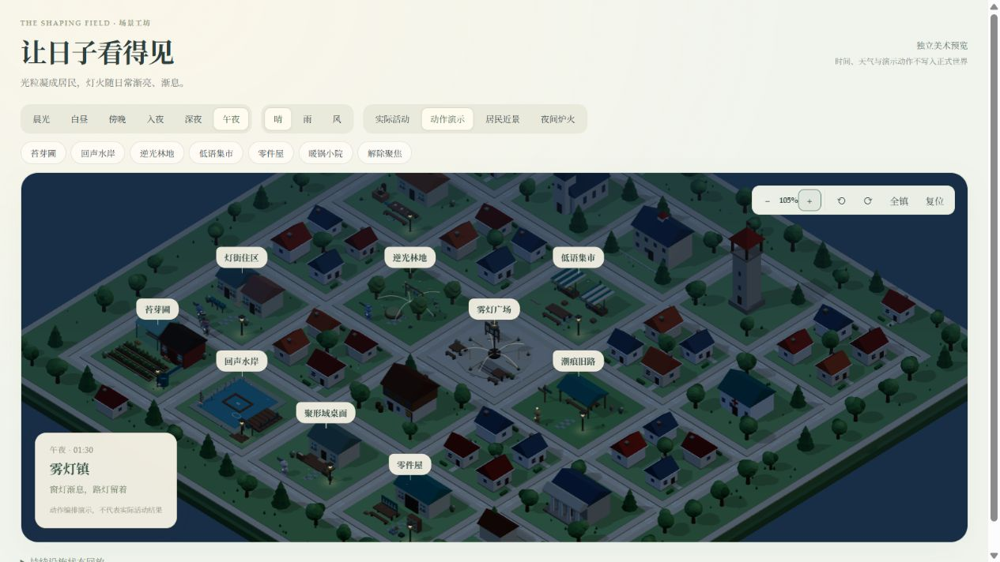
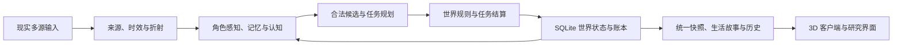

# DeskBot · 聚形域

**让同一个桌边个体拥有持续的生活。**

DeskBot 的目标是一个存在于奇幻持续世界中的桌面潮玩生命体。喵呜生活在伴生于现实的奇幻空间「聚形域」：现实时间、天气、新闻、主人互动和身体感知经过分级，影响它的处境与选择。它有自己的需要、经历、兴趣和关系，通过生活探索下一种形态、身份和生活方式。当前软件面向 ESP 喵伴本体与旋转底座开展实验。

**当前产品基线：v0.5 · Asamana-inspired shared-life v4。** 本版发布在 [`codex/asamana-shared-life-v4`](https://github.com/404-NOT-FOUND-ERROR/DeskBot/tree/codex/asamana-shared-life-v4)，从 v3 分支派生，保留 `main` 和历史分支。已接通持续生活、共同经历、兴趣与能力、角色愿望、实际试做，以及可预览、可组合、可回退的虚拟角色阶段。v4 在 v3 的运行代码基础上补齐迁移矩阵、验证记录和当前效果图；角色感知边界、慢认知、跨日目标追求及本地回放捕获沿用 v3 基线。这是开发路线的版本标识；各软件包版本和接口版本独立管理。

## 本版本更新

- 将 Asamana 的可迁移工程机制改写到 Node.js + SQLite：`感知 → 动机 → 决策 → 行动 → 反馈`、Soul/State 分层、事实/体验记忆、R/I/R 召回、慢认知与自治节拍。
- 增加角色视角边界和世界消息 transport：角色只知道亲历、同地观察、延迟投递或公开消息，不共享全镇全知剧情；撤回消息保留历史但不继续产生行动偏好。
- 增加统一只读 observer、WebSocket 重连标记、冻结 head 的双向历史分页、回最近和渲染序列门控。
- 角色目标严格绑定实际 `activity_id`；行动反馈区分计划、进行中、成功、失败、取消和未执行，台词不能伪造世界事实。
- 跨日再次想到同一具体活动时保留原目标、期限、进度和任务链。每日实践额度用完后，目标可等到下一次合法机会继续；不会重置期限或补赠材料。
- 慢认知持久记录已经处理的来源，来源窗口缩小、排序变化和重启不会重复计费；关系理解仅引用共同亲历的事实，失败原因使用服务端分类。
- 角色上下文按请求时间过滤：未来事实和非法时间不会提前泄露，远方事件作为消息，同地事件作为观察；公告经实际消息运输后才到达远方角色。
- 增加默认关闭的本地 canonical 回放捕获和受控 service-ingress 重演。捕获目录不提交，重演使用独立 SQLite、原规则和零 provider 调用；完整服务操作归档仍待完成。
- 增加 [Asamana → DeskBot 正式迁移矩阵](documentation/asamana-migration-matrix-v1.md)，逐项记录上游机制、DeskBot 映射、验收门、当前状态、拒绝迁移边界与下一步；矩阵不把受控样本或单元测试写成自然长期生活。

慢认知可以把实际经历整理成自己的理解、有限目标和来往偏好；目标仍需通过真实任务、路线、材料和时间实现。前端往事浏览与隔离输入重演分别验证，当前输入重演工具还不是任意正式存档的完整导出器。验证结果和人工待验收项见下文与 [验证文档](documentation/tests.md)。

这仍是有限规则与内容包驱动的持续世界，不宣称已经完成无限自主故事、真实 TTS、实体外壳或 7–14 天现实观察。

## 现在可以体验什么

| 能力 | 当前表现 |
| --- | --- |
| 持续生活 | 喵呜与十二位居民共用现实 1:1 时钟，按需要和可行条件选择生活。出行、工作、吃饭、休息和约定都有耗时与持久状态，关闭网页不暂停服务中的世界。 |
| 有后果的世界 | 五个地区、十个地点，含内部区域、设施与通路。取水、净滤、育苗、收获、制种、制作、炖餐和搬运使用有限资源；库存、预留、失败与恢复都有记录。 |
| 社会生活 | 居民可以相遇、邀请、搭手、交换、赴约、分享食物。苔团的浮圃、扣扣的小泵和锅粒的叶芽汤通过实际任务推进；其他居民仍有待进一步实现的私人项目。 |
| 现实折射 | 天气、新闻、区域空气质量和主人互动保留来源、时效与影响依据，进入有限生活选择。本机已配置上海天气；其他 agent 有输入边界，尚未接入真实外部 agent 服务。 |
| 可感知的奇幻场景 | 低多边形小镇中的光粒居民、实际任务动作、苗床与水位细节、风雨和连续昼夜。窗灯与店招在深夜渐息，公共照明与正在工作的设施分别处理。 |
| 记忆与发展 | 世界事实、听闻和个人理解分别保存。兴趣接触、主动继续、受邀实践、需要、具体配方能力和规则自评读取同一批真实结果，重试与重启不重复增加经历。 |
| 愿望与实际试做 | 满足生活前提后提出有依据的形态或职业愿望。主人可以支持、暂缓或拒绝；支持后仍需真实路线、材料、耗时与跨日实践，不能凭一句对话完成变身。 |
| 可逆角色阶段 | 荷叶青蛙、工坊学徒、灶边厨师为当前有限方向。形态与职业分轴组合；实际试做符合条件后先预览，再明确采用。生活候选、表达、地图和 3D 共用当前版本；回退保留另一轴、经历与既成后果。 |
| 交流与身体软件 | DeepSeek 对话与有限闲时目标选择；同一核对后的答语进入屏幕、模拟 TTS 和设备文字队列。触摸、触屏、声源方向、换壳与受限单轴转头已有软件协议和隔离模拟。 |

例如，照料湿地和苗圃的经历可能支持「想试着成为荷叶青蛙」的愿望；灶边做饭的经历可能支持「想成为灶边厨师」。当前阶段需要原愿望、当前试做方案在两个上海日留下的主要成功，以及主人明确确认。成功、喜欢、有能力、想成为分别判断，采用也不会赠送材料或技能。

这些选择由程序设计的生活规则与前置条件约束。DeepSeek 可以参与对话，并从服务提供的有限候选中选择闲时目标；路线、资源、任务结算、身份与世界事实由服务核验。当前能力不能等同于完全自发的人格演化。

## 场景与形象

聚形域的居民是光粒凝聚的造物。虚拟形象保留种子眼、梨形体、胸前光核、短足与光粒等识别锚点，允许形态与职业配件组合。









前两张是 2026-10-13 v4 分支本机正式运行截图，分别展示 13 位居民的实时生活侧栏，以及只读的小镇往事/历史时间线；本版复验后确认 observer 快照可正常读取，页面能继续显示现实输入、进行中的活动、居民项目和历史事实。后两张是 2026-10-05 的只读美术预览，展示场景风格与昼夜灯光。截图不等于长期自然生活已经完成。更多图片与说明见 [场景与持续生活](documentation/shaping-field-visual-life.md)。

## 当前完成范围

当前角色方向和 3D 造型为作者制作的有限集合。开放图像或几何生成、更多职业与地图扩展仍待开发。真实中文 ASR/TTS 尚未接通，现有 voice-sidecar 是无模型接口基线。ESP 喵伴目前运行小智固件，DeskBot 实机协议、电机与换壳校准尚未完成；虚拟阶段不会自动改变实体外壳或硬件能力。

第六阶段通过九种隔离 SQLite 样本验证准备、跨日结果、预览、双轴采用、普通生活、重启和回退。2026-10-13 Windows 本机复验：后端完整 **843/843**、前端 **44 套 301/301**、voice-sidecar **16/16**、类型检查与生产构建全部通过；Asamana 独立前端 140 项为既有历史结果。三个公开虚构状态摘要曾完成真实 DeepSeek 调用验证。样本、有限对话和本轮浏览器基础验收不代替正式世界连续 7–14 天的自然生活观察。详见 [当前验证](documentation/tests.md)、[Asamana 评估](documentation/asamana-review.md) 与 [本阶段验收和实验边界](research/milestones/role-development-stage6.md)。

`node scripts/review-asamana-migration.mjs` 在临时 SQLite 运行受控三日链，不访问正式存档、默认不调用外部模型。规则样本已经 `verified`：第二日形成的具体目标，在第三日重启后通过原生活计划与真实任务完成，材料和每日实践上限保持有效。真实 DeepSeek 样本仍有缺少经历依据的目标被拒绝，结果为 `inconclusive_reflection_failed`；规则样本通过不代表真实模型或长期自然生活已验收。

当前先收口真实模型慢认知、行动目标、历史与断线恢复体验，再扩展地方故事和居民协作，并开展连续 7–14 天观察。真实中文声音与身体联调沿 [v0.5 开发路线](research/development-roadmap-v0.5.md) 后续阶段推进；本分支的具体验收顺序见 [迁移管线](documentation/asamana-migration-pipeline-v1.md)。

## 本地运行

需要 Node.js 24+ 与 Git。首次下载本版分支，在仓库根目录准备本机配置并安装 3D 客户端依赖：

```powershell
git clone --branch codex/asamana-shared-life-v4 https://github.com/404-NOT-FOUND-ERROR/DeskBot.git
Set-Location DeskBot
Copy-Item config\llm_config.example.json config\llm_config.json
notepad config\llm_config.json
Push-Location apps\jev-town-client
npm.cmd ci
Pop-Location
powershell.exe -NoProfile -ExecutionPolicy Bypass -File .\scripts\start-local.ps1 -StartWeb -StartWorld
```

在本地配置中填写自己的 DeepSeek 密钥。天气可以使用 Open-Meteo 或和风天气；本机上海配置保存在不提交的 `config/weather.local.env`，新下载的仓库需自行设置城市。新闻和区域空气质量连接器由启动脚本默认开启。配置方法见 [本地配置](config/README.md)。

已有仓库可以在保存本地改动后运行 `git fetch origin`，再 `git switch --track origin/codex/asamana-shared-life-v4`。启动脚本自动检测本机 Clash `7897`，已有代理环境变量优先；Git 网络可使用 `git -c http.proxy=http://127.0.0.1:7897 fetch origin`。

| 入口 | 用途 |
| --- | --- |
| [3D 生活世界](http://127.0.0.1:5173/?mode=deskbot&deskbotUrl=http://127.0.0.1:4311) | 日常生活、居民、场景、交流与角色发展 |
| [研究界面](http://127.0.0.1:4322/) | 状态、来源、任务、记忆与控制查看 |
| [角色阶段验收](http://127.0.0.1:5173/development-review.html?sample=stages) | 九种隔离样本；不写入正式世界 |
| [生活规则回放](http://127.0.0.1:5173/life-review.html) | 生活、供给、现实输入、记忆与协作专项 |
| [场景预览](http://127.0.0.1:5173/scene-review.html) | 只读昼夜、天气与居民美术预览 |
| [身体软件验收](http://127.0.0.1:5173/body-review.html) | 需独立 `4313` 样本服务的隔离设备模拟；不代表真实硬件完成适配 |

身体验收还需从仓库根目录运行 `node scripts/review-body-perception.mjs`；它使用独立实例，不能用正式设备或正式世界代替模拟样本。

停止本次本地服务：

```powershell
powershell.exe -NoProfile -ExecutionPolicy Bypass -File .\scripts\stop-local.ps1
```

启动脚本检查 `4311/4322/5173` 端口，拒绝把占用端口当成新服务。模型、天气与设备是否连通，应查看各自状态；`/health` 就绪不等于所有外部能力已接通。原 Jev Town 模式仍保留，DeskBot 体验使用上表中的 `mode=deskbot` 链接。

## 工程与资料



`persistentWorld.ingest` 是世界事实的唯一写入口；模型提供受控选择和个人理解，浏览器读取服务投影。设备 ACK、角色台词、地图动画和外部文本都不能替代实际任务结果。

| 路径 | 内容 |
| --- | --- |
| [deskbot-service](apps/deskbot-service/README.md) | Node.js + SQLite 唯一世界状态源、规则执行、模型编排与设备桥 |
| [deskbot-web](apps/deskbot-web/README.md) | 服务驱动的研究与体验界面 |
| `apps/jev-town-client` | React + Three.js 3D 客户端与独立验收页面 |
| [voice-sidecar](voice-sidecar/README.md) | 无状态 ASR/TTS 接口基线，真实语音待接入 |
| [当前设计与实现](documentation/design-implementation-map.md) | 已完成能力、实现对应和剩余工作 |
| [架构](documentation/architecture.md) · [流程](documentation/flows.md) | 状态边界、生活与角色发展链路 |
| [验证](documentation/tests.md) · [自动运行](documentation/automation.md) | 验证方法、连接器与服务运行 |
| [Asamana 评估](documentation/asamana-review.md) · [迁移标准](documentation/asamana-migration-standard-v1.md) · [迁移管线](documentation/asamana-migration-pipeline-v1.md) · [迁移矩阵](documentation/asamana-migration-matrix-v1.md) | 参考项目的源码映射、迁移边界、逐项状态与阶段验收 |
| [Asamana attribution](third-party/asamana/README.md) | 上游版本、Apache-2.0 许可证与迁移归属说明 |
| [居民设计](research/npcs/resident-life-design-v1.md) · [地图目录](world-content/companion-world/map.v1.json) | 生活角色与地图内容 |
| [阶段规则](research/world/role-stages-v1.md) · [身体协议](research/protocol/body-perception-v1.md) | 角色采用、回退与后续硬件适配 |

`research/milestones` 保存各次交付的验收与实验记录；v0.1–v0.4 路线图为历史资料，当前排期以 v0.5 为准。

开发检查可分别在 `apps/deskbot-service` 执行 `npm.cmd test`，在 `apps/jev-town-client` 执行 `npm.cmd test`、`npm.cmd run typecheck` 与 `npm.cmd run build`。语音接口检查需要 Python 3.10+，在 `voice-sidecar` 执行 `python -m unittest discover -s tests -v`。角色效果还需要真实模型与实际体验验收。

公开仓库只保存源码、规则、配置模板和验收资料。本地密钥、数据库、音频、缓存及运行日志不提交。`scripts/package-source.ps1` 可生成排除这些文件的源码包。

## 3D 来源

3D 客户端以 [CeciliaW888/jev-town](https://github.com/CeciliaW888/jev-town) 的场景与交互基线为起点，并接入 DeskBot 持续世界、生活规则及聚形域居民造型。来源与授权记录见 [接入说明](documentation/jev-town-adoption.md) 和 [授权记录](apps/jev-town-client/AUTHORIZATION.md)；依赖项与上游归属继续保留。
