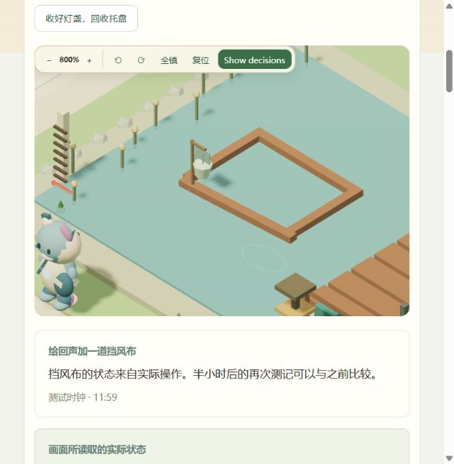
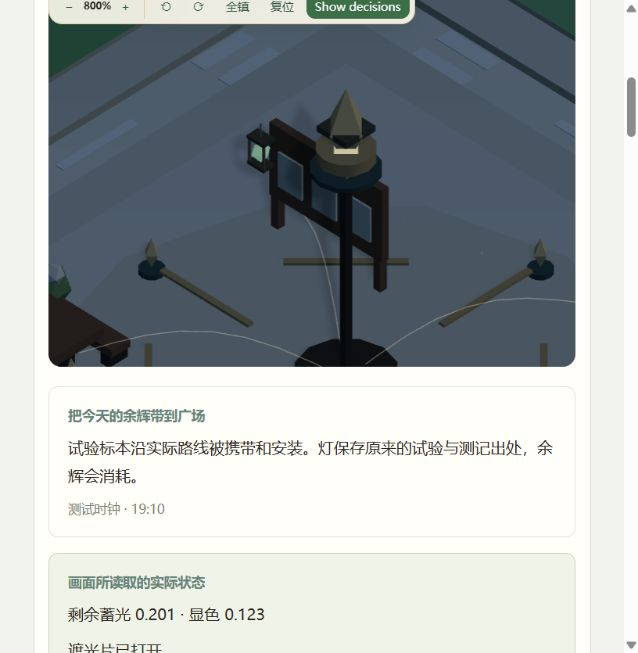
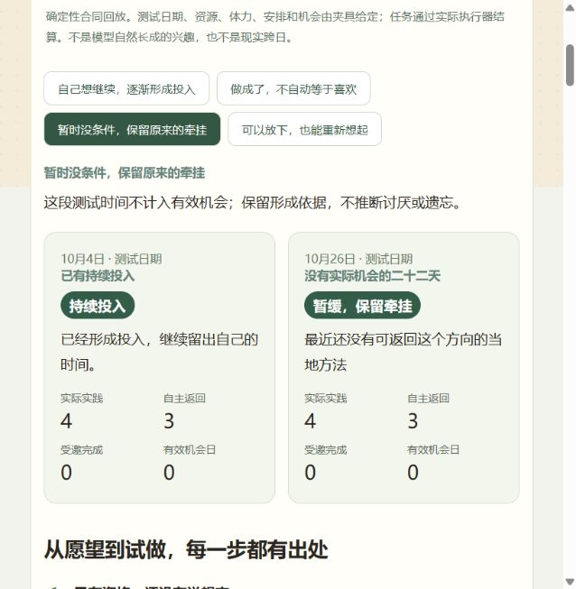

# DeskBot · 聚形域

**让喵呜在桌边拥有持续的生活，由自己的经历与选择，逐渐形成想成为谁的愿望。**

聚形域是伴生于现实的奇幻空间。时间、天气、新闻、主人互动与身体感知经过分级，成为角色能够理解的处境和机会。角色有自己的需要、关系和未完成的问题；实际行动消耗时间与材料，留下可追溯的结果。用户可以参与，输入不会直接改写身份或赠送成果。

**当前版本：v0.6 · 认知生活闭环（2026-10-11）。** Asamana 迁移管线第 1–5 阶段的软件合同与固定隔离样本已验收；自然跨日生活体验仍待第 6–7 阶段验证。各软件包和接口版本独立管理。

## 当前能力

| 能力 | 已实现范围 |
| --- | --- |
| 现实时间与有限世界 | 上海 1:1 时钟、天气、风雨昼夜、路线、有限库存、设施占用与持久任务。关闭网页不暂停仍在运行的服务；电脑停机不补造未曾安排的行为。 |
| 多源理解 | 有来源、时效和接收范围的感知；区分目击、听闻、建议、否定、假说和邀请。新闻可以引出问题，不直接成为亲历或物理定律。 |
| 个人认知 | 复用 Asamana 的感知、需要、目标、决策、双流记忆、反馈、反思与关系整理。Python 提出意图，Node 核验位置、条件和后果。 |
| 三条奇幻生活链 | 凝光苔明暗试验；水岸回声杯的悬点、风与水位；把余辉标本带到广场，开合遮光片、测记和收起。规律、材料、测记与 3D 读取同一实际状态。 |
| 关系与共同事务 | 回复关联、明确邀请、接受、拒绝、延期重确认与退出。实际赴约或交接才算完成；个人印象不修改对方记忆或客观关系。 |
| 长期运行基础 | 事件与到期事项唤起；睡眠休息不调用模型；公平排队、最多两名人物并行。个人原文归档、有界热记忆、可重建索引、慢速整理与故障恢复。 |
| 兴趣与机会 | 首次探索、自主返回、受邀、需要与已接受义务分开记录。形成看跨日实际证据；维持看真实可行窗口。离线、缺材料和忙碌不自动等于失去兴趣。 |
| 愿望、试做与采用 | 新认知人物需自己表达角色意愿，再经过既有条件。试做与普通生活共用执行器；采用保留身份，可按形态/职业分轴撤回，不自动更换实体壳。 |
| 生活观察与交流 | 原世界保留聊天入口；回顾呈现为什么、做了什么、实际结果和后续。固定实验、规则回放与正式世界清楚分开。 |

十三名生活角色已经登记，连续调度在隔离测试中覆盖十三人；真实模型对照使用有限人物与小批量情境，没有把十三人全天付费生活当作已完成体验。本机正式世界保留原生活层，新连续认知需显式启用；本轮仅授权发送隔离虚构数据。

## 本次画面与验证



水岸物件来自实际制作、安装与调节任务。画面为固定规则回放，天气与测试时间是虚构条件。



夜灯保留苗圃标本与测记出处。当前仍是场景机制样本，完整角色美术与实体外壳尚未交付。



第五阶段包括四类兴趣轨迹合同回放和十二组真实 DeepSeek 后续对照。十一组形成可复查后续，其中 **7/11（63.6%）实际推进**，包含一项从留言转为明确会面邀请，尚未共同完成；另有一组反馈语义合同失败。十六个有余力窗口都有至少两种不同可行安排。未按“做了任何事”计算成功。

第三至第五阶段共记录 974 次提供者调用尝试，峰时价格保守估算约 **¥8.25**，其中两次用量未知保留预留；第五阶段约 ¥2.19。不是账户账单，不含原聊天、旧规划器等其他调用。全系统成本和延迟对照属于下一阶段。

见 [v0.6 验收与局限](research/milestones/asamana-cognition-stage5-v1.md)。当前仍会反复等回应、混淆时区、误解物理规律或在自由文本中多说事实；严格执行器不等于模型每句话都正确。两例预设愿望讨论没有提出新角色，自然愿望的发生频率尚未证明。

## 本地运行

需要 Node.js 24+、Python 3.11+。密钥保存在本机配置，不提交仓库。

```powershell
Copy-Item config\llm_config.example.json config\llm_config.json
notepad config\llm_config.json
Push-Location apps\jev-town-client
npm.cmd install
Pop-Location
.\scripts\start-local.ps1 -StartWeb -StartWorld
```

认知适配器使用短生命周期 Python，无需额外常驻 TCP 服务。用 `DESKBOT_COGNITION_PYTHON` 指定解释器。模型、天气及来源配置见 [本地配置](config/README.md)，实验命令见 [认知适配器](services/deskbot-cognition/README.md)。新下载仓库不继承开发机密钥、正式人生或实验数据库。

| 入口 | 用途 |
| --- | --- |
| [世界与聊天](http://127.0.0.1:5173/?mode=deskbot&deskbotUrl=http://127.0.0.1:4311&view=journal) | 正式日常生活、交流和观察 |
| [兴趣与角色愿望](http://127.0.0.1:5173/cognitive-life-review.html?sample=development) | 四类轨迹与真实模型后续逐项核对 |
| [水岸与夜灯](http://127.0.0.1:5173/cognitive-life-review.html?sample=resonance) | 奇幻规律、物件和模型选择 |
| [共同生活](http://127.0.0.1:5173/cognitive-life-review.html?sample=social) | 协商、实际履约和个人关系理解 |
| [凝光苔](http://127.0.0.1:5173/cognitive-life-review.html?sample=inquiry) | 苗圃试验与结果 |
| [多源对照](http://127.0.0.1:5173/cognitive-life-review.html?sample=inputs) | 来源、语义与成对选择 |
| [既有角色阶段](http://127.0.0.1:5173/development-review.html?sample=stages) | 虚拟形态/职业采用与回退样本 |

认知回顾下半页保留第二阶段原始实验和原额度，不代表第三至第五阶段预算。停止本地服务用 `.\scripts\stop-local.ps1`。健康接口就绪不等于模型、天气或真实硬件全部连通。

## 下一阶段

先做第六阶段：比较旧规则、完整认知和优化版的质量、费用、延迟与重复等待；再做第七阶段小规模自然七日观察。需要包含安静日、中断恢复、昨天留下的后续，以及用户能否看懂改变安排的原因。测试时钟不替代自然七日。

完整人物、美术、表情、声音与打印壳在此基础上联合设计。现实身体没有摄像头或移动能力，只有屏幕、触摸、双麦声源方向、磁识别和单轴转头。当前设备仍为小智固件，DeskBot 实机协议、电机与换壳校准、真实中文 ASR/TTS 尚待接入。虚拟身份不会赋予现实身体额外能力。

## 架构与来源

- [当前架构](documentation/architecture.md) · [能力与实现](documentation/design-implementation-map.md) · [验证](documentation/tests.md)
- [迁移管线与出口](research/design/asamana-migration-pipeline-v2.md) · [第五阶段验收](research/milestones/asamana-cognition-stage5-v1.md)
- [Asamana](https://github.com/dreamscroll-lab/asamana)：固定提交 `e9fc862642369ba8b177595d2f8e3f20c1636da4`，52 个未修改上游文件；Apache-2.0 全文和哈希清单保留，适配器在 vendor 外。
- [旧 v0.5 路线](research/development-roadmap-v0.5.md) 与旧阶段验收作为历史保留，编号不与本轮认知迁移混用。

公开仓库保存源码、规则、配置模板和虚构验收摘要。密钥、正式人生数据库、音频、运行日志与原始出站记录不提交。
