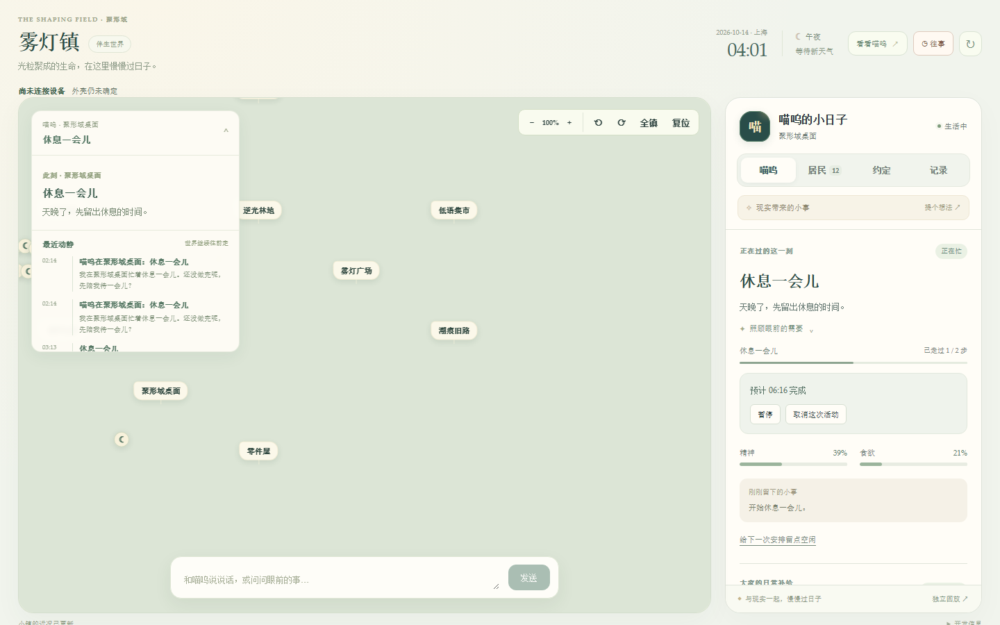
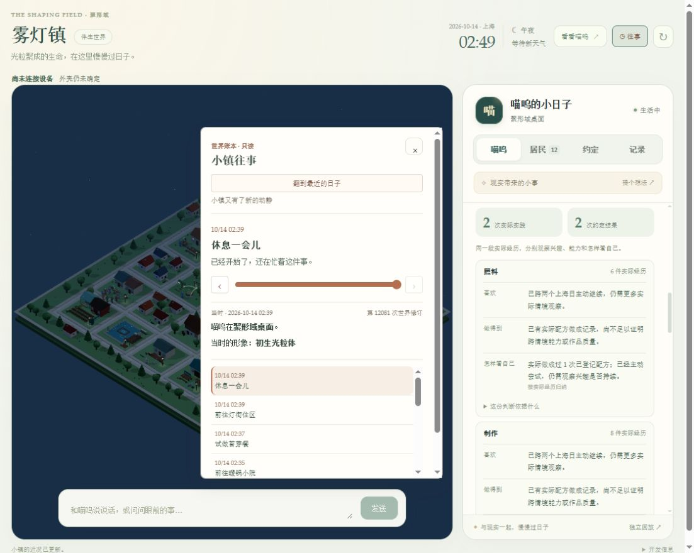
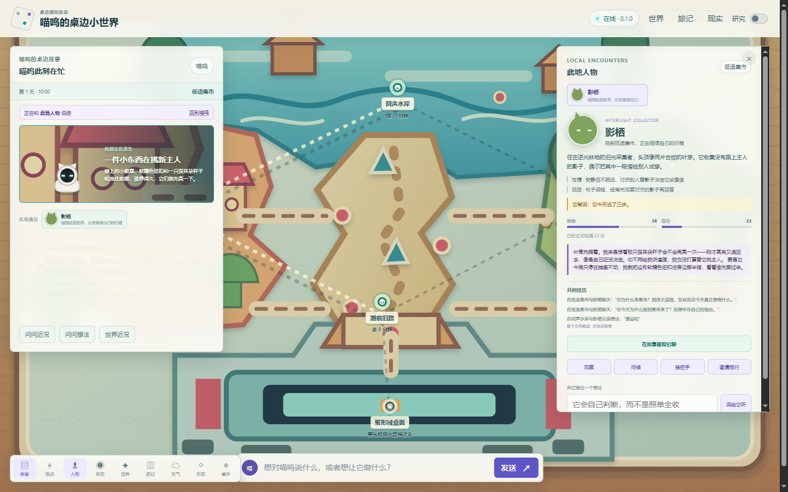
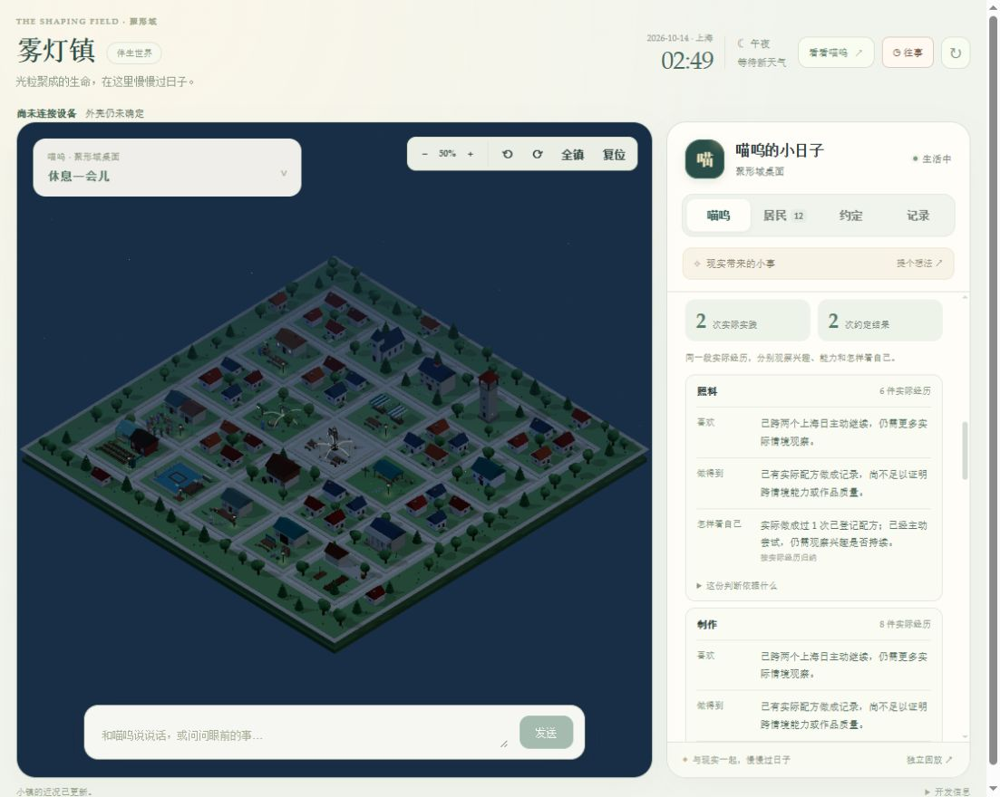
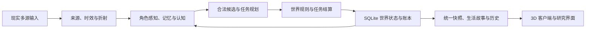

# DeskBot · 聚形域

**让同一个桌边个体拥有持续的生活。**

DeskBot 的目标是一个存在于奇幻持续世界中的桌面潮玩生命体。喵呜生活在伴生于现实的奇幻空间「聚形域」：现实时间、天气、新闻、主人互动和身体感知经过分级，影响它的处境与选择。它有自己的需要、经历、兴趣和关系，通过生活探索下一种形态、身份和生活方式。当前软件面向 ESP 喵伴本体与旋转底座开展实验。

**当前产品基线：v0.6 · Asamana migration program v2 preview（P4 foundation，2026-10-14）。** 本版发布在 [`codex/asamana-migration-program-v2-release-2026-10-14`](https://github.com/404-NOT-FOUND-ERROR/DeskBot/tree/codex/asamana-migration-program-v2-release-2026-10-14)，从已发布的 M6b-R operation-context preview 基线派生，保留 `main`、v6.4 release 和此前的 M6b-R 分支。已接通持续生活、共同经历、兴趣与能力、角色愿望、实际试做，以及可预览、可组合、可回退的虚拟角色阶段；本轮把迁移标准 v2、第一批 HTTP route operation replay 和受限 authored world-event candidate 桥接纳入同一条可核验管线。该分支是迁移开发快照，不代表 P4 或长期自然共同生活已经完成：仍有未覆盖的 role/life/world 全入口、worker、device、voice ASR/cancel、真实模型跨日目标追求和 7–14 日人工观察门。真实 TTS、真实设备 ACK 与外壳机械实现不属于本版完成条件；各软件包版本和接口版本独立管理。

### 本版发布亮点

- 迁移目录现在由 `scripts/validate-migration-catalog.mjs` 机器校验，运行时会先检查 18 个迁移项的唯一性、状态、依赖、证据和 freshness。
- voice `transcribe/tts` 在受控 replay 模式下可从私有 fixture 完整重入原 route，fresh/restart、缺失、篡改和错误 fixture 会 fail closed；这不等同于真实语音模型或 ASR/cancel 的完整生产归档。
- worker scheduler operation 已有稳定 operation ID、SQLite 重启恢复和 canonical mutation/role-run 去重验收。
- README、发布记录和运行截图与本分支一致；本版主要是后端回放与验收硬化，UI 视觉基线保持不变。

### 本次迁移程序分支新增

- 迁移标准、管线、作业单和 evidence schema v2：每个 Asamana 机制按合同、权限、正/负向、幂等、重启、原入口回放和交付复核逐项升级，不把邻近模块或 fixture 的通过结果写成全部迁移完成。
- 第一批 HTTP route 已接入 `deskbot.service-operation.v1` operation context：`role.evolution.run`、`world.candidate.preview/accept/dismiss` 和研究场景入口可做 fresh/restart/replay 验收，重演使用独立 SQLite 且不调用 provider。
- 增加受限 authored world-event package：现实观察先匹配雾灯镇（Morrowmere）内容包，再生成合法 world candidate，经 preview/accept 后才由 `persistentWorld.ingest` 写入 canonical world；内容包不能提交任意地点、资源或 mutation。
- 这批能力是服务端与验收层更新，地图、居民面板和生活侧栏沿用已验收的真实运行截图；截图不会被用来宣称 P4 全量或 7–14 日自然生活。

### 已继承的 M6b-R 基线能力

- 为本地回放捕获增加版本化 `deskbot.service-operation.v1` journal envelope：记录 operation、来源、请求摘要、写入 namespace、事务边界和记录哈希，不把原始请求或密钥写入归档。
- 增加 `runServiceOperation` / `runWorkerOperation` 接缝，把已覆盖的 HTTP route、life-choice、slow-cognition 和调度入口绑定到稳定 operation ID、logic time、route ID、规则版本与来源事件引用；未覆盖入口继续保持显式 `partial`。
- 为 `/api/chat` 用户分支、`/api/event` 通用入口和 `input-runtime` source run 接入统一 operation context；输入运行记录使用 `input-runtime:<source>:<timestamp>:<sequence>` 标识，并保存脱敏 `deskbot.input-runtime-result-ref.v1`。
- provider 与 TTS 结果以脱敏引用进入 operation journal；聊天正文、provider 原始响应、密钥和敏感 prompt 不进入公开回放归档。v6.4 的可执行回放使用脱敏 LLM/input-runtime fixture；私有 capture tape 可能保留事件与 provider fixture 原文，只能留在本机，不能提交或发布。
- 增加 operation-journal、chat 和 input-runtime 合同测试，覆盖 namespace 白名单、上下文跨异步边界、重复/篡改检测、SQLite 重启恢复与敏感请求不落盘。
- 将 voice ASR、transcribe、TTS、cancel 路由和 WebSocket device bridge 纳入 operation scope 第一批接缝，使用稳定 `voice.*` / `device.*` operation ID；其中 transcribe/tts 已有私有 archive/replay 原入口闭环，这不表示真实语音模型或固件已接入。
- M6b 仍按迁移矩阵逐项推进：input-runtime 的受控 fixture replay 已完成 I0–I7 验收（见 [I4/I7 记录](documentation/asamana-input-runtime-replay-v1.md)）；本迁移程序分支只新增第一批直接 HTTP domain route 接缝，完整 assistant 分支、worker、WebSocket 和生产归档仍按目录逐项收口，不把当前 partial 状态写成完整生产归档。
- 视觉效果沿用已验收的雾灯镇实时小镇与往事面板；本版再次核对 2026-10-14 本机运行页面，新增能力主要位于服务端 chat/input-runtime replay 和回放审计，不伪装成新的 UI 改版。

## 本版本更新

- 将 Asamana 的可迁移工程机制改写到 Node.js + SQLite：`感知 → 动机 → 决策 → 行动 → 反馈`、Soul/State 分层、事实/体验记忆、R/I/R 召回、慢认知与自治节拍。
- 增加角色视角边界和世界消息 transport：角色只知道亲历、同地观察、延迟投递或公开消息，不共享全镇全知剧情；撤回消息保留历史但不继续产生行动偏好。
- 增加统一只读 observer、WebSocket 重连标记、冻结 head 的双向历史分页、回最近和渲染序列门控。
- 角色目标严格绑定实际 `activity_id`；行动反馈区分计划、进行中、成功、失败、取消和未执行，台词不能伪造世界事实。
- 跨日再次想到同一具体活动时保留原目标、期限、进度和任务链。每日实践额度用完后，目标可等到下一次合法机会继续；不会重置期限或补赠材料。
- 慢认知持久记录已经处理的来源，来源窗口缩小、排序变化和重启不会重复计费；关系理解仅引用共同亲历的事实，失败原因使用服务端分类。
- 角色上下文按请求时间过滤：未来事实和非法时间不会提前泄露，远方事件作为消息，同地事件作为观察；公告经实际消息运输后才到达远方角色。
- 增加默认关闭的本地 canonical 回放捕获和受控 service-ingress 重演。捕获目录不提交，重演使用独立 SQLite、原规则和零 provider 调用；完整服务操作归档仍待完成。
- 增加 [Asamana → DeskBot 正式迁移矩阵](documentation/asamana-migration-matrix-v1.md)，并以 [迁移标准 v2](documentation/asamana-migration-standard-v2.md)、[迁移管线 v2](documentation/asamana-migration-pipeline-v2.md) 和 [迁移作业单 v2](documentation/asamana-migration-runbook-v2.md) 细化逐项合同、验收门、证据和回滚边界；这些资料不把受控样本或单元测试写成自然长期生活。

慢认知可以把实际经历整理成自己的理解、有限目标和来往偏好；目标仍需通过真实任务、路线、材料和时间实现。前端往事浏览与隔离输入重演分别验证，当前输入重演工具还不是任意正式存档的完整导出器。验证结果和人工待验收项见下文与 [验证文档](documentation/tests.md)。

这仍是有限规则与内容包驱动的持续世界，不宣称已经完成无限自主故事、真实 TTS、实体外壳或 7–14 天现实观察。

## 现在可以体验什么

| 能力 | 当前表现 |
| --- | --- |
| 持续生活 | 喵呜与十二位居民（共十三位角色）共用现实 1:1 时钟，按需要和可行条件选择生活。出行、工作、吃饭、休息和约定都有耗时与持久状态，关闭网页不暂停服务中的世界。 |
| 有后果的世界 | 五个地区、十个地点，含内部区域、设施与通路。取水、净滤、育苗、收获、制种、制作、炖餐和搬运使用有限资源；库存、预留、失败与恢复都有记录。 |
| 社会生活 | 居民可以相遇、邀请、搭手、交换、赴约、分享食物。苔团的浮圃、扣扣的小泵和锅粒的叶芽汤通过实际任务推进；其他居民仍有待进一步实现的私人项目。 |
| 现实折射 | 天气、新闻、区域空气质量和主人互动保留来源、时效与影响依据，进入有限生活选择。本机已配置上海天气；其他 agent 有输入边界，尚未接入真实外部 agent 服务。 |
| 可感知的奇幻场景 | 低多边形小镇中的光粒居民、实际任务动作、苗床与水位细节、风雨和连续昼夜。窗灯与店招在深夜渐息，公共照明与正在工作的设施分别处理。 |
| 记忆与发展 | 世界事实、听闻和个人理解分别保存。兴趣接触、主动继续、受邀实践、需要、具体配方能力和规则自评读取同一批真实结果，重试与重启不重复增加经历。 |
| 愿望与实际试做 | 满足生活前提后提出有依据的形态或职业愿望。主人可以支持、暂缓或拒绝；支持后仍需真实路线、材料、耗时与跨日实践，不能凭一句对话完成变身。 |
| 可逆角色阶段 | 荷叶青蛙、工坊学徒、灶边厨师为当前有限方向。形态与职业分轴组合；实际试做符合条件后先预览，再明确采用。生活候选、表达、地图和 3D 共用当前版本；回退保留另一轴、经历与既成后果。 |
| 交流与身体软件 | DeepSeek 对话与有限闲时目标选择；同一核对后的答语进入屏幕、模拟 TTS 和设备文字队列。触摸、触屏、声源方向、换壳与受限单轴转头已有软件协议和隔离模拟。 |

例如，照料湿地和苗圃的经历可能支持「想试着成为荷叶青蛙」的愿望；灶边做饭的经历可能支持「想成为灶边厨师」。当前阶段需要原愿望、当前试做方案在两个上海日留下的主要成功，以及主人明确确认。成功、喜欢、有能力、想成为分别判断，采用也不会赠送材料或技能。

这些选择由程序设计的生活规则与前置条件约束。DeepSeek 可以参与对话，并从服务提供的有限候选中选择闲时目标；路线、资源、任务结算、身份与世界事实由服务核验。当前能力不能等同于完全自发的人格演化。

## 场景与形象

聚形域的居民是光粒凝聚的造物。虚拟形象保留种子眼、梨形体、胸前光核、短足与光粒等识别锚点，允许形态与职业配件组合。



> 这张图是本机 `5173` 客户端连接 `4311` DeskBot 服务的实际运行快照：地图、居民、往事回放、生活侧栏和聊天入口同时可见。它用于说明当前可体验的产品形态，不把一张截图当作 7–14 天自然长期生活的替代验收。








第一张是本迁移程序分支沿用的最新实际运行截图：地图、居民面板、共同经历和聊天入口同时可见。P4 foundation 本轮主要改动服务端 replay 接缝与 authored world-event candidate 治理，没有伪造一张“新 UI”图片；因此这张图仍是当前可体验产品形态的真实证据，但不等于 P4 全量、长期自然生活或全入口回放已经完成。更多图片与说明见 [场景与持续生活](documentation/shaping-field-visual-life.md)、[M6b-R 接缝合同](documentation/asamana-m6b-route-worker-device-replay-v1.md)、[迁移管线 v2](documentation/asamana-migration-pipeline-v2.md) 和 [世界事件内容包](documentation/asamana-authored-world-event-package-v1.md)。

## 当前完成范围

当前角色方向和 3D 造型为作者制作的有限集合。开放图像或几何生成、更多职业与地图扩展仍待开发。真实中文 ASR/TTS 尚未接通，现有 voice-sidecar 是无模型接口基线。ESP 喵伴目前运行小智固件，DeskBot 实机协议、电机与换壳校准尚未完成；虚拟阶段不会自动改变实体外壳或硬件能力。

第六阶段通过九种隔离 SQLite 样本验证准备、跨日结果、预览、双轴采用、普通生活、重启和回退。v6.4 基线的 Windows 本机复验与 M6b-R 接缝审计结果见 [当前验证](documentation/tests.md)、[Asamana 评估](documentation/asamana-review.md)、[M6b-R 接缝合同](documentation/asamana-m6b-route-worker-device-replay-v1.md) 与 [迁移矩阵](documentation/asamana-migration-matrix-v1.md)。本迁移程序分支只把已验证的受控 replay、第一批 operation 接缝和 authored world-event candidate 骨架写入发布说明；服务端全量 route/voice/worker/device 回放、真实模型跨日目标追求和 R0–R8 完整验收仍是后续门槛。样本、有限对话和本轮浏览器基础验收不代替正式世界连续 7–14 天的自然生活观察。

`node scripts/review-asamana-migration.mjs` 在临时 SQLite 运行受控三日链，不访问正式存档、默认不调用外部模型。规则样本已经 `verified`：第二日形成的具体目标，在第三日重启后通过原生活计划与真实任务完成，材料和每日实践上限保持有效。真实 DeepSeek 样本仍有缺少经历依据的目标被拒绝，结果为 `inconclusive_reflection_failed`；规则样本通过不代表真实模型或长期自然生活已验收。

当前先收口真实模型慢认知、行动目标、历史与断线恢复体验，再扩展地方故事和居民协作，并开展连续 7–14 天观察。真实中文声音与身体联调沿 [v0.5 开发路线](research/development-roadmap-v0.5.md) 后续阶段推进；本分支的具体验收顺序见 [迁移管线 v2](documentation/asamana-migration-pipeline-v2.md)。

## 本地运行

需要 Node.js 24+ 与 Git。首次下载本版分支，在仓库根目录准备本机配置并安装 3D 客户端依赖：

```powershell
git clone --branch codex/asamana-migration-program-v2-release-2026-10-14 https://github.com/404-NOT-FOUND-ERROR/DeskBot.git
Set-Location DeskBot
Copy-Item config\llm_config.example.json config\llm_config.json
notepad config\llm_config.json
Push-Location apps\jev-town-client
npm.cmd ci
Pop-Location
powershell.exe -NoProfile -ExecutionPolicy Bypass -File .\scripts\start-local.ps1 -StartWeb -StartWorld
```

在本地配置中填写自己的 DeepSeek 密钥。天气可以使用 Open-Meteo 或和风天气；本机上海配置保存在不提交的 `config/weather.local.env`，新下载的仓库需自行设置城市。新闻和区域空气质量连接器由启动脚本默认开启。配置方法见 [本地配置](config/README.md)。

已有仓库可以在保存本地改动后运行 `git fetch origin`，再 `git switch --track origin/codex/asamana-migration-program-v2-release-2026-10-14`。启动脚本自动检测本机 Clash `7897`，已有代理环境变量优先；Git 网络可使用 `git -c http.proxy=http://127.0.0.1:7897 fetch origin`。

| 入口 | 用途 |
| --- | --- |
| [3D 生活世界](http://127.0.0.1:5173/?mode=deskbot&deskbotUrl=http://127.0.0.1:4311) | 日常生活、居民、场景、交流与角色发展 |
| [研究界面](http://127.0.0.1:4322/) | 状态、来源、任务、记忆与控制查看 |
| [角色阶段验收](http://127.0.0.1:5173/development-review.html?sample=stages) | 九种隔离样本；不写入正式世界 |
| [生活规则回放](http://127.0.0.1:5173/life-review.html) | 生活、供给、现实输入、记忆与协作专项 |
| [场景预览](http://127.0.0.1:5173/scene-review.html) | 只读昼夜、天气与居民美术预览 |
| [身体软件验收](http://127.0.0.1:5173/body-review.html) | 需独立 `4313` 样本服务的隔离设备模拟；不代表真实硬件完成适配 |

身体验收还需从仓库根目录运行 `node scripts/review-body-perception.mjs`；它使用独立实例，不能用正式设备或正式世界代替模拟样本。

停止本次本地服务：

```powershell
powershell.exe -NoProfile -ExecutionPolicy Bypass -File .\scripts\stop-local.ps1
```

启动脚本检查 `4311/4322/5173` 端口，拒绝把占用端口当成新服务。模型、天气与设备是否连通，应查看各自状态；`/health` 就绪不等于所有外部能力已接通。原 Jev Town 模式仍保留，DeskBot 体验使用上表中的 `mode=deskbot` 链接。

## 工程与资料



`persistentWorld.ingest` 是世界事实的唯一写入口；模型提供受控选择和个人理解，浏览器读取服务投影。设备 ACK、角色台词、地图动画和外部文本都不能替代实际任务结果。

| 路径 | 内容 |
| --- | --- |
| [deskbot-service](apps/deskbot-service/README.md) | Node.js + SQLite 唯一世界状态源、规则执行、模型编排与设备桥 |
| [deskbot-web](apps/deskbot-web/README.md) | 服务驱动的研究与体验界面 |
| `apps/jev-town-client` | React + Three.js 3D 客户端与独立验收页面 |
| [voice-sidecar](voice-sidecar/README.md) | 无状态 ASR/TTS 接口基线，真实语音待接入 |
| [当前设计与实现](documentation/design-implementation-map.md) | 已完成能力、实现对应和剩余工作 |
| [架构](documentation/architecture.md) · [流程](documentation/flows.md) | 状态边界、生活与角色发展链路 |
| [验证](documentation/tests.md) · [自动运行](documentation/automation.md) | 验证方法、连接器与服务运行 |
| [Asamana 评估](documentation/asamana-review.md) · [v6.4 发布说明](documentation/asamana-replay-journal-v6-4.md) · [v6.3 发布说明](documentation/asamana-replay-journal-v6-3.md) · [input-runtime 回放验收](documentation/asamana-input-runtime-replay-v1.md) · [v6.2 发布说明](documentation/asamana-replay-journal-v6-2.md) · [M6b 接缝合同](documentation/asamana-m6b-seam-contract-v1.md) · [迁移标准 v1](documentation/asamana-migration-standard-v1.md) · [迁移标准 v2](documentation/asamana-migration-standard-v2.md) · [迁移管线 v1](documentation/asamana-migration-pipeline-v1.md) · [迁移管线 v2](documentation/asamana-migration-pipeline-v2.md) · [迁移作业单 v2](documentation/asamana-migration-runbook-v2.md) · [迁移矩阵](documentation/asamana-migration-matrix-v1.md) · [世界事件内容包](documentation/asamana-authored-world-event-package-v1.md) | 参考项目的源码映射、迁移边界、逐项状态与阶段验收 |
| [Asamana attribution](third-party/asamana/README.md) | 上游版本、Apache-2.0 许可证与迁移归属说明 |
| [居民设计](research/npcs/resident-life-design-v1.md) · [地图目录](world-content/companion-world/map.v1.json) | 生活角色与地图内容 |
| [阶段规则](research/world/role-stages-v1.md) · [身体协议](research/protocol/body-perception-v1.md) | 角色采用、回退与后续硬件适配 |

`research/milestones` 保存各次交付的验收与实验记录；v0.1–v0.4 路线图为历史资料，当前排期以 v0.5 为准。

开发检查可分别在 `apps/deskbot-service` 执行 `npm.cmd test`，在 `apps/jev-town-client` 执行 `npm.cmd test`、`npm.cmd run typecheck` 与 `npm.cmd run build`。语音接口检查需要 Python 3.10+，在 `voice-sidecar` 执行 `python -m unittest discover -s tests -v`。角色效果还需要真实模型与实际体验验收。

公开仓库只保存源码、规则、配置模板和验收资料。本地密钥、数据库、音频、缓存及运行日志不提交。`scripts/package-source.ps1` 可生成排除这些文件的源码包。

## 3D 来源

3D 客户端以 [CeciliaW888/jev-town](https://github.com/CeciliaW888/jev-town) 的场景与交互基线为起点，并接入 DeskBot 持续世界、生活规则及聚形域居民造型。来源与授权记录见 [接入说明](documentation/jev-town-adoption.md) 和 [授权记录](apps/jev-town-client/AUTHORIZATION.md)；依赖项与上游归属继续保留。
