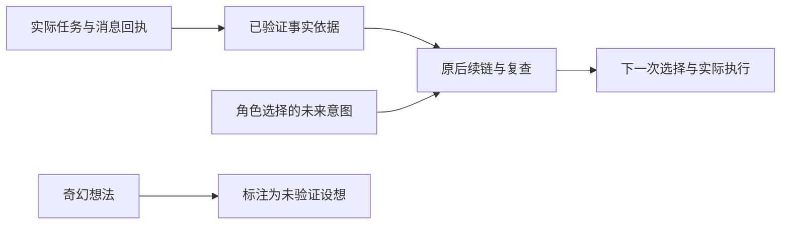
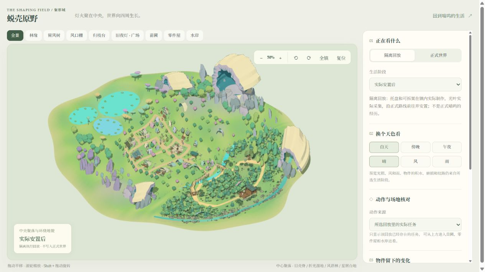
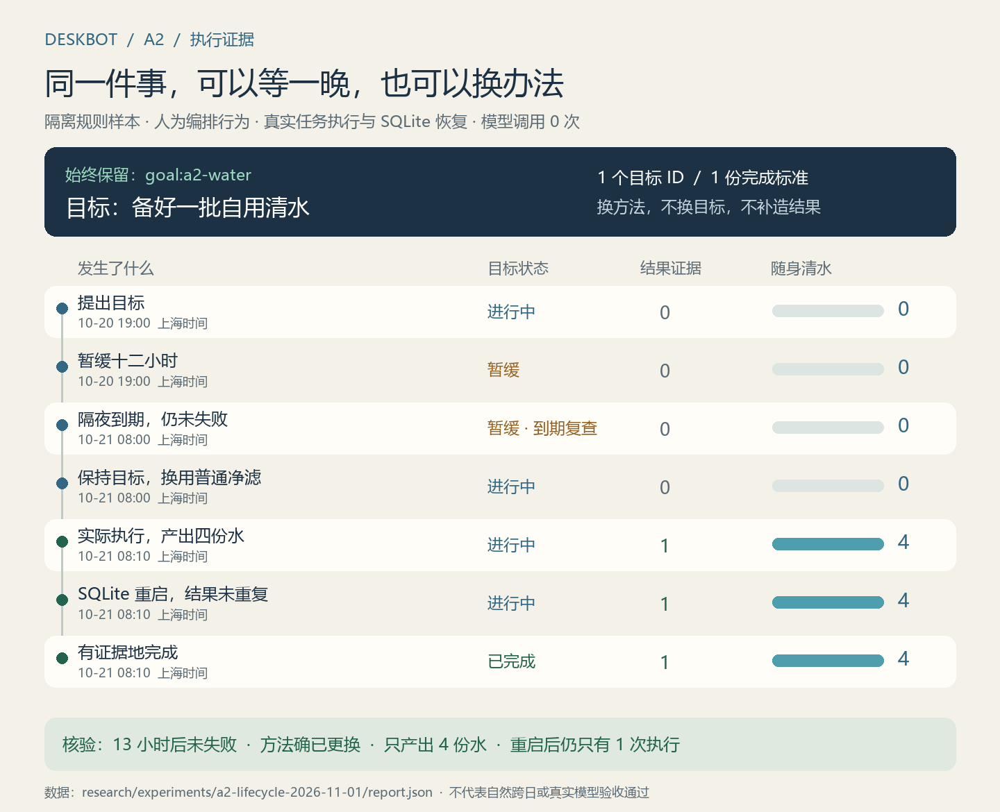
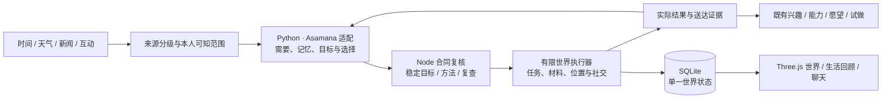
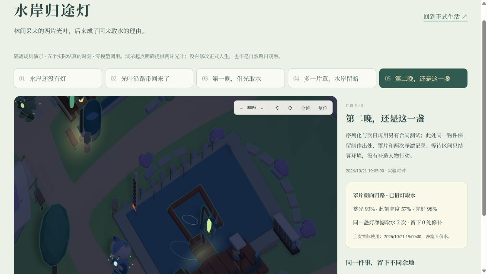
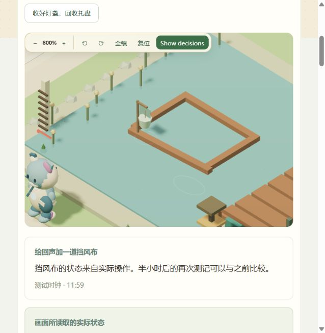
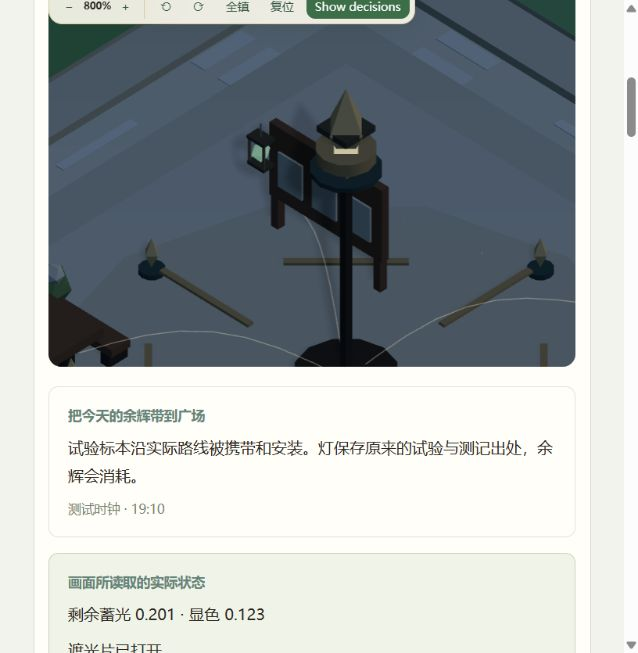
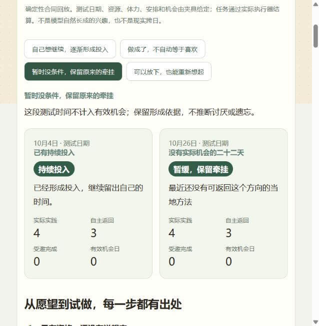

# DeskBot · 聚形域

**让喵呜在桌边拥有持续的生活，由自己的经历与选择，逐渐形成想成为谁的愿望。**

聚形域是伴生于现实的奇幻空间。时间、天气、新闻、主人互动与身体感知经过分级，成为角色能够理解的处境和机会。角色有自己的需要、关系和未完成的问题；实际行动消耗时间与材料，留下可追溯的结果。用户可以参与，输入不会直接改写身份或赠送成果。

**当前进度：A3.2 新冻结复验已执行，R3-A 尚未通过。** 1,399 项离线检查与构建通过；真实原矩阵进入 2/20 窗，1 窗完整有效，第二窗因设想字段类型不匹配停止。实际取水已结算，错误反馈未采用。14 次调用峰时估算上界约 ¥0.32；严格缓存回放一致，未追加调用。见 [A3.2 记录与原始反例](research/milestones/a32-refrozen-acceptance-2026-11-02.md)。

固定隔离上下文的免费对照中，请求由 **29 次降至 25 次**，提示字符减少 **26.85%**；目标形成调用保留。这是预设响应的工程测量，**不是真实费用节省或生活质量验收**。上一轮 [A3](research/milestones/a3-behavior-validation-2026-11-01.md) 仍保留 8/20 完整、7 有效的原结论。

目标与原则见 [开发基线](documentation/development-baseline.md)，接缝见 [接口与调用链](documentation/interfaces.md)，总排期见 [工程交付管线](research/design/engineering-delivery-plan-2026-11-01.md)。**下一步 [A3.3](research/design/a33-command-readmodel-boundary-2026-11-02.md)：分离命令与读模型、完善类型化提示和字段诊断，先做连续读回回归。** 目标专项已准备但 0/16 真实窗口运行，保持未覆盖。正式新认知尚未启用；三人双向生活、地区机制、自然跨日及角色/实体设计仍按门槛推进。



A3.1 仍使用原世界、目标和兴趣链，没有新建平行规划器。新增地区、活动或通信能力应提供自己的真实结果与引用用途；角色说“想做什么”不会使它直接发生。




已有场景采用 low poly / NPR：中央壳屋聚落与四周地貌形成生活空间。图为 2026-10-19 的实际渲染；外圈部分地形仍是视觉区域，新增地区活动与规律按后续地区包推进。

## 已实现的 A2：把“持续生活”落实到同一件事



上图由 [可重跑的执行记录](research/experiments/a2-lifecycle-2026-11-01/report.json) 绘制：夜里考虑借灯取水，先暂缓；次日仍记得原目标，换用普通净滤。实际完成后得到四份水，SQLite 重启没有重复执行。**行为是人为编排的合同样本，模型调用为 0；时间推进十三小时，不是自然运行一夜。**

| 本轮能力 | 实际约束 |
| --- | --- |
| 同一个目标可以换办法 | 目标 ID、完成标准固定；清水储备允许已声明等价的两种方法，研究条件仍精确区分。 |
| 等待可以跨夜 | 暂缓、恢复、放下均有明确转换；复查时间与社交约定截止分开，睡眠优先。 |
| 完成必须有对应结果 | “任务完成通知”不等于“指定读数已送给指定的人”；开放研究不因一次动作自动结案。 |
| 知道的位置有边界 | 当前亲见、历史位置和实际告知分开；30 分钟陈旧、24 小时位置未知，不窥远处人物状态。 |
| 新旧版本有明确边界 | 新 job 不能省略合同降级；旧冻结实验保留原协议，不补历史证据。 |

实现与扩展方式见 [目标生命周期与位置知识](documentation/cognitive-goal-lifecycle.md)。A2 经 1,385 项自动检查和构建验证。随后 A3 的八窗目标队列始终为空，连续性来自既有问题后续链；新目标建立和生命周期选择仍未得到真实模型覆盖。正式新认知尚未启用。

| A3 观察 | 结论 |
| --- | --- |
| 净滤、测记、装罩、次日展开和休息 | 第一例五窗连续保留原问题；模拟跨日，不是自然运行。 |
| 回执与后续问题互相矛盾 | 库存和回执正确，question 仍可能带入未发生的动作；停止后未追加付费抽样。 |
| 16 次目标调用全部为空更新 | 约 27.3 万输入 token、¥0.536 峰时估算；目标覆盖和按需调用都需补齐。 |
| 调用 / 完整窗口 P95 | 2.463 秒 / 15.121 秒；小样本不外推全镇全天表现。 |

## 当前架构



Python 提出意图与个人理解，Node 拥有世界提交权。短期目标仍在原队列与 `goal_bindings` 中，复用原需要/进度调用；新增 A2 没有增加一轮目标模型请求。目标、研究后续与长期兴趣属于不同层，彼此用实际结果关联。

## 历史实验与阶段记录

[10 月 31 日历史复验](research/milestones/r3a-phase-contract-validation-2026-10-31.md)：完成 18/20，15 有效，123 次调用保守估算 ¥3.083；装罩、净滤、测记、询问与移动均有实际结算，规划／反馈阶段字段没有再次阻断执行。但最后一窗把“测记任务完成通知”扩大成“实测结果已告知”，并作无约定依据的责任归因；执行器未建立虚假承诺。原版本 123 条缓存严格回放一致。保留 [上批 2/20](research/milestones/architecture-round4-retest-2026-10-31.md) 和 [更早失败](research/milestones/architecture-round4-2026-10-28.md)，不与本轮 A3 合并窗口。

[第三轮记录](research/milestones/architecture-round3-2026-10-28.md)：当前选择、短期目标和反馈后的下一步共用具体机会；已满足用途不能变成未来重复备货，已就绪条件不能伪装等待，暂存问题不重开回复期限。目标步骤由真实结算证明，证据随重启保存。该轮 1,342 项自动测试与生产构建通过，新增付费调用为 0。扩展方式见 [机会与目标接口](documentation/cognitive-opportunities.md)。

[第二轮记录](research/milestones/architecture-round2-2026-10-28.md)：普通汲水、借灯净滤与新增水岸测记共用方法定义、条件绑定和完成证据，结果进入现有记忆与发展链。同条件重复实验受限，取消与重启保持资源和证据一致。该轮 1,327 项自动测试与生产构建通过，新增付费调用为 0。扩展方式见 [活动方法接入规范](documentation/activity-methods.md)。

上一真实模型证据保留在 [具体动作与沟通目的](research/milestones/cognition-r3a-catalogue-2026-10-25.md)：计划20窗口，完成6个、进入7个，其中严格有效4个；45次调用后按停止规则终止。后续本地修正不改写该批结果。旧架构、实验与阶段文档保留历史结论，排期以当前开发基线为准。

**R3 · 同一盏灯，不同来由。** [实验、修复与边界](research/milestones/cognition-r3-2026-10-20.md) 比较规则、旧模型选择与新认知。材料和邀请能影响实际安排，三名人物仍较趋同；发现并局部修复留言误报交付、预扣后重复算库存等问题。原矩阵真实性门槛未通过，不能用局部复验替代全量结论。

**本次 R3 修正。** [稳定后续、交接与等待](research/milestones/cognition-r3-hardening-2026-10-20.md) 增加问题编号、暂存与恢复、明确结案、清水交接和重复唤醒控制。小批 58 次调用保守估算 ¥1.178，完成六个窗口并保留一次计划协议失败；随后只用本地回归修正换词催问与回复编号接线，没有追加付费重试。

**R2 · 水岸归途灯。** [首条共同日常与容量收口](research/milestones/waylight-r2-2026-10-20.md) 接通林地光叶、镇内备料、水岸造物、双方交接与次日晚间使用。敞亮或有罩的做法具有不同材料、风雨和耗光后果；原存档从空挂点开始。48 小时隔离规则运行走通制作—合作改造—次日使用；新历史检查点压缩后，一万条同类存储负载约 278 MB。自然跨日仍待 R4。

2026-10-19 本地开发：6A 的时间、等待与后续修正，以及 6B 的四处风语林地点、十二种有限活动已经接入。最新 [蜕壳原野视觉重建](research/milestones/shaping-field-stage6b-shell-v4.md) 将中央聚落与环绕地貌组织在连续曲面上，采用 low poly 三阶卡通光照、细描边、壳状建筑与山脊。新增湿地、旧壳脊与星屑台地目前是视觉地貌，尚未开放新的活动。第六阶段的自然生活质量仍未整体验收。

[第一轮空间与生活呈现打磨](research/milestones/shaping-field-round1-2026-10-19.md) 已在本地实现：弯曲街巷、四类壳屋、温室、镇林过渡与任务驱动细节，附美术参考、前后截图和验证边界。

[R0→R1A 同版本生活观察](research/milestones/world-observer-r1a-2026-10-19.md) 已实现：可恢复源码/存档基线、统一地图/人物/生活/角色快照、断线恢复与实际绘制确认、逐人运行模式。六小时隔离规则诊断暴露补给与等待节奏问题，随后在 R1B/R1C 修正；持续生活质量仍待后续验证。

[R1B 生活轨迹与进餐协调](research/milestones/world-history-r1b-2026-10-19.md) 已接回原存档：版本化增量、检查点重建、冻结历史分页、材料与任务记录，以及六座位进餐和有条件等待唤醒。同一存档的一分钟调度六小时规则对照中，用餐 9→11 次、等饭采样量下降约 20%；个别人首餐仍很晚，生活公平性与自然跨日尚未验收。

[R1C 个人供给与运行观测](research/milestones/life-fairness-r1c-2026-10-19.md) 已接回原存档：持久需要排队、实际备餐/送餐承诺、分阶段灶台占用与并行备料，正式/实验存档分离，调用用量、失败、费用估算与延迟可查。同前态六小时规则对照中，最晚首餐 348→250 分钟、等饭采样 1609→253 人分钟；正常富余前态未恶化。千/万条记录重建与重启通过；其检查点容量问题在 R2 接入无损压缩，长期容量治理和生活质量继续验证。

## 当前能力

| 能力 | 已实现范围 |
| --- | --- |
| 现实时间与有限世界 | 上海 1:1 时钟、天气、风雨昼夜、路线、有限库存、设施占用与持久任务。关闭网页不暂停仍在运行的服务；电脑停机不补造未曾安排的行为。 |
| 多源理解 | 有来源、时效和接收范围的感知；区分目击、听闻、建议、否定、假说和邀请。新闻可以引出问题，不直接成为亲历或物理定律。 |
| 个人认知 | 复用 Asamana 的感知、需要、目标、决策、双流记忆、反馈、反思与关系整理。Python 提出意图，Node 核验位置、条件和后果。 |
| 目标连续性与可知位置 | 稳定 ID、结果标准、显式改计划/暂缓/恢复、单次复查唤起；亲见与报告保留出处和年龄。已通过离线合同与恢复验证，真实模型选择质量待 A3。 |
| 奇幻规律与共同日常 | 凝光苔、回声杯、余辉夜灯与风语林活动；归途灯新增林地采料、两种制作方法、协作装罩、修补与次日净滤水。规律、材料、任务和 3D 读取同一实际状态。 |
| 关系与共同事务 | 回复关联、明确邀请、接受、拒绝、延期重确认与退出。实际赴约或交接才算完成；个人印象不修改对方记忆或客观关系。 |
| 长期运行基础 | 事件与到期事项唤起；睡眠休息不调用模型；公平排队、最多两名人物并行。个人原文归档、有界热记忆、可重建索引、慢速整理与故障恢复。 |
| 兴趣与机会 | 首次探索、自主返回、受邀、需要与已接受义务分开记录。形成看跨日实际证据；维持看真实可行窗口。离线、缺材料和忙碌不自动等于失去兴趣。 |
| 愿望、试做与采用 | 新认知人物需自己表达角色意愿，再经过既有条件。试做与普通生活共用执行器；采用保留身份，可按形态/职业分轴撤回，不自动更换实体壳。 |
| 生活观察与交流 | 原世界保留聊天入口；回顾呈现为什么、做了什么、实际结果和后续。固定实验、规则回放与正式世界清楚分开。 |
| 连续地形与风语林 | 中央聚落、四周不规则地形、壳体地标、桥梁、湿地、台地与植被群；风语林的安装、测记、风痕、修补和带回夜灯内衬继续读取真实任务与物件。 |

十三名生活角色已经登记，连续调度在隔离测试中覆盖十三人；真实模型对照使用有限人物与小批量情境，没有把十三人全天付费生活当作已完成体验。本机正式世界保留原生活层，新连续认知需显式启用；本轮仅授权发送隔离虚构数据。

## 本次画面与验证



R2 的五段预览来自已执行的隔离规则样本，展示同一盏灯从空挂点到次日使用的变化。48 小时成对实验检验有限材料、协作与重启后的连续性，未调用模型。当前正式存档不会继承演示库存和成果；详见 [R2 验证与边界](research/milestones/waylight-r2-2026-10-20.md)。以下保留 v0.6 的认知与兴趣验收证据。



水岸物件来自实际制作、安装与调节任务。画面为固定规则回放，天气与测试时间是虚构条件。



夜灯保留苗圃标本与测记出处。当前仍是场景机制样本，完整角色美术与实体外壳尚未交付。



第五阶段包括四类兴趣轨迹合同回放和十二组真实 DeepSeek 后续对照。十一组形成可复查后续，其中 **7/11（63.6%）实际推进**，包含一项从留言转为明确会面邀请，尚未共同完成；另有一组反馈语义合同失败。十六个有余力窗口都有至少两种不同可行安排。未按“做了任何事”计算成功。

第三至第五阶段共记录 974 次提供者调用尝试，峰时价格保守估算约 **¥8.25**，其中两次用量未知保留预留；第五阶段约 ¥2.19。不是账户账单，不含原聊天、旧规划器等其他调用。全系统成本和延迟对照属于下一阶段。

见 [v0.6 验收与局限](research/milestones/asamana-cognition-stage5-v1.md)。当前仍会反复等回应、混淆时区、误解物理规律或在自由文本中多说事实；严格执行器不等于模型每句话都正确。两例预设愿望讨论没有提出新角色，自然愿望的发生频率尚未证明。

## 本地运行

需要 Node.js 24+、Python 3.11+。密钥保存在本机配置，不提交仓库。

```powershell
Copy-Item config\llm_config.example.json config\llm_config.json
notepad config\llm_config.json
Push-Location apps\jev-town-client
npm.cmd install
Pop-Location
.\scripts\start-local.ps1 -StartWeb -StartWorld
```

认知适配器使用短生命周期 Python，无需额外常驻 TCP 服务。用 `DESKBOT_COGNITION_PYTHON` 指定解释器。模型、天气及来源配置见 [本地配置](config/README.md)，实验命令见 [认知适配器](services/deskbot-cognition/README.md)。新下载仓库不继承开发机密钥、正式人生或实验数据库。

| 入口 | 用途 |
| --- | --- |
| [世界与聊天](http://127.0.0.1:5173/?mode=deskbot&deskbotUrl=http://127.0.0.1:4311&view=journal) | 正式日常生活、交流和观察 |
| [蜕壳原野](http://127.0.0.1:5173/windleaf-review.html?sample=installed&sceneMetrics=1) | 中央聚落、环绕地貌、昼夜风雨及风语林状态的独立预览 |
| [水岸归途灯](http://127.0.0.1:5173/waylight-review.html) | R2 五段隔离规则样本：采料、制作、装罩与次日使用 |
| [R3 认知与兴趣对照](http://127.0.0.1:5173/r3-review.html) | 六类输入、三条路径、人物/兴趣、原失败、修复、费用与门槛 |
| [兴趣与角色愿望](http://127.0.0.1:5173/cognitive-life-review.html?sample=development) | 四类轨迹与真实模型后续逐项核对 |
| [水岸与夜灯](http://127.0.0.1:5173/cognitive-life-review.html?sample=resonance) | 奇幻规律、物件和模型选择 |
| [共同生活](http://127.0.0.1:5173/cognitive-life-review.html?sample=social) | 协商、实际履约和个人关系理解 |
| [凝光苔](http://127.0.0.1:5173/cognitive-life-review.html?sample=inquiry) | 苗圃试验与结果 |
| [多源对照](http://127.0.0.1:5173/cognitive-life-review.html?sample=inputs) | 来源、语义与成对选择 |
| [既有角色阶段](http://127.0.0.1:5173/development-review.html?sample=stages) | 虚拟形态/职业采用与回退样本 |

认知回顾下半页保留第二阶段原始实验和原额度，不代表第三至第五阶段预算。停止本地服务用 `.\scripts\stop-local.ps1`。健康接口就绪不等于模型、天气或真实硬件全部连通。

## 下一阶段

下一批按 [A3.3 接缝修正](research/design/a33-command-readmodel-boundary-2026-11-02.md)先完成免费验证，再登记原 20 窗口矩阵及单列目标专项。原矩阵要求 20 个完整、至少 16 个有效且无关键事实错误；失败、修复、未运行和费用完整保留。A1/A2 离线通过不转化为模型通过率。放行后按[当前开发基线](documentation/development-baseline.md)进行少量人物双向生活、地区机制迁移和正式运行接线，再进入 R4 自然多日观察。

完整人物、美术、表情、声音与打印壳在此基础上联合设计。现实身体没有摄像头或移动能力，只有屏幕、触摸、双麦声源方向、磁识别和单轴转头。当前设备仍为小智固件，DeskBot 实机协议、电机与换壳校准、真实中文 ASR/TTS 尚待接入。虚拟身份不会赋予现实身体额外能力。

## 架构与来源

- [当前架构](documentation/architecture.md) · [能力与实现](documentation/design-implementation-map.md) · [验证](documentation/tests.md)
- [迁移管线与出口](research/design/asamana-migration-pipeline-v2.md) · [第五阶段验收](research/milestones/asamana-cognition-stage5-v1.md)
- [Asamana](https://github.com/dreamscroll-lab/asamana)：固定提交 `e9fc862642369ba8b177595d2f8e3f20c1636da4`，52 个未修改上游文件；Apache-2.0 全文和哈希清单保留，适配器在 vendor 外。
- [旧 v0.5 路线](research/development-roadmap-v0.5.md) 与旧阶段验收作为历史保留，编号不与本轮认知迁移混用。

公开仓库保存源码、规则、配置模板和虚构验收摘要。密钥、正式人生数据库、音频、运行日志与原始出站记录不提交。
