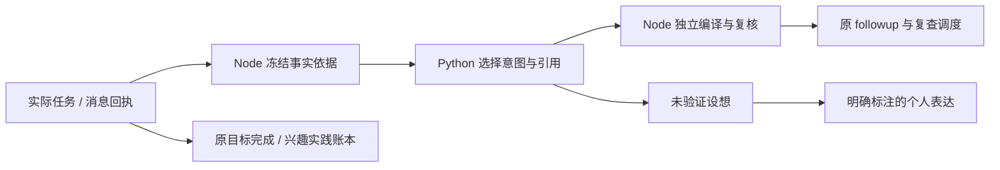

# 后续意图与证据引用接口 · A3.1

2026-11-01。Node 世界仍是唯一提交者；沿用原 followup、issue ID、结果根、目标队列和 SQLite。不新增规划器。

## 字段归属

| 字段 | 权限与处理 |
| --- | --- |
| `followup_intent.bases` | 执行器提供本次结果根及通信回执；原始数值、背包变化和任务仍在 `result`，不靠摘要重建。 |
| 模型 `basis_ids` | 必须完整匹配本次依据目录，不能引用别人的记录替换本次结果。 |
| `status / next_step / wait_for` | 角色选择未来安排；复用原机会、等待、问题关闭校验，不执行动作或改变目标标准。 |
| `question / reason` | Node/Python 按共享模板与已验证依据生成。Node 再独立编译比较；不能由模型任意补写过去发生的事。 |
| `unverified_idea` | 可选最多 160 字。持久化为 `intent_evidence.unverified_idea`，明确标记 `epistemic:unverified`；显示为“未验证设想”，不能成为完成或实践证据。 |
| `closure` | 引用原问题与原证据；`resolved` 只结束已证明的小步骤，`satisfied/abandoned` 是个人决定。 |

新反馈必须提交 `followup_binding:{contract,actor_payload}`。绑定保留原模型选择，编译的 `followup` 保持现有字段接口。冻结目录和提交时的当前目录分别复核，防止调用期间出现的新选项被追认。反馈只能在原任务终态后认领；失败保留 pending 结果，恢复时不重做动作。未执行的等待计划也使用保守标题，将个人理由留在未验证区。

历史 job 没有新合同标识时走原协议；不改写旧实验的输入、响应或结论。历史 `original_question` 保留在原问题记录，投影明确区分当时的想法与当前条件。A3 的原错误响应仍由旧合同接受，这是历史事实；新合同拒绝它。

## 同一引用目录，不同用途

`evidence_refs` 只从本人的已知上下文投影，不查询远处 NPC 私人状态。不要求模型从 ID 前缀猜类型。

| 类型 | 选择依据的编译去向 | 限制 |
| --- | --- | --- |
| 外来输入 `input` | `source_ids` | 听闻不算亲历。 |
| 本人结果 `outcome` | `own_evidence_ids` | 被引用不自动满足目标；目标执行证据仍另核验。 |
| 通信回执 `receipt` | `context_evidence_ids` | 只证明实际送达、公开字段；不证明理解、接受或交付。 |
| 位置 `position` | `context_evidence_ids` | 历史位置保留线索属性；超过保留期拒绝。思考耗时不重造观察 ID；提交时重新检查可见范围。 |
| 设想 `speculation` | 仅 `idea_context` | 不允许当作通常选择事实、义务、实践或完成证据。 |

不存在与不可见统一报 `evidence_ref_unavailable`，避免暴露私人 ID；过期报 `evidence_ref_stale`，用途不符报 `evidence_ref_wrong_use`。选择器的 `source_ids` 接受目录引用，双端按类型分流。义务仍需 `obligation_ref` 的当前条款，不因出现在引用目录而放宽。

## 调用控制与验证

无 active/interrupted 目标时跳过结果阶段的目标进度调用，保留已关闭目标历史。**计划阶段的目标形成调用保留；有活动或暂缓目标时仍复查。** 暂不采用“看起来无关”这种更激进的规则，以免漏掉放下或换方法的机会。

反馈不能新建目标或换方法，因此提示省略未绑定的标准目录与下一方法目录；各已绑定目标的标准、证据和复查状态保留。后续选择不再重复发送已在结果/记忆阶段读取的全部现场快照。完整冻结上下文继续用于校验，压缩不是修改权威数据。

共享合同：[`followup-intent`](../contracts/cognitive-followup-intent.v1.json)、[`evidence-refs`](../contracts/cognitive-evidence-refs.v1.json)。登记见 [`architecture.v1.json`](../contracts/architecture.v1.json)。反例、跨语言、真实工作进程与恢复测试，以及可复跑字符量测量见 [A3.1 交付记录](../research/milestones/a31-followup-remediation-2026-11-01.md)。

当前输出使用受控模板，不是最终自然台词效果。更多人物口吻应在保持事实/设想边界后设计，不通过重新开放事实标题自由生成来解决。
