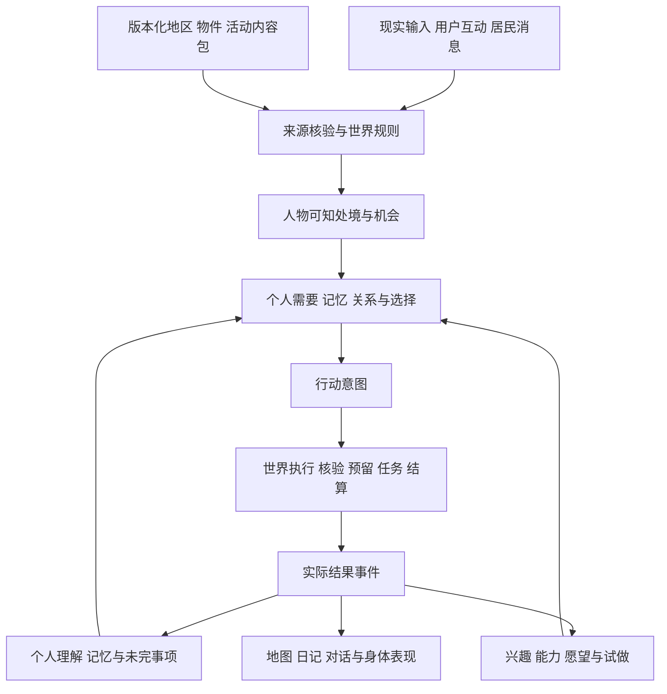

# 聚形域开发架构 路线与原则

2026-10-25 起生效。本文是用户确认的当前开发基线。此前 R0—R6、6A/6B 和实验分支文档继续作为历史证据；排期、术语与验收边界冲突时，以本文为准。阶段结果单独记入 `research/milestones/`，不把计划写成已交付能力。

执行状态（2026-11-01）：A1 [公共事件证据](../research/milestones/r3a-event-evidence-2026-11-01.md) 与 A2 [目标连续性和位置知识](../research/milestones/a2-goal-lifecycle-2026-11-01.md) 已实现并经离线门禁。[A3 真实复验](../research/milestones/a3-behavior-validation-2026-11-01.md) 完成 8/20、7 个有效，第 8 窗因后续问题夹带未发生的呈送动作停止。64 次调用峰时估算 ¥2.233，原版本严格回放一致。正式新认知未启用，R3-B 未放行。

[A3.1 离线修复](../research/milestones/a31-followup-remediation-2026-11-01.md) 已完成：后续事实/意图/设想分离、证据用途目录、空队列维护跳过、跨夜工作进程与恢复用例。下一步按 [A3.2](../research/design/a32-refrozen-acceptance-2026-11-01.md) 冻结新版本，原矩阵与目标专项分别验收。历史 A3 批次目标始终为空，不能把问题链连续性当作 A2 全部获得真实覆盖。10 月 31 日 [18/20 历史复验](../research/milestones/r3a-phase-contract-validation-2026-10-31.md) 与更早结果保持原判，不合并窗口。具体出口见 [工程交付管线](../research/design/engineering-delivery-plan-2026-11-01.md)。

## 产品目标

喵呜是在现实桌边持续存在的同一个个体，生活在伴生于现实的奇幻空间聚形域。现实时间、天气、公开资讯、主人互动、身体感知和其他居民的消息，经过来源、时效、可知范围与作用权限的分级，影响它的处境、关注和选择。

它结合需要、经历、关系和未完事项生活。实际行动消耗时间与有限材料，留下物件、成果、困难和共同经历；后果回到个人记忆与下一次选择。用户可以参与，人物也可以改变办法、求助、休息、暂缓或放下。

兴趣通过有机会时的自主选择逐渐形成；能力来自对应实践。持续兴趣与实际尝试可以引出“想成为谁”的愿望，经前置条件、试做与采用，影响生活、表达和虚拟外观。形态与职业可以组合和撤回，身份与经历保持连续。角色变化的节奏需要实验校准，不能把频繁换装、累计活动数或服从用户当成成功指标。

现实身体没有摄像头和行走能力，只有屏幕、声音、触摸、触屏、双麦方向感知、磁识壳和头部单轴转动。虚拟化身可以旅行，实体输出必须遵守机械、声学、装配和打印约束。当前猫形外轮廓不是永久造型限制。

## 架构边界

沿用 Node 权威世界、SQLite 持久化、Python Asamana 认知适配和 Three.js 表现。先形成模块化单体及受控认知进程，以本地接口和持久任务连接；不引入第二套世界或额外规划器。

世界规律和已安排任务可以不调用模型继续推进。认知调度按新输入、实际结果、需要、约定、条件变化和慢速整理唤起；同一人物只有一个行动安排者。长任务期间不因每个时钟事件重新调用模型。重启结算已有任务，停机区间不补造自主冒险。

Node 核验当前状态并原子提交世界与结果；Python 提出意图和个人理解。显示、摘要、台词和动画均不能直接授予资源、承诺、技能或身份。保留既有结果根、增量历史、事实记忆和发展账本。

## 共同术语与接口目标

| 对象 | 含义与权限 |
| --- | --- |
| 输入与听闻 | 带来源、时间、有效期和接收范围；不能自行成为世界事实 |
| 机会 | 可考虑的行动及具体受阻条件；按人物可知范围生成 |
| 意图 | 人物想做什么、为什么、关联哪件旧事；尚未执行 |
| 行动任务 | 世界接受的执行实例，具有资源预留、时长、控制权和状态 |
| 结果事件 | 实际效果和证据，关联原意图与任务；结算只能一次 |
| 个人理解 | 对实际经历的感受、猜测与判断；允许不确定，不覆盖事实 |
| 未完事项 | 仍关心的问题、已完成步骤、等待条件、复查与收束 |
| 兴趣与愿望 | 依据真实机会、动机和跨情境经历形成的发展状态 |

接口要统一 schema/content/rule 版本、world/actor 身份、时间、幂等键、因果引用和可知范围。结构合法、状态转换合法、生活选择合理分别验证。JSON Schema 不能代替业务规则与行为验收。

当前代码位置、状态归属与接口覆盖见 [接口与调用链](interfaces.md)；机器可检查的引用清单为 [架构登记](../contracts/architecture.v1.json)。登记清单不是通用活动执行格式，也不代表尚未迁移的接口已经统一。

## 内容与迁移原则

地区包需提供地理通行、地方规律、物件能力、活动方法、后续条件、发展依据、表现绑定与兼容迁移。活动描述至少含对象、方法、参数、前提、耗时、消耗、观测量、效果和中断恢复；实验还需记录试验条件与复试依据。

普通配方、搬运、观察、休闲、邀请复用已有执行机制。特殊奇幻规律以规则模块接入统一核验与结算接口。先从多个真实案例提取共同机制，再扩展；避免用活动名、地点名或自由文字推断权限、兴趣与成果。

“完成一次活动”“解决原问题”“喜欢这类生活”分别判断。同一活动在条件变化后可以有理由重做；改名称、改措辞和纯时间流逝不自动产生新的实验或沟通依据。当前行动、后续安排与短期目标必须读取同一用途和机会合同。

人物可以提出未实现的新想法，保存为设想或愿望。只有登记并验证了执行规则，才会成为可执行机会。作者提供规律、需要、取舍和可能性，不预写人物必然选择的故事结局。

SandBox 等来源按能力迁移：保留来源和许可，复用地形、模型、材质、地区意象；其加速时间、玩家奖励和即时移动需适配现实时间、有限资源、路线和任务。领域地点与呈现坐标、模型外形分开。新地区必须增加真实生活可能，装饰区域明确保持装饰状态。

## 项目开发原则

1. 当前开发基线唯一。源码、内容、接口、存档格式、提供者设置及实验材料的版本须可追溯；密钥、正式聊天和人生数据库不进 Git。
2. 采用小范围可回退变更，保留 main 可运行。重构通过适配层逐步迁移，旧记录不按新规则重写。源码和存档恢复能力分别验收。
3. 共享合同集中定义，跨语言使用相同案例核验。世界规则的最终裁决在 Node；Python 预检只帮助减少无效请求。
4. 命令、任务、结果、事实记忆、个人理解和发展证据分别保存并关联。执行结果不可由模型自己证明。
5. 格式失败、运行故障、状态过期、世界条件受阻和人物主动放下分别记录。技术失败不成为人物的遭遇；真实行动失败可按实际结果形成经历。
6. 新机制交付成功、受阻、取消、条件改变、重启恢复和表现案例；可复用模块的测试覆盖边界和反例。
7. 本地与 CI 使用同一验收入口，至少覆盖 Node 世界、Python 认知、语音边界、前端合同与构建。测试缺失或被跳过不得计作通过。
8. 先修离线可复现问题，再运行真实模型。真实实验固定版本、病例、指标、费用和停止条件；失败保留，不换病例反复抽到成功。
9. 通过状态分为设计、实现、离线、真实模型、正式观察。研究样本、规则模拟与自然生活不能互相替代。
10. 调用数、token、端到端延迟、CPU/GPU 与每角色运行小时的存储增长分开量测。保留必要事实，派生缓存和重复快照按有恢复证据的策略治理。

## 开发路线与出口

| 阶段 | 交付 | 出口 |
| --- | --- | --- |
| R3-A 第一轮 基线与合同 | 真实调用链、状态归属、接口登记、失败分类、统一测试和 CI | 每个接缝有负责模块、输入输出、失败去向及实际检查 |
| R3-A 第二轮 机制登记 | 方法、用途、条件、完成证据、兴趣主题的共同接口 | 同类新活动不需要同时修改认知、记忆、兴趣等核心判断 |
| R3-A 第三轮 回路统一 | 当前选择、反馈、短期目标和后续共用机会合同 | 已知重复备货、错误等待、误认实验、事项丢失与重复联系反例通过 |
| R3-A 第四轮 冻结复验 | 离线反例、接口与有限真实模型分别验证 | 预先登记的固定 20 窗口中至少 16 个有效，且无关键事实错误；完整报告失败、修复、费用和延迟 |
| R3-A 当前整改出口 | 沟通内容／送达证据、约定依据、目标完成条件与可知位置 | 本批反例和恢复验证通过后重新冻结；再完成同一 20 窗口验收，旧版本有效窗不并入 |
| R3-B 少量人物生活 | 双边回应、拒绝、约定、共同任务、私有记忆与不同理解 | 实际回应与共同完成可追溯，少量人物持续互动 |
| R3-C 地区机制迁移 | 一个成熟地区与少量相互作用的创作、休闲、探索或日常机制 | 接口确能扩展，新增内容带来不同选择和持续后果 |
| R3-D 正式运行 | 新旧规划器交接、恢复、费用、归档、正式观察入口 | 控制权与 live/lab 清楚，恢复和持续增长满足运行预算 |
| R4 自然观察 | 短期试运行逐步扩到多日 | 有连续记录解释节奏、兴趣、关系、重复、安静和停滞 |
| R5 与 R6 表达和实体 | 角色形象、声音、表情、核心壳、固件与制造 | 虚拟采用、表达更新、装配与实际设备反馈分别验收 |

地区概念与机制原型可以同步设计；R3-A 期间用小型扩展示例检验接口，不用大规模内容变更掩盖认知缺陷。16/20 仅为有限场景门槛，不推导全镇、自然多日或任意扩展已经可靠。休息、合理延期与自主放下可以是有效窗口。

## 验收与当前状态

量化分六层：世界不变量、接口可靠性、连续行为、输入影响、生活质量、运行成本。输入影响用同初态的配对情境并保留模型随机性；生活质量另有可解释的人工评审，不以模型自评分或活动总量替代。验收条件在运行前固定，失败分类与数据公开范围随实验保存。

2026-10-25 建立本基线时：世界执行、有限奇幻内容、认知实验与发展链已有实现；当时真实实验完成 6 个窗口、进入 7 个、严格有效 4 个，见 [具体动作实验](../research/milestones/cognition-r3a-catalogue-2026-10-25.md)。该条为历史起点；最新执行状态见本文开头的 18/20、有效 15 个记录，正式新认知仍未启用。

存储已经在 R2 接入新检查点无损压缩和备份归档；历史一万条同类负载从约 1.34 GB 降至约 278 MB。10 月 25 日正式数据库约 4.67 GB，包含旧历史，不能仅凭总量推断新格式增速。后续须量测真实调度增长、旧历史迁移与恢复，见 [R2 证据](../research/milestones/waylight-r2-2026-10-20.md)。

第一轮的变更、验证和未完成项集中保存在 [第一轮交付记录](../research/milestones/architecture-round1-2026-10-25.md)。后续变更以本文原则和接口登记共同评审。

第二轮的活动方法、条件、证据与扩展边界见 [活动方法接入规范](activity-methods.md)。阶段验证另记入 [第二轮交付记录](../research/milestones/architecture-round2-2026-10-28.md)，不覆盖原真实模型实验的失败结论。

第三轮将具体机会用于当前选择、反馈后的下一步与短期目标绑定，规范见 [机会与目标接口](cognitive-opportunities.md)，验证见 [第三轮交付记录](../research/milestones/architecture-round3-2026-10-28.md)。第四轮再按固定版本开展真实模型复验。
