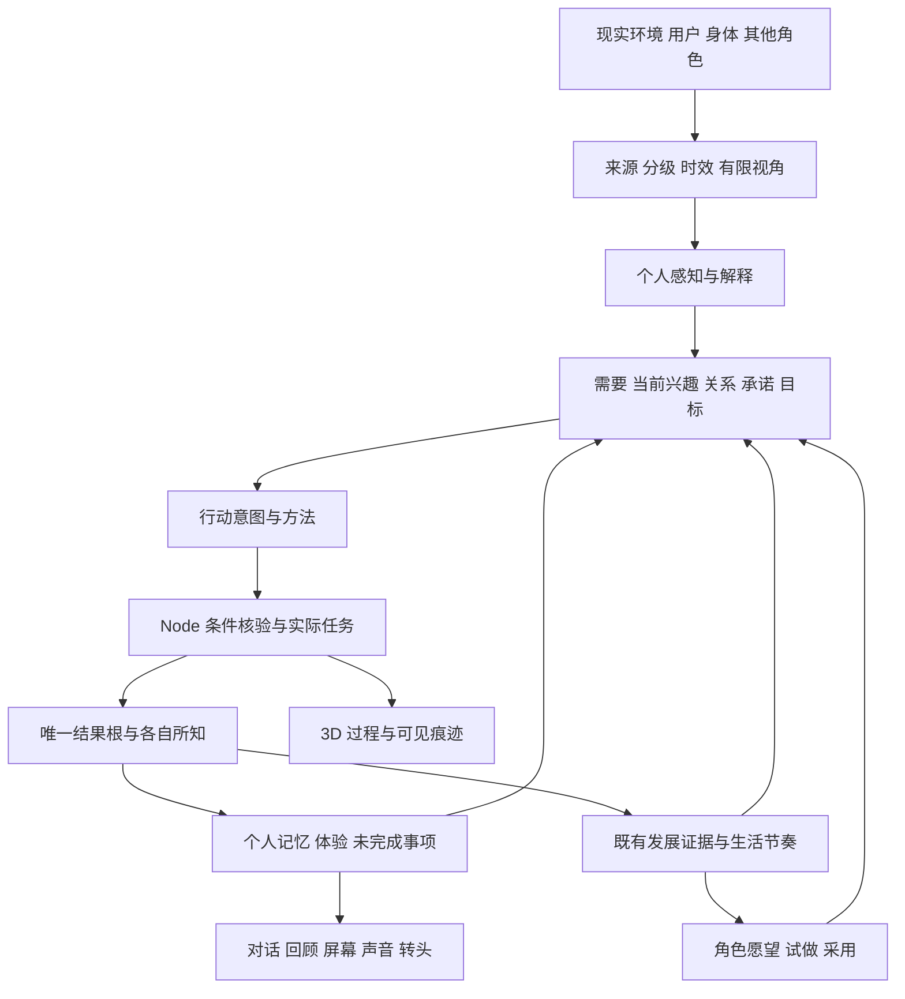

# DeskBot 与 Asamana 迁移复核及后续开发管线

> 更新于 2026-10-11：本文保留审查时的问题与原定管线。第 1–5 阶段现已完成软件合同与固定样本验收；当前实现、失败与后续入口见 [第五阶段验收](../milestones/asamana-cognition-stage5-v1.md)。下文“尚未连接”等描述是设计起点，不是现版本状态。

喵呜需要在聚形域里持续生活：多源输入改变它所遇到的条件、问题和机会，它结合需要、经历、关系和当前投入作出选择；真实行动留下后果，后果又影响后续选择。经过一段有条件的探索与实践，它才可能提出新的角色愿望，进入试做和采用。形象与声音应表达这段成长，并适配现实身体。

当前已证明认知意图能够进入实际任务，并把核验后的结果带回个人记忆。尚未证明多源输入、关系、长期兴趣、角色愿望和可见的奇幻生活已经成为一个连续系统。下一步应先完成第二阶段的连接补全，再按原第三至第七阶段推进。新增 API、扩大居民数量和完成角色造型，都不能代替这些连接。

复核日期：2026 年 10 月 11 日。Asamana 以本地固定版本 `e9fc862642369ba8b177595d2f8e3f20c1636da4` 为基准；迁移状态以当前 DeskBot 适配代码为准。本文承接原迁移管线（开发机留存：`runtime/asamana-deployment/asamana-migration-pipeline-v1.md`，未公开）和[第二阶段实验记录](../../research/milestones/asamana-cognition-stage2-v1.md)。

## 当前能力与证据边界

| 层面 | 已有能力 | 仍须证明的部分 |
| --- | --- | --- |
| 世界执行 | 现实时间、位置、设施占用、有限资源、任务持续时间、实际完成结果、SQLite 正式提交 | 异步认知与内容扩展后的对象引用、版本和恢复完整性 |
| 最小认知 | 三个人物可提出目标、形成意图；通过已有活动、观察、休息、留言和等待行动；回收个人事件、体验和洞见 | 完整感知记忆、持久关系、慢速整理、多源语义、跨地点安排 |
| 连续后续 | 测试时钟下出现次日观察、浇水、再次复查的链；后续与结果可持久保存 | 自然时间中的长程连续性、受阻改法、安静日、关系后果 |
| 兴趣与发展 | 原系统已有共同结果、兴趣与能力分离、生活节奏、愿望、实际试做、角色采用 | 新认知的动机、来源、未完成事项与旧账本全面接通 |
| 对话与场景 | 对话能读取新认知的原因、任务、结果和后续；原 3D 昼夜天气与活动表现仍在 | 用户对话进入新认知的完整反向链；新动作的通用场景语义；奇幻规律的动态表现 |
| 正式运行 | 第二阶段保持有限回合和隔离实验，正式人物默认不启用付费认知 | 全天调度、全系统费用、长期存储和正式多日验收 |

上一轮真实实验共 114 次有提供者用量的调用，保守费用估算约 0.5483 元；单次 API 中位数 1.069 秒、P95 1.603 秒。确认轮中清水 12→9、苗床水分约 0.065→0.304，说明行为确实影响世界。一次人物安排或反馈含多次调用，这些延迟不能代表整轮等待，更不能据此推算全体居民一天的费用。原始指标（开发机留存：`runtime/asamana-deployment/stage2/final-metrics.json`，未公开）。

同轮也出现没有任务依据的“刚浇过水”、苗况误述、反思比较错时间基准和反复问候。事实提交的保护有效，并不意味着对外叙述已可靠。最后加强任务增量说明的改动还没有真实重复实验结果。

本次另外运行了五项隔离诊断，使用虚构世界和无模型替身，没有调用提供者或修改正式人生。它们验证接口行为，不计入上一轮完整回归结果，也不充当生活质量评测。诊断结果（开发机留存：`runtime/asamana-deployment/audit-20261011/integration-results.json`，未公开）、可复现脚本（开发机留存：`runtime/asamana-deployment/audit-20261011/probe-integration.mjs`，未公开）。

## Asamana 的可复用架构

Asamana 的核心价值来自多个环节协作：有限视角的感知、需求与外部推力、目标和行动、受条件约束的执行、个人事件与主观经历、关系、慢速整理以及分阶段审查。调用 `Agent.plan_step` 和行动反馈只覆盖其中一部分。

上游运行时明确组织了外部推力、感知、打断、活动推进、计划和提交；另外周期运行记忆、反思、长期目标和关系整理。忙于活动的人也能接收感知。对应代码见 [runtime.py](https://github.com/dreamscroll-lab/asamana/blob/e9fc862642369ba8b177595d2f8e3f20c1636da4/engine/runtime.py#L376)、[cognition_maintenance.py](https://github.com/dreamscroll-lab/asamana/blob/e9fc862642369ba8b177595d2f8e3f20c1636da4/engine/cognition_maintenance.py#L40)。项目的官方定位与目录结构见 [Asamana](https://github.com/dreamscroll-lab/asamana)。

聚形域仍采用既定分工：Node 管世界事实、条件与执行，Python 管个人理解和选择。所有正式状态由同一持久化入口提交；角色的主观误解可以存在，但必须与实际完成事实分开。

| 上游部分 | 迁移判断 | 聚形域适配要求 |
| --- | --- | --- |
| `agent/agent.py`、need、decision、memory、reflection | 已用于小闭环，继续保留 | 稳定管理版本和适配层；完整人物状态进出，避免每轮重新变成只有静态设定的人物 |
| `perception_layer.py`、`perceive_step` | 优先补接 | 结构化接收、目击、听闻与私人观察；重复输入只入账一次，忙碌也可获知，不把获知记为实践 |
| `engine/world_pressure.py` | 复用有限视角和信号强度结构 | 发展为压力、机会、知识、邀请、旧事唤起；允许没有行动意义，不把普通新闻升级为急事 |
| `agent/goals.py` 的目标与未完成事项 | 复用目标结构与评估 | 使用真实期限、可行窗口和受阻原因；承诺单独持久保存，不能因普通目标队列满而消失 |
| `relation.py`、`relation_evolution.py` | 复用有方向的关系及慢速理解 | 保存交往记录和个人看法；事实承诺由双方事件确立，模型生成的关系标签不等于双方达成关系 |
| `engine/message_system.py`、social executor | 复用递送、共同事件与各自反馈结构 | 加回复关联、接受/拒绝、共同工作；避免把两人的全部私人记忆放进同一生成请求 |
| scheduler、interrupt coordinator、arbiter | 复用触发、公平与中断原则 | 改为真实时间与事件队列；与 Node 占用和资源结算对齐；不整城等最慢模型，不强迫同伴参与 |
| cognition maintenance | 复用整理次序与独立周期 | 记忆摘要、反思、长期目标与关系更新分开调度；摘要可重建，事实原文与共同结果可追溯 |
| memory ranking 与检索 | 复用相关性、时间与重要性的组合 | 当前词法哈希检索作为基线，与语义检索实测比较；索引独立可重建，不每轮装载全部人生 |
| `world/builder.py`、cast designer、agent generator | 作为离线内容设计工具复用 | 提案生成居民差异、当地问题、关系和活动；审核内容合同、地理可达性、资源循环和历史出处后入库 |
| `engine/event.py` | 复用稀疏事件、冷却与影响边界 | 根据现有世界规律产生机会和变化；控制密度，不安排每个人照剧本走，不凭空奖励材料 |
| tuning、phase harness、scenario store、audit reconstruct | 优先用于持续验收 | 固定前态、分阶段回放、输入开关对照、泄漏与无依据事实检查；人工体验判断与模型审查分开 |

有三项上游行为必须改写。其一，社交执行器明确记录“一次生成整段双方对话”，也明确承认同一提示中包含两侧私人记忆的泄漏风险；共享生成的成本优势需与视角可靠性一起测量。其二，事实记忆压缩会在摘要保存后删除成员，并把洞见来源改指摘要；聚形域应保留原文归档和源关系，以支持发展证据追溯。其三，目标队列在全是未完成事项时仍可能淘汰旧项；已接受的约定不能因此自动失败。[社交实现](https://github.com/dreamscroll-lab/asamana/blob/e9fc862642369ba8b177595d2f8e3f20c1636da4/engine/executors/social.py#L223)、[记忆压缩](https://github.com/dreamscroll-lab/asamana/blob/e9fc862642369ba8b177595d2f8e3f20c1636da4/agent/memory.py#L1091)、[队列淘汰](https://github.com/dreamscroll-lab/asamana/blob/e9fc862642369ba8b177595d2f8e3f20c1636da4/agent/goals.py#L237)。

不整体迁移上游按步推进的世界引擎、历法、2D 展示、文件向量存储或让模型直接裁定实物产出的执行路径。它们与已有现实时间、3D 场景、SQLite、有限资源及硬件表达的分工不一致。上游“导演”具有修改世界与人物的权限，也不适合作为普通用户对话或外部新闻的接入口。

## 需要先补全的连接

### 多源输入尚未完整进入新认知

当前 `cognitiveContext` 读取时间天气、现场对象、在场人名、少量留言和自身上一结果。旧的分级输入、身体记录、人生记忆和发展状态没有完整投影进去。诊断中加入额外分级记录、旧记忆与身体字段后，新上下文完全相同。此结果只说明直接连接缺失，旧规则仍可能通过改变后续世界状态间接影响新认知。

用户聊天已进入旧输入系统，回答也会读取新认知状态；“用户的话经过解释，成为新认知的某项问题，再影响后续安排”的反向通路仍未闭合。旧折射主要依赖少数建议类别，科学新闻多停留在有来源的报道和接触记录。现在优先扩大输入的可理解作用，随后再按内容链需要选择新来源。[上下文构建](../../apps/deskbot-service/src/cognitive-life-state.mjs#L14)、[旧折射](../../apps/deskbot-service/src/input-refraction.mjs#L34)、[对话读取](../../apps/deskbot-service/src/chat-orchestrator.mjs#L231)。

### 完整感知和持久关系尚未接通

Python 适配器把信号转为环境文本，只刷新现场并调用 `plan_step`，没有调用上游独立的 `perceive_step`；结构化 inbox 与 broadcasts 传入空数组。仅仅增加一次调用仍不够，Node 的 plan 分支目前不提交这类新增感知记忆，需要独立的接收与提交合同。

每次会话新建临时 AgentStore，恢复了个人状态和记忆，但没有恢复与导出关系存储。当前实例化 RelationSystem 不代表关系已跨回合持续。已知人物、失败尝试、检索元数据等跨轮状态也需逐项核对，禁止把临时进程当成人生存档。[Python 适配](../../services/deskbot-cognition/life_worker.py#L142)、[上游感知入口](https://github.com/dreamscroll-lab/asamana/blob/e9fc862642369ba8b177595d2f8e3f20c1636da4/agent/agent.py#L285)。

### 新认知与发展账本缺少共同动机和结果连接

隔离浇水任务完成后，原发展系统正确识别了实践，然而动机和触发类型均为 `unknown`，来源列表为空。认知反馈使用 `cognitive-outcome:…`，发展账本使用 `task:cognitive:…`，目前没有统一关联合同。

应建立可验证的结果根映射、来源快照、实际动机和后续引用，保留已有结果。不能简单把所有模型选择标为自主，也不能把旧的未知动机补写成自主。需要、自己延续的兴趣、受邀和已接受义务分别记录。完整兴趣模型可以在第五阶段完善，基础证据连接必须现在完成。[新任务提交](../../apps/deskbot-service/src/cognitive-life-state.mjs#L88)、[发展归因](../../apps/deskbot-service/src/development-evidence.mjs#L45)。

### 活动语义与对象引用需要统一

观察、留言任务仍以通用 `kind: care` 创建，没有观察/社交的标准 `life_action` 和目标字段；现有 3D 投影读取的是这些标准字段。因此新认知页的文字正确，不代表场景能正确表演活动。隔离诊断确认了这一接口缺口，尚未另作本轮浏览器视觉回归。

同时，模型返回对象编号后，采用时重新从当前对象列表解析；相关状态指纹没有包含该编号表。诊断把同一批对象顺序倒转，编号 1 从苗床变为苗架，指纹不变，提案也被采用。应冻结当时的编号到 ID 映射，并在提交时核验对应对象、相关状态和前置条件；不必因为世界任何变化就废弃思考。[采用逻辑](../../apps/deskbot-service/src/cognitive-life-state.mjs#L79)、[场景投影](../../apps/jev-town-client/src/deskbot/activityProjection.ts#L41)。

### 长期运行需要慢速整理和有界工作集

当前每轮恢复全部个人记忆、重新生成词法向量，随后导出全部记忆；提案还有 230,000 字符上限。随人生增长，这会逐渐影响延迟、存档与可提交性。已有同 ID 记忆直接跳过的策略保护了原文，但检索次数等可变元数据也需要独立保存。

长期目标已经能够初始化，尚未接上完整周期修订；关系演化、记忆衰减和整理也没有完整调度。应采用“不可变原文与结果、有限热记忆、可重建索引、带来源摘要、独立整理任务”。不要把记忆压缩等同于删除人生，也不要要求每个普通日常都产出深刻洞见。

### 有限试验调度尚不等于全天生活

目前每人最多四次安排，按三名固定角色顺序处理到期任务；遇到错误会关闭该人物试运行。限制适合首轮实验，但直接去掉上限并不能获得可靠的持续生活。

需要区分暂时网络错误、条件过期、预算不足和程序错误；保证已有活动及结果反馈在重启、回退时仍有归属。旧调度与新认知必须有清楚的角色控制权，不在两个系统中各自安排一次。事件唤起、到期复查、重要打断、后台公平和安静窗口共同决定何时思考。[当前调度](../../apps/deskbot-service/src/cognitive-life.mjs#L5)。

## 奇幻内容和兴趣稳定的设计要求

持续生活需要三种互相联系的变化：短时的情绪与关注，中期的项目与兴趣，长期的角色愿望与采用。前者可以快速响应，后两者需要实践、条件和复查窗口。形成兴趣与维持兴趣采用不同条件，短暂没有材料或没有机会不应被误判为失去兴趣；也不安排固定频率的换形配额。

第一条奇幻链继续使用苔芽圃，但具体设计“雨后凝光苔的蓄光与显色”一类可计算规律。现实天气改变暴露条件，新闻或用户说法提供可讨论的假说，居民带来不同的观察和方法。喵呜能选择测量、对照、遮风、移放、照料、求助、等待或改变问题。每条实际方法有时间、材料、位置和效果，模型的解释可以出错，规则不会随叙述漂移。

例如下雨以后凝光苔显色变暗，并不自动等于缺水。根据最终确定的规律，光照、含水和凝聚稳定度可能分别造成不同现象；观察和对照能提供证据。该例是待设计的内容，不是已经存在的世界机制。通过内容评审确定规律后，不能为了配合一次故事临时改结果。

活动扩展包含跨地点移动、观察、比较、采集、准备、照料、试验、制作、修复、分享、协商和休息。当前五类能力限定于现场，扩大地图前须接通移动与可达性。自由作品文本可以变化，实际消耗、技能和物品归属仍由执行器管理。

新地点、居民和活动采用同一内容包：位置与通路、对象及规律、行动合同、产消关系、角色能力和独立牵挂、输入折射规则、场景过程及结果表现、验收案例。上游构造器可以帮助生成草案；每次扩展不应要求重写调度器。居民差异至少体现可做的事、需要、已有关系、未完成问题与日常习惯，不能只换姓名和口癖。

3D 场景从第三阶段同步工作：观察应有朝向与工具，试验应有可辨认的托盘与摆放，风雨改变物体状态和动作，作品留下可追踪版本；傍晚亮灯、午夜熄灯、营业与睡眠读取实际运行状态。这是机制能否被感知的验收内容。最终角色造型和实体主题壳稍后深化。

## 后续阶段与验收

保留原第一至第七阶段编号，第二阶段增设连接补全。下列指标是拟定验收条件，不是已达到的实验成绩。每阶段都交付代码合同、隔离案例、同一世界里的可见演示和结果记录；后续阶段以验收通过为入口。

| 阶段 | 交付内容 | 阶段出口 |
| --- | --- | --- |
| 2.1 连接与状态补全 | 固定对象引用；统一动作、结果和动机；明确感知提交；持久化个人关系及必要跨轮状态；旧新调度交接；建立全系统调用分类和诊断轨迹 | 同一结果贯通任务、个人记忆、发展账本、聊天与场景；模型等待期间的相关变化、重复投递和重启无错绑、丢失或重复计分 |
| 3A 多源感知与折射 | 将原输入来源送入有限视角；结构化消息、目击、知识和假说；用户对话双向连接；按来源权限生成机会；开始忙碌时的感知与中断合同 | 30 个以上预标注案例及成对输入对照；正确机会/条件差异目标至少 80%；否定、引用、过期、重复及范围外各自报告 |
| 3B 首条奇幻生活链 | 凝光苔规律、移动及方法编译、实际试验和作品；3D 同步表现现场、过程、痕迹和结果 | 不同人物可以提出不同可执行方法；失败能导致改法；同一规律允许不同经过；非法物品、技能、完成和换形提交为零 |
| 4A 关系与共同生活 | 消息回复关联、邀请协商、承诺、共同活动、各自记忆、关系理解；居民不只等待主角 | 接受、拒绝、失约、延期和协助都有可追溯后续；同一共同结果不重复计实践；不可见的私人信息不进入对方上下文 |
| 4B 长期调度与内容扩展 | 事件、到期事项、睡眠与安静窗口驱动；慢速整理、原文归档、热记忆与索引；扩水岸和夜间两条链；逐批增加居民 | 公平调度与设施无固定角色饥饿；内存和每轮上下文有界；离线、重启、故障和预算降级不丢已发生的事 |
| 5 兴趣与角色愿望 | 连接个人目标、实践和原 facets/rhythm/wishes/trials/stages；区分形成、维持、暂缓、唤起与退出 | 长期受邀劳动不自动变成爱好；缺料不等于厌恶；有依据地提出愿望并真实试做；保留身份，采用可以延迟或撤回 |
| 6 综合成本与质量验收 | 旧规则基线、完整认知参照、优化版同场景重复对照；全系统费用、记忆检索、社交生成与阶段合并实验 | 优化不损坏已通过的事实与生活质量合同；明确居民规模、活动密度、预算、延迟和回退策略 |
| 7 正式跨日与设计交接 | 先三人、后扩展的七个自然日观察；统一聊天和生活回顾；形成有经历依据的角色设计简报 | 有效在线时段内能看懂昨天留下什么、今天为何继续或改变；包含安静日和中断恢复；再进入完整角色美术与打印壳联合设计 |

2.1 的最小交付应限定为五个工作包：版本化上下文与冻结引用；标准任务和共同结果映射；感知接收及跨轮状态保存；调度归属与失败恢复；观察页和确定性合同测试。此轮先让一件真实活动在各层表达同一件事，不扩大整城付费运行。

3A 开始完整的语义和认知采用实验；2.1 只建立入口与可靠状态合同，不提前把所有新闻、社会系统和奇幻内容塞入一个迭代。4B 的完整归档与运行优化可以后做，但 2.1 起就要避免将所有原文无限复制进每次认知请求。

## 量化与体验实验

硬性合同和生活体验分别验收。库存、来源权限、结果去重、私有视角、重启恢复等合同用确定性检查；故事是否有趣、人物是否可辨认、后续是否值得牵挂还需要固定问题下的人工评审。

| 实验 | 方法及判据 |
| --- | --- |
| 输入是否真的产生影响 | 固定同一前态与可行动条件，加入或移除一个输入；每组至少三次独立重复。记录接收、理解、可行机会、选择、执行和后续各段变化。生成具有随机性，三次仅为首轮筛查，不能据此宣称总体显著性 |
| 顺从与自主 | 对照建议、命令、错误说法、明确否定、不同利益及既有约定。能够采纳、商量、推迟或拒绝且有实际依据；不把采纳率或拒绝率当成功指标 |
| 事实可靠性 | 发言拆为现场观测、他人说法、个人假说、实际完成四类；检查来源确实支持语义，而非仅检查 ID 存在。错误完成声明逐件修复，洞见不改写实际结果 |
| 生活连续性 | 至少十件后来有可行窗口的已选择后续，首轮目标六成在窗口内实际推进或明确暂缓/放下；未做到逐件区分忘记、条件变化和本人改变主意。生活主线按真实窗口衡量，不用字数或回顾条数代替 |
| 安静与余裕 | 非紧急、未被占用的清醒窗口中，至少七成有两种实质不同的可行安排作为首轮目标；正常供给下持续六小时无法沿已有路径恢复的等待进入诊断。睡眠、离线和预算停机不混入分母 |
| 社会后果 | 固定私有信息不对称、回复、拒绝、延期、协助和共同活动案例；比较共享对话生成与分视角方案的事实泄漏、无依据让步、往返次数和费用。被邀请不等于答应，被答应不等于完成 |
| 兴趣稳定性 | 至少覆盖持续探索、短时密集建议、暂时缺资源、长期沉寂后重逢四类轨迹。统计有效机会、自主返回、切换原因、受邀占比和退出理由；不要求固定日期出现角色愿望 |
| 内容变体 | 苗圃、水岸、夜间三条规律链分别在不同天气、材料、伙伴和旧经历下运行；比较方法和结果差异。只换措辞、同一路线加不同旁白不算行为变体 |
| 成本与延迟 | 所有模型调用统一记账，覆盖对话、旧 life-choice、新认知、整理、重试和可能的 embedding。分别测首个有效回复、整轮认知、任务启动、场景更新的 P50/P95；记录取消、无采用和失败的费用 |
| 长期存储与恢复 | 用人工构造的大量历史验证规模，不伪装自然人生；测试全量原文可检索、索引可重建、摘要可回溯、重复恢复不重复实践。自然七日另作观察 |

各次实验在运行前固定案例、模型配置、样本数、费用和调用数上限。已有两元授权仅对应上一轮隔离实验，剩余额度不等于新的长期运行授权；本次审查无新增模型费用。样本不足标明证据不足，不用完成预算或测试文件数量充当生活质量达标。

观察入口应自动汇总每天的五件事：正在做什么、昨天留下什么、为什么改变安排、哪些是自己的选择、下一步还在等什么。展示具体来源与活动痕迹，用户不需要每天翻开发者日志。七日按自然日期与确认在线覆盖同时记录，睡眠、电脑关闭和不可观测时间独立呈现，不把测试时钟跨日称为现实跨日。

## 与美术和现实身体的交接

在机制阶段即可并行测量内部空间、屏幕及麦孔、触摸区、转头间隙、接口、磁识别位置和打印装配约束，并制作最小结构原型。已有 STL 可作为几何参考，网格外包框不等于内部净空、装配公差或旋转安全空间。

完整角色设计需要前面提供稳定的依据：它希望成为谁、为什么、做过什么、目前能做什么、还缺什么，以及采用后如何继续生活。青蛙等形态方向和厨师等职业方向可组合，当前兴趣不会自动触发身体变形。触摸或换壳既可成为体验输入，也有设备事实含义；检测到壳子不能直接改写它的个人意愿和过去经历。

物理身份锚点优先由结构与必要外露部位决定。当前猫耳、配色或身体比例可以是喵呜的初始造型，不必永久锁死所有未来主题。屏幕、表情、声音、单轴转头与可换壳共同表达角色，真实身体仍不能走动或做饭；厨师身份能提供的信息帮助与虚拟烹饪能力要清楚区分。设备实机闭环需在后续固件适配中验证。

完整人物与外壳制作的进入条件是：共同事实可信，多源输入可影响实际选择，有可追溯的关系和持续事项，兴趣与愿望节奏通过对照，真实跨日能被用户看懂，并已明确身体约束。运行中的场景表现和物理结构研究持续推进，不必等到最后才开始。

## 代码复核范围

Asamana 复核覆盖 Agent 的感知、计划、反馈与状态，need/motivation/goals，双流记忆、检索、反思与关系，runtime/scheduler/pressure/interrupt/arbiter，社交与消息，周期整理，世界与人物构造器、事件，以及 tuning 和阶段回放。DeskBot 对照了 Python worker、认知状态与调度、预算与持久化、旧输入折射、对话、任务执行、发展证据与节奏、场景投影，以及既有阶段报告和物理约束文档。这是沿关键调用链的架构复核，不是对上游全部文件的逐行审计。

本轮新增内容仅为本地复核文档、隔离诊断脚本和结果。生产代码与正式存档未作修改，下一阶段仍按上述出口逐步实施。
