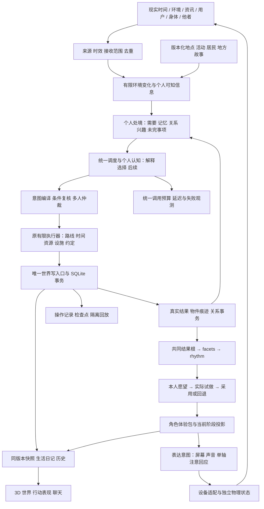

# 聚形域：恢复后整体架构审计与开发管线

2026-10-19。本次是审计与规划，未合并实验分支、启用正式连续认知或修改人生数据。后续排期以本文为准；旧主线 6A/6B、实验分支 M0–M8、角色包 P0–P9 编号仅作来源追溯，不相加为完成度。

**结论：现有世界执行基础、认知实验和视觉方向值得保留，能够承载目标；持续生活质量尚未达标。下一轮应统一运行基础、补足生活内容并验证行为，再确定具体角色与主题壳。**

**后续执行细化（2026-10-21）：** [R3 收口到持续生活的执行管线](r3-to-r6-execution-plan-2026-10-21.md) 依据当前源码和小批结果，将 R3 拆成语义与成本、三人互动、多源/人物/兴趣、正式接线四批，明确自然七日的进入条件，以及同步地图打磨和硬件测量的范围。本文原架构和 R0–R6 编号继续有效；历史审计表保留当时状态，新增计划不计作已经完成。

本地后续进展：[R0→R1A](../milestones/world-observer-r1a-2026-10-19.md) 已完成恢复检查、同版本当前观察、运行方式与断线/绘制确认。R1 余下的核心操作记录、存储增量、历史及 live/lab 分离继续排期；不将这一批计为完整 R1 验收。

进一步进展：[R1B](../milestones/world-history-r1b-2026-10-19.md) 完成核心操作摘要、版本化增量/检查点、校验重建、冻结历史页与有限进餐协调。六小时同前态规则配对改善了总量，但仍有个人首餐推迟。下一批 R1C 修正个人供给公平性、量测长期存储并收齐 live/lab 与总调用观测，随后进入 R2 的首条奇幻日常；R1 尚未整体关闭。

最新进展：[R1C](../milestones/life-fairness-r1c-2026-10-19.md) 已完成计划内的个人供给规则、同前态/富余实验、正式与实验边界、已接入调用账本和千/万条存储量测。最晚首餐 348→250 分钟，三个个体仍比原来晚，不能宣称全员改善。存储恢复通过，但一万条合同负载约 1.34 GB，主要来自检查点；在长期无人值守前必须压缩/归档并再次验证。

## 1. 我们要达成什么

喵呜是同一个持续存在的个体。它在与现实伴生的奇幻空间“聚形域”中生活。现实时间、天气、公开资讯、主人互动、身体感知及其他角色的消息，经过来源、时效、接收范围和作用权限核验，改变它的处境、关注和可选机会。它结合自己的需要、经历、关系与承诺作出选择。

行动留下物件、成果、困难、共同经历和未完事项。兴趣从持续选择中发展，能力来自对应实践，二者不互相替代。满足条件后，它可以提出“想试着成为谁”，经历试做、回应和采用，改变生活、表达和虚拟外观。形态与职业可组合、可回退；身份与经历连续保存。实体换壳另有制作、安装和识别过程。

生活感至少需要满足：

- 无人聊天时仍有合理安排；服务离线时如实显示未运行区间，不补造冒险。
- 昨天的问题能影响今天；可以完成、改办法、求助、暂停或放下。
- 同一输入对不同角色产生有依据的不同理解，不能瞬间改写身份。
- 熟悉的日常与可理解的新变化共存，允许安静的一天，不靠持续危机或换装维持热闹。
- 奇幻规律能被行动触碰，并在物件、环境和社会关系中留下后果。
- 用户能聊天、建议、参与和观察；角色保留自己的取向。
- 最终屏幕、声音、转头和外壳表达同一段生活、同一个当前角色阶段。

无限地图、完整经济政治模拟和全镇高频调用模型，都不是首轮达标的必要条件。

## 2. 本次实际核对

| 对象 | 核对结果 |
| --- | --- |
| GitHub main | `f127a221323f997d654188abd2f82554ce93ecf7`，2026-10-11 的 v0.6 认知第 1–5 阶段 |
| 恢复后的本地主线 | `338d5dca34f93054fa42b7a18c5da584a7e8ba6c`，含恢复的 6A/6B 和最新中央聚落、环绕地貌；审计开始时比远端 main 多 1 个提交，尚未推送 |
| GitHub 实验分支 | 本轮重新 fetch；19 个 `codex/*` 分支全部是同一实验提交链的祖先节点；最新节点 `1270533425215bc5aba6d24a3cf13a74dd0529df` |
| 两线起点与交叉 | 共同起点 `b6ec79debfe56399d600f274d90c531e98493a7e`；相对该起点，主线改动 308 个文件，实验线 172 个。27 个同路径文件双方均有不同改动，其中 19 个在应用 src；这是差异交叉，不是实测 merge 冲突数 |
| Asamana | 本机 `e9fc862642369ba8b177595d2f8e3f20c1636da4` 的 runtime、scheduler、perception、memory ranking、maintenance、initializer、builder 和 tuning；不宣称是上游最新版本 |
| 分支测试 | 最新实验节点导出至隔离目录，13 个相关测试文件、60 项通过：角色包/冻结、感知、记忆召回、慢目标实际进展、观察快照、历史分页及部分原入口回放。未重跑分支完整 877 项 |
| 服务 | health、地图、生活接口均 HTTP 200；单次地图响应约 877 KB、生活约 30 KB，不当作长期性能基准 |
| 正式运行 | 14 地点、12 NPC，加喵呜共 13 人；规则生活和旧有限模型选择开启；新 Asamana 连续认知启用人物数 **0** |

首次隔离测试受本机连接权限限制而失败；允许连接临时本机 HTTP 服务后原测试通过。测试使用虚构夹具与隔离 SQLite，不读写正式人生，本轮无新增付费模型调用。

恢复来源、画面与上轮验证见 [6B 蜕壳原野记录](../milestones/shaping-field-stage6b-shell-v4.md)。源码恢复到留存的 10 月 15 日工作副本，再进行新修改；最新找到的旧人生备份是 **10 月 13 日 11:24 上海时间**。之后缺失的记录不能凭新版程序补回。当前时钟已推进，不代表空缺历史已恢复。

审计脚本、分支清单、测试输出及脱敏统计保存在工作区 `runtime/architecture-audit-20261019/`；不附密钥、聊天内容或数据库。

## 3. 已有能力与关键缺口

| 维度 | 已有实现 | 尚未达成 |
| --- | --- | --- |
| 持续世界 | 上海 1:1、路线、到期任务、有限资源、设施占用、幂等、SQLite 和共同结果根 | 长期运行与存储治理、可靠恢复和自然跨日验证；补结算不等于离线时自主行动 |
| 多源理解 | 时钟、上海天气、NASA RSS、区域空气、聊天/建议、身体协议；来源、TTL、接收范围与有限折射 | 各来源实际改变后续选择的覆盖与强度；正式外部 agent 来源；连续认知尚未正式启用 |
| 个人认知 | Python 复用 Asamana 感知、需要、目标、决策、反馈、双流记忆、反思，Node 核验行动 | 实验配置与产品配置分离，减少时间/事实表述错误，证明真实模型多日追求 |
| 社会生活 | 13 人规则生活、浮圃/小泵/叶芽汤、邀请/拒绝/赴约/共同履约、个人关系理解 | 更多居民拥有可执行长期事务；现有奇幻内容偏测记研究，日常用途、不同做法与情感后果不够丰富 |
| 兴趣与角色 | 共同经历→facets→rhythm→愿望→实际试做→双轴采用/撤回 | 自然愿望频率、稳定性与采用后的生活差异未证明；不能仅靠次数或热词达成 |
| 地图与表现 | 中央聚落、环绕地貌、low poly Toon、风语林实态、风雨昼夜和渐息灯光 | 新湿地/旧壳脊/星屑台地仍是装饰；路网较规则、壳屋类型较重复，细节和生活密度仍低于概念图 |
| 交流与观察 | 聊天、生活侧栏、观察记录、实验回顾页 | 正式入口分别请求地图/生活/角色，存在版本错位窗口；需要统一的日常回顾和可恢复历史 |
| 实体 | 输入输出软件合同、队列和 ACK 边界、STL、约束文档 | 小智固件桥、真实 ASR/TTS、声学/磁识别/单轴校准、最小核心和打印壳均未完成 |

**实验不能替代自然生活。** [第五阶段](../milestones/asamana-cognition-stage5-v1.md) 12 组真实模型双轮实验中，11 组形成后续，7/11 实际推进；其中一项仅推进到正式邀请，未算共同完成。另有一组反馈合同失败，两次愿望讨论均未提出新角色。[6A](../milestones/asamana-cognition-stage6a-v1.md) 五项复查完成任务，但仍有“明早”与当晚复查时间不一致、把新测记称为调整瞬间读数等问题。43 次提供者调用，完整案例中位约 13.97 秒，不等于单次 API 延迟。

实验分支的真实模型跨日记录为 `inconclusive_reflection_failed`，三日夹具成功不能改成模型成功。正式观察存在大量未观测区间，10 月 14–17 日无连续在线样本；多天日期和大量事件不能证明完成 7 日持续生活验收。

**存储需要提前处理。** 本次只读统计，人生库约 3.85 GB，世界 mutation JSON 原文约 3.79 GB。`diffValues` 对变化数组保存整段 old/new，聊天结果另存世界快照。个人热记忆有界不代表整个系统能长期低成本运行。应保留旧库，再做版本化增量、快照引用、冷归档和恢复验证，不能清空历史来换体积。

## 4. GitHub 分支如何吸收

以恢复后的 main 为底座，按能力迁移，不将实验分支整树覆盖 main。实验线不包含 main 后来的 Python 认知迁移，也没有当前新地图；19 个分支不应当作 19 份独立功能重复合并。

用户在本次审计后的取舍是：以当前实现和视觉方向继续发展，分支用于取长补短。下面的模块清单是候选复用范围，不是必须全部搬入的任务。每项先明确当前缺口，在相同数据和场景中比较收益，再选择复用代码、仅吸收算法/测试、改写适配或不采用。保留当前更完整的认知链、地图和生活连接；已经满足需求的主线模块不因分支存在同名功能而替换。

| 分支族/模块 | 值得吸收 | 适配边界 |
| --- | --- | --- |
| `role-experience-pack-v1`；`role-experience-packages`、`role-experience-performance` | 角色语义、生活、世界关联、口吻、屏幕/TTS、虚拟外观的版本化体验包；采用版本冻结、双轴组合、回退；厨师和探险家样本 | 仍由当前 `role_stages` 决定采用。修改旧猫耳/黄点/梨形体硬锚点，区分机械约束与艺术特征。注册星空/梦境包不等于对应生活和资产完成 |
| `asamana-shared-life-v1…v5`；`memory-ranking`、`actor-perception`、`slow-cognition`、`cognition-cadence` | R/I/R 与 MMR 召回、事实锚点、知识范围、目标与真实任务绑定、关系偏好和认知节拍 | 迁移算法/合同/反例到当前认知层，**不再并行运行第二套计划和反思 worker**；个人理解仍关联原结果根 |
| 同族 `world-observer`、`worldObserver.ts`、`WorldHistoryPanel`、`renderCompletion` | 同版本 map/Scene/NPC/feed/role；序号门控、渲染确认、重连和冻结分页 | 优先吸收；补上新 cognition、风语林与新地形。旧历史断层明确显示，不伪造回放 |
| `asamana-replay-journal-v6…v6.1`、`m6b-seam-v6-2…v6-4` | canonical capture、操作上下文、脱敏 provider fixture、chat/input 原入口回放 | 扩展到 main 新认知 claim/plan/feedback、预算、归档索引与内容版本；保存响应重放，不重新调用模型 |
| `asamana-m6b-r-*`、最新 `asamana-m6b-route-worker-replay-2026-10-14` | route/worker/TTS fixture/角色采用回退的进一步回放；迁移覆盖目录和证据版本 | 用作累计参考。生产归档、namespace 原子性、voice/设备等仍有缺口；旧分支的通过状态不能继承成新主线通过 |
| 最新链的 `authored-world-events`、`world-events.json` | 内容包→合法候选→原世界写入口的边界 | 保留合同，重做触发语义。目前“雾/灯/湿地”等关键词匹配固定雾灯故事，不能证明连续几晚实际发生过。增加真实条件、对象状态、作用范围、冷却与后果 |

参考：[角色包分支](https://github.com/404-NOT-FOUND-ERROR/DeskBot/tree/codex/role-experience-pack-v1)、[共享生活 v5](https://github.com/404-NOT-FOUND-ERROR/DeskBot/tree/codex/asamana-shared-life-v5)、[累计实验节点](https://github.com/404-NOT-FOUND-ERROR/DeskBot/tree/1270533425215bc5aba6d24a3cf13a74dd0529df)。

迁移顺序：合同与测试 → 同版本观察投影 → 核心操作记录/回放 → 体验包与历史冻结 → 召回和节拍算法适配 → 有限事件包。交叉的 `app.mjs`、`persistent-world.mjs`、`autonomous-life.mjs`、`life-choice.mjs`、`social-life.mjs`、`DeskBotApp.tsx`、`TownScene3D.tsx` 逐模块适配并复验。旧分支文档含其他机器路径和多套“当前状态”，保留为来源，不复制成现行说明。

## 5. Asamana 的下一步复用

当前 main 已复用不少 [Asamana 固定版本](https://github.com/dreamscroll-lab/asamana/tree/e9fc862642369ba8b177595d2f8e3f20c1636da4) 的 Python 代码，实验线另有 Node 适配；不能把相同功能再建第三遍。

- `agent/perception_layer.py`：人物当时知道什么、来源是什么；环境说明与亲历分开。
- `agent/memory_ranking.py`、`engine/cognition_maintenance.py`：减少重复召回，保留依据，整理目标与关系；摘要不删除事实、不增加成长次数。
- `engine/scheduler.py`、仲裁/执行反馈：何时思考、谁正忙、多角色争用和打断；时钟与事务继续由 DeskBot 拥有。
- `world/builder.py`、人物生成工具：离线创作地区规则、居民动机和分歧，再编译成可验证内容包。运行时不能随口造库存、道路或历史。
- `tuning/`：阶段隔离、场景对照、归因和叙事评审。模型评分只辅助，事实由实际结果和人工复核裁决。

不迁移整个上游 runtime：它按明确有限步数运行，多阶段调用模型；恢复会重置进行中动作，回放主要读取历史快照，与现实 1:1、已有任务恢复、SQLite 幂等和实体约束不同。也不照搬“只换便宜模型来省成本”的唯一策略；DeskBot 可以按事件、休息和机会控制思考频率，同时保留人物语义和任务连续性。

近期维持 **Node 世界服务 + 有界 Python 认知 worker**。是否移植某些 Python 阶段到 Node，由同场景质量、延迟和维护成本决定，当前不重写第二套后端。

## 6. 统一架构

以下是整合目标，不代表所有连接已经上线。

**人物运行归属。** 每人同一时刻只由一个系统发起新计划。当前自主生活已避让启用认知的人物，在此基础上统一旧 planner、Python cognition 和分支 slow-cognition 的职责。切换时保存待反馈结果、运行任务、约定和在途请求；旧模型响应不能覆盖新状态。模型停机时，需要保障和事务结算仍工作。

**事实与理解。** 保留 `persistentWorld.ingest`、canonical mutation、`root_outcome_id` 与既有角色阶段。来源、解释、意图、行动和结果分别保存。多人讲述同一结果不增加多份成长；个人理解可以不同，但不能替别人答应。

**运行配置与预算。** `createCognitiveRuntime` 仍创建 stage2 命名实验库，使用默认 ¥2/120 次的实验预算；虽然可调度两个人，broker 的请求还串行排队。这是产品化前应清理的实验接线。分离 live/lab 配置和账本，记录聊天、选择、反馈、反思、翻译、重试和未知用量；交互和背景思考有可观察优先级，测瓶颈后决定并发与阶段合并。

用户取消的是隔离实验金额上限，正式聊天/传感器数据的出站范围未因此扩大；正式启用前明确该范围，不默默沿用实验授权。本次未新增付费调用。

**持久化。** 保留旧库和迁移前检查点。大数组历史改用有版本的细粒度记录/可重放增量，原文冷归档，热视图和模型上下文有界。验证旧库恢复、迁移回退、随机中断无重复结果、索引重建与历史缺口。设备音频回放随设备功能接入，不让未上线路径无限推迟软件生活试验。

**呈现。** 一次权威读取生成同版本地图、人物、角色阶段、生活条目和痕迹；序号抵挡迟到响应，渲染确认有超时恢复。观察者可看全镇，人物模型只读本人可知的信息。正式聊天始终可达，诊断信息放第二层。

## 7. 内容、地图与奇幻生活

沿用 `world-content`、现有执行器和内容安装机制，补齐可执行规范，不新建与原数据脱节的世界编辑器。

| 内容类型 | 必须写清与核验 |
| --- | --- |
| 地区/地点 | 边界、入口/邻接、路程/通行、坡地/水岸、设施能力、开放状态、资源用途、渲染版本 |
| 活动 | 动机、地点/工具/材料、耗时/容量、成功/受阻/退出、结果根、实践范围、动作过程与痕迹 |
| 居民 | 稳定取向、当前事务、需要/休息、知识范围、关系及不同做法；作者愿望不冒充已经完成 |
| 地方故事/事件 | 真实触发、参与角色、可选处理、状态转移、作用范围、重复/冷却、可放下的后续与持久后果 |
| 角色体验包 | 依据、形态/职业轴、采用条件、采用后生活、表达/外观、能力边界、版本/冻结/冲突/回退 |
| 资产与表现 | 对象/活动 ID、坐标/脚底、状态映射、动作阶段、天气/昼夜/经营状态、LOD 与资源预算 |

内容按“概念远景→可通行→有活动→有人持续使用”分别验收。地图变大不自动增加生活。当前 nonlinear projection 主要改变画面；新路线、距离和耗时要做正式地图版本迁移，不能把装饰或画面距离当成已改变的规则。

**空间方向：**中央聚落与环绕地区继续发展。路网顺坡、顺水岸，主环路和捷径连接地区；过渡带承担采集、碰面、运输和天气变化。建筑轮廓区分用途，地形/植被/材料/颜色连续过渡。迁移既有人物和任务时不丢引用、不瞬移。

首批深化“中央聚落—风语林—水岸/折光湿地”的往返链。旧壳脊、星屑台地继续概念和资产预研，内容达标后开放。这不限制最终面积，而是让开放地区值得再次前往。

**地图与视觉持续打磨。** 当前地图是后续迭代基准。保持 low poly、三阶卡通光照、细描边、中央聚落与环绕地形，并继续改善实际空间、资产和动态；R5 的完整角色艺术阶段不承担全部场景打磨工作。

| 持续任务 | 下一批重点 | 实际效果验收 |
| --- | --- | --- |
| 地形与空间构图 | 高低层次、谷地、水岸、聚落台地；减少中央棋盘感，细化镇林过渡和顺地形道路 | 远景能辨认地区和地标；中景坡道、桥、岸线相接；人物和热点贴合真实可行走表面 |
| 建筑与资产密度 | 壳屋轮廓与用途差异、入口和院落、公共设施、植被群落、地标的局部细节 | 建筑用途可辨；细节围绕活动空间分布，保留路径和视线，避免单纯堆满重复模型 |
| 生活状态与动作 | 持物、工作、等待、收拾、交接；实际修补、摆放、使用和归还痕迹 | 开始/进行/结束/中断可分辨；留下的变化能追溯到任务或对象状态，动画不自行完成事务 |
| 昼夜天气与呈现 | 经营/休息灯光、雨后湿润、风的层次、远近景色彩、遮挡、LOD 与渲染负载 | 同场景白天/傍晚/夜晚及相关天气可核对；特效遵守实际状态；改细节同时记录性能变化 |

大型构图或新地标先出局部概念和资产方案，再制作可运行场景。每批视觉变更保留相同镜位的前后截图；动态变更补短录屏或可交互验收。概念图说明意向，最终以实际 WebGL 和人物活动中的效果为准。地图骨架、具体资产、生活痕迹可以分批完善，不要求每次都推翻整张地图。

**从测记工具扩展到日常用途。** 现有光叶架、风痕、雨盆、夜灯内衬可以继续发展：听风、歇脚、避雨、晾晒、借工具、送内衬、夜间陪人收摊，与研究制作形成不同选择。遮片、风雨和磨损改变物件；喵呜可以修、换位置、求助或等明天。居民可分别偏好夜灯或遮雨用途，对有限材料有不同诉求，不预写必然和解。

新旧壳地貌的规则，例如存风、释放余辉、条件性共鸣，是待制作的设计候选；先定义真实条件和结果，再产生视觉和叙事。角色可以误解来历，作者背景、假说、验证结果分别保存。采用“稳定日常 + 小变化 + 有限较大地方事件”，调度只创造合法机会，不强迫高潮或角色愿望。

**输入分级不是单一权重。** 分开真实性、时效、相关性、作用权限、打断资格和重复来源。时钟决定到期；天气经已定义规律影响环境；新闻先成为听闻与问题；主人互动影响注意与关系；他者消息需要实际送达和回应。休息、需要与已接受约定独立约束选择。

先提升已有来源的折射，再按用途加来源，例如季节/昼长、天文观测窗口、自然资讯。不为数量接新闻洪流。普通公开数据用缓存/TTL 适配器即可，MCP 留给确实需要的工具，并遵守同样的权限边界。

## 8. 兴趣与角色变化的分层

继续使用现有量化链，不增加独立“进化经验值”。

| 时间层 | 可变内容 | 原则 |
| --- | --- | --- |
| 瞬时至分钟 | 注意、表情、反应 | 不改长期身份，不因一条消息反复打断 |
| 小时至数日 | 未完事项、方法、计划、关系理解 | 稳定 ID、前提和复查条件，改写理由不能无限延长等待 |
| 多个有效机会日 | 兴趣形成、维持、搁置、重访 | 区分自主/义务/受邀/无机会；离线不是放弃，熟练不等于喜欢 |
| 跨日实践后的慢变化 | 愿望、试做、采用 | 现有跨日证据门作为初始规则；本人表达，允许暂缓/拒绝/撤回，不规定每几天必须换角色 |
| 作品与实体版本 | 外观、声音、屏幕、主题壳 | 基于体验制作、核验和登记；生成图片不等于可打印结构 |

工作流：生活与愿望依据 → 体验包草案 → 采用后的活动/表达差异 → 日常表现评审 → 造型声音方案 → 可编辑资产 → 实体包络和分件 → 样件功能验证。先完成有限而完整的青蛙/厨师等方向；开放生成先产候选包，内容与制造检验后才可使用。

硬约束是电子件安装、圆屏、双麦声学、触摸、扬声器/接口、单轴转动及线缆净空；猫耳和黄点属于可变艺术内容。[物理约束](physical-constraints-v1.md)已有正确区分。现在就能测量最小核心，具体主题壳等待生活方向稳定，二者不必互相阻塞。

## 9. R0–R6 开发管线

每段交付可运行结果、相关回归、已知限制和可回滚记录，不用文档状态替代验证。

| 阶段 | 工作与交付 | 出口条件 |
| --- | --- | --- |
| **R0 基线与整合准备** | 锁定源码/人生/配置/素材版本，备份恢复演练，27 个交叉文件迁移清单，人物运行归属 | 隔离恢复同一人生；正式库不被夹具覆盖；不会双重安排；源码与私密运行数据分别备份 |
| **R1 统一运行和观察** | observer/历史、live/lab、预算和调用观测；核心输入/认知/执行/采用可追踪回放；增量存储；保留聊天 | 一次输入可追到选择、结果和画面；重启/重复无新成果；旧响应不倒退；增长得到量测。设备全量回放不阻塞软件试验 |
| **R2 首条完整奇幻生活链** | 中央聚落—风语林—水岸；先聚焦喵呜和两名不同需要的居民；日常、分歧、受阻、等待、返回及物件痕迹 | 一件事有多种真实做法，次日能接上；NPC 可拒绝/改法；选择留下不同结果且画面可见，不止地图标签 |
| **R3 真实认知与兴趣对照** | 相同场景比较规则/旧选择与新认知；输入消融、重复等待、个体差异、召回、四类兴趣轨迹；全链成本与延迟 | 达到下节预登记门槛；失败局部修正；规则守事实、文字经语义核验；不强制提出愿望凑成功率 |
| **R4 自然跨日试运行** | 明确正式出站数据后，少量人物启用，再按质量/成本扩展；至少 7 个自然日，必要时 14 日；经历重启/断网/安静期 | 每日能说明昨日后续、当日选择、理由、痕迹、等待；在线/离线分开；无重大重复或虚构；能感到同一个体的生活。没有新愿望不自动判失败 |
| **R5 角色体验与艺术深化** | 适配体验包，一组形态+职业的完整日常；统一屏幕、声音意图、外观、动作和回退 | 采用前后生活/表达可辨认且信息准确；换主题仍是喵呜；双轴组合、资产版本与当前状态一致 |
| **R6 实体闭环与扩展** | ASR/TTS、打断/失败，小智桥、触摸/双麦/磁识别、屏幕/yaw；最小核心和首壳样件；再拓区域/居民/开放候选生成 | 实测输入—理解—输出—设备闭环；ACK 与物理执行分开；结构、声学、旋转、装拆、打印通过验证；扩展不破坏人生 |

地图与视觉作为持续交付任务贯穿后续阶段：R0 固定当前画面基准和问题清单；R1 在统一观察数据的同时细化地形衔接、路径和对象投影；R2 随生活内容交付场所细节、动作与物件痕迹；R3–R4 依据真实运行继续调节昼夜天气、活动密度、遮挡和性能；R5–R6 扩展角色与地区时沿用同一视觉标准。各批次有可核对的实际画面，避免基础设施开发期间长期没有可见改进。

STL/内部件尺度、装配基准、声学与单轴运动也可在 R1–R3 提前研究。上述场景和结构工作不宣布角色已自然成长，具体主题壳仍以生活依据和实测约束为输入。

**当前执行位置（2026-10-20）：R3 修正与小批复验，尚未放行 R4。** [首轮](../milestones/cognition-r3-2026-10-20.md)保留 108 组主矩阵、6 组人物、4 组兴趣及原失败。[本次修正](../milestones/cognition-r3-hardening-2026-10-20.md)接通稳定问题编号、暂存/恢复、明确结案、清水交接和复查去重；先验证后运行两条四窗口病例，58 次调用，六个完整窗口与一次计划失败。随后本地修正换词催问、回复编号与精确协议提示，完整服务 857 项通过，未追加付费。下一批先验证这些边界，再做多人真实交接、人物/来源反事实及兴趣对照，达到原出口后才进入 R4。

[R2 里程碑](../milestones/waylight-r2-2026-10-20.md)保留两种做法、材料往返、协作/拒绝/延期、次日使用与可见物件，以及 48 小时规则运行。一万条历史的检查点压缩将同类 DB 从约 1.34 GB 降至 278 MB，旧备份/实验清理约 29.16 GB。旧正式库历史仍保留，完整冷热生命周期、自然七日和模型生活质量未关闭；不能把规则闭环或容量改善当成整体愿景验收。更早的审计结论保留为当时基线，当前实现与实验数值以对应里程碑为准。

## 10. 实验与验收口径

以下是建议的首轮工程目标，不是已有实验结论。实施前固定场景、计算口径、代码/内容/模型版本及失败判据；改门槛须记录理由。

| 问题 | 方法 | 量化与初始出口 |
| --- | --- | --- |
| 人生是否可靠 | 固定输入/已存响应，fresh/restart/duplicate；调用、任务完成、采用前后中断 | 被测事实/库存/角色/结果根一致，重复执行零新增；缺归档明确失败；回放零模型调用，不声称覆盖所有未来故障 |
| 多源是否有效 | 6 类成对场景 × 3 次重复，共 36 次短场景运行；单独改变一种合法输入，另设过期/重复/否定/无关反例 | 分别报告意图、行动、对象结果差异；引用来源不等于因果。正例作用合理，反例不授予权限或成长；小样本仅作筛查 |
| 后续是否延续 | 至少 20 个具有实际可行后续的窗口，真实执行第二轮 | 暂定 ≥80% 有实际推进或有依据改法/延期/放下；完成与合理收束分列，纯重复等待不算。报告分母，不直接与旧 7/11 宣称显著优越 |
| 机会是否足够 | 分开自由、睡眠、需要优先、承诺、缺条件窗口 | ≥70% 自由有余力窗口存在两种实质不同安排，不把同一测记不同措辞算两种；连续已观测可行停滞 6 小时触发诊断，不强迫造剧情 |
| 兴趣是否稳而可变 | 持续自选、密集建议/义务、无机会、沉寂后再遇；同条件交换人物设定 | 不把受邀变爱好、不因离线衰减、不因复述重复计证据；再次选择可追溯；报告频率与原因，不要求次次出愿望 |
| 奇幻是否有生活用途 | 同一问题的自行处理/合作/延期路线，实际物件与跨日用途 | 回来理由、剩余问题、使用次数和后果；人工检查是否只有台词变化，允许平淡结果 |
| 表达是否可靠且有差异 | 事实核对，加隐去实现方式的短片段人工比较 | 被测完成/承诺/身份/库存关键错误为零；其他描述错误单列修正；个体差异来自理解与做法，不只口癖 |
| 成本延迟是否可接受 | 所有调用/失败/修复/缓存/未知用量；同内容比较，单 API 与整轮分测 | 每有效行为、每人物在线小时、全镇一天 token/费用及 p50/p95；交互不被背景队列长期占用；价格按实验当时核验 |
| 存储与呈现是否能持续 | 隔离库 1千/1万及更长事件；典型镜头、雨夜、13 人、断线与 WebGL 恢复 | 热视图有界，历史不整段反复复制；报告 DB/WAL/写入量/恢复时间；帧时间、内存和加载注明机器视口，不拿截图代替性能验收 |
| 用户能否观察 | 正式入口呈现“正在做、昨日留下、为何变化、留下什么、等待什么”，与聊天共存 | 不开研究页也能追踪一件事；离线明确；自然体验与机器指标分别记录 |

R1 起收集观察资料，R4 正式七日窗口在版本和运行条件稳定后开始。夜间休息计入服务在线覆盖，不进入自由选择分母。明显改变行为规则后，不把前后天数拼成同一版本验收。

## 11. 判断愿景是否成立

目前不需要放弃 Node 世界、Python 认知或 low poly 方向。主要缺口是它们尚未作为同一产品持续运行、提供丰富选择、可靠表达并接受自然跨日验证。

下一阶段应能看到：用户回来时，喵呜接着昨天在林地留下的问题生活；新天气和朋友回应让它尝试另一种办法，实际物件发生变化。一段时间后，它根据自己反复选择的事情提出一种角色愿望。用户理解原因，画面与表达体现差异，真实外壳再经过制作安装。这个过程成立，美术与角色设计才有可依赖的生活基础。
