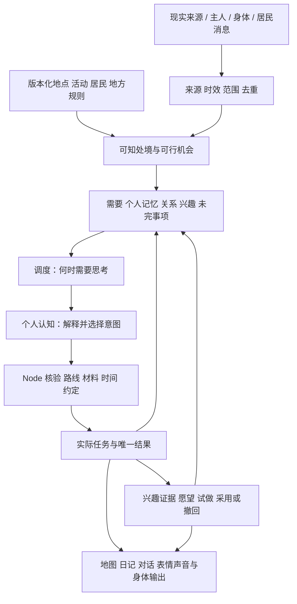

# 聚形域现状核对与后续开发管线

本页保留 10 月 23 日的核对证据。当前路线、架构和开发原则已由 [统一开发基线](../../documentation/development-baseline.md) 承接。

2026-10-23，运行状态采样约上海时间 20:27，随后补充 SandBox 机制与地区扩展规划。DeskBot 源码基线 `main / 5f88437`；SandBox 本地内容与 GitHub main 同为 `6987092161e30d9b96923ac1110d34a18bcc0d83`，本地工作目录未改动。此次核对源码、既有实验汇总、本机运行状态、SandBox 设定和保存的实机截图；未修改运行逻辑、重启服务或发起新的模型实验。下列测试数是既有记录，不是本次重新运行的结果。

**结论：可执行的世界底座、有限奇幻内容及认知/角色发展连接已经存在；稳定而有差异的持续人生尚未验收。当前仍是 R3-A。** 代码检查通过、隔离场景能走通、自然生活达标是三种不同证据。不能把研究页的成功片段或多个版本的窗口累加为整体完成度。

## 目标及设计边界

喵呜是持续存在的同一个个体，在伴生于现实的奇幻空间聚形域生活。现实时间、环境、资讯、主人互动、身体感知和他者消息，先区分来源、时效、接收范围与作用权限，再影响处境、关注和可选机会。需要、个人经历、关系、承诺和未完事项共同影响选择；选择须经实际任务留下后果，后果再进入记忆和下一次选择。

持续兴趣与实际尝试可以形成“想成为谁”的愿望。形态和职业是可组合的方向，采用、暂缓、撤回均要保留同一个体的历史。前置条件由程序设计，具体选择保留给人物；数值达标不等于已经有愿望。用户参与这一过程，但一句要求不能立即改身份。

变化应分层：当前注意与情绪随事件变化，活动随需要和条件安排，兴趣依据反复自主选择及真实机会变化，角色采用需要较长证据与尝试。时间长度和门槛是需校准的产品规则，不是已经证明的心理规律。允许安静、休息、暂时没有新愿望；也要诊断有机会却长期停滞。

现实载体没有摄像头和行走能力，仅有头部单轴转动、触摸/触屏、双麦方向与磁识壳。机械锚点是电子件、开孔、声学、触摸、转动和装配要求；猫耳、黄点及当前身体轮廓不是永久机械限制。造型图、虚拟采用、可打印模型、实际装壳分别验收。

## 当下真正运行了什么

| 本次直接查询 | 实际状态 | 含义 |
| --- | --- | --- |
| 4311 服务与 5173 验收页 | 健康 / HTTP 200 | 服务在线，不代表生活体验已达标 |
| 世界时间、人数与地点 | real_time；喵呜加 12 位居民；14 个地点 | 这些是当前存档计数，不是 13 名新认知角色均已稳定运行 |
| 原有模型入口 | DeepSeek Flash 已配置；`dialogue_and_life_choice`；旧 planner 启用 | 原生活规则与受限候选选择继续存在；本次未发送聊天验证 |
| 新 Asamana 正式连续认知 | `live.enabled=false`；该范围调用 0；人物启用 0 | 实验额度与正式人生分离。此处的 0 不代表全项目无模型调用 |
| NASA 科学资讯、上海空气 | 实际 input-runtime 均 enabled / fresh | 已有真实来源在刷新，尚不证明新认知已经消费并影响选择 |
| 上海天气及预报 | disabled / stale；天气最后成功为 10 月 21 日 00:35 左右 | 当前不能宣称持续同步上海实时天气，需要修复启动配置 |
| 设备桥接 | 连接数 0；hardware_verified=false | 当前服务没有已验证的实体闭环；不据此推断 USB 物理插拔状态 |

发现一处状态展示不一致：`/api/context` 仍把泛化的 news 显示为 not_configured，而 `/api/input-runtime` 中 `nasa_science` 实际为 fresh。应统一到实际连接器状态，而不是让两套展示分别判断。

源码确认 `createCognitiveRuntime` 只有收到 `liveBudget` 才创建正式认知，当前 `app.mjs` 没有传入。正式上线需要独立接线与运行配置，不是实验页通过后自动开启。

## 架构及复用关系

- **Node + SQLite** 保存世界事实、时间、有限资源、任务、约定、原文与结果。模型不能用一段台词增加库存或完成交接。
- **Python + 固定 Asamana** 承担个人感知、需要、目标、选择、双流记忆、反馈、反思与关系理解。本次重新核验 vendor 的 52 个文件，52 个哈希全部匹配清单。适配代码在 vendor 外；没有搬入上游整套世界 runtime。
- **调度层** 区分正在做事、实际结果待反馈、睡眠、新输入、后续到期和慢速整理。同一个人物应只有一个行动安排者；旧候选选择与新认知需明确交接控制权。
- **发展层** 延用 facets / rhythm / wishes / trials / stages 的共同经历账本，区分自主继续、受邀、义务、能力和机会；没有额外平行的成长积分。角色候选仍是有限作者定义：青蛙、制作、厨师有对应实践，星空/梦境还缺实践内容。
- **Three.js / Web 客户端** 已有正交视角、三阶卡通光照、描边、中央聚落和周围地形。真实物件状态驱动画面；外围造景不自动拥有任务和社会生活。
- **聊天与实体** 已有世界上下文、表达与输出协议，但聊天的旧流程、新个人认知、现实设备的完整一致性仍需验收。物理设备未接通不能由画面动画代替。

值得继续吸收的分支能力是体验包、历史版本、回放、召回与节拍算法；当前主线已有更完整的世界与 Python 迁移，不整树覆盖，也不再增加另一套规划器。

## 已有成果与证据强度

| 范围 | 已实现或已有证据 | 还没有证明 |
| --- | --- | --- |
| R1 世界基础 | 同版本观察、历史重建、任务与库存、需要调度、设施公平、重启与回放 | 长期无人值守、所有生活矛盾均已解决 |
| R2 奇幻日常 | 苗圃/凝光苔、回声杯、余辉灯、风语林和归途灯等有限规则；归途灯制作、装罩、使用、修补与画面关联 | 世界整体已丰富；外圈每片地形都有生活。48 小时规则实验不是自然模型生活 |
| R3 认知 | 真实模型能提出意图，经执行产生结果，再形成个人反馈和后续；同一研究保存已完成步骤已经实际发生 | 稳定多轮延续、三人持续自主协作、明显而合理的个体差异 |
| 兴趣与角色 | 自主/受邀/义务、有效机会、跨日实践、愿望与试做的结构和样本 | 自然生活下的稳定兴趣与自主角色采用；不是任意新形态自动生成 |
| 表现与实体 | 地图视觉系统、状态驱动物件、日记聊天、软件身体协议与物理约束文档 | 最终角色美术、完整新声音/表情、适配固件和可制造通用核心壳 |

最近真实记录保留在 [R3-A 生活语义修正](../milestones/cognition-r3a-life-semantics-2026-10-23.md)：

- 较早版本完成 8 个模拟窗口，但出现把已可做的事误判为仍需等待、无用途重复生产、个人记忆弱化真实留言等问题，仍未通过。
- 最近两版分别完成 1 和 2 个窗口，随后因活动编号遗漏、用途引用错类停止。后者实际完成装罩并保留步骤证据，但第三窗口没有执行滤水。
- 两版合计 33 次调用，估算约 ¥0.490；最新一版 21 次调用、输入 222,079 tokens，只完成两个窗口，完整窗口记录约 16–17 秒。不能外推整镇日费用或稳定延迟。
- 最新本地修正记录为后端 884 项、Python 52 项通过，前端类型/构建通过；尚未真实复验。缓存重放复现了相同失败，不代表新版行为正确。

## 这次审计后的调整

**先减轻决策协议负担。** 当前个人决策已经选定方法、用途与事项，后面的模型编译还需重复输出相同字段。最近错误主要发生在这些引用衔接处。应让人物只作一次明确的结构化选择，程序解析经过校验的选项引用并确定性传递；保留人物选择权与执行校验，不靠猜测缺失意图或放宽校验过关。

**把程序格式错误留在程序层。** 格式修复、真正的材料不足、人物自愿改变计划是不同事件；校验失败不能变成喵呜记忆里的“别人阻止我”。真实任务失败仍进入生活经验。

**把用途和机会补完整。** 当前生产用途主要由本地活动推导，可能漏掉已知的跨地点用途；自由机会统计也主要按活动 ID 加观察项计数。需要区分已知远处用途与当前可执行路线，并按后果是否实质不同评价选择空间。不能把两个近似观察动作当作丰富生活。

**先提高折射质量，再添来源。** 现有天气、资讯、主人建议、他者和个人经历已经足以开展第一轮因果核验。应查清信息是否被接收、是否形成关注、是否改变机会/方法、是否留下后果。无关消息允许没有影响；加更多 RSS 或 MCP 不自动改善生活。

**奇幻内容要同时包含规律与日常用途。** 目前偏试验、制作、测记；下一条内容宜让归途灯服务晚归、歇脚、避风与次日晚用，让人有独处、邀人、维护或离开的选择。具体机制尚待设计，不能预写为已发生故事。更远地区也需提供地方规律、可做的事、真实取舍、返回理由和可见痕迹。

## SandBox 带来的管线调整：新机制也是生活验证的一部分

用户明确支持 R3-A，同时希望后续突破已有美术与活动选项。**地区和机制扩展提前进入 R3-C；不再把新内容整体延后到角色定稿或实体完成之后。** 原有归途灯保留为稳定回归场景，新机制用于验证丰富的世界是否能形成更好的选择与后续。R3-A 的当前复验场景保持稳定，避免同时换内容和接口而无法归因。

### 已核对的 SandBox 参考

[SandBox-Game 固定版本](https://github.com/404-NOT-FOUND-ERROR/SandBox-Game/tree/6987092161e30d9b96923ac1110d34a18bcc0d83)已有九区、十八段可玩活动、十位人物的四系列造型与九处生活角。连续地形、道路、地标轮廓、区域配色和生活角将人物爱好变成具体地方，值得复用。实际代码集中在 `index.html`：

- `REGIONS` 提供地方规则与奇遇；`ACTIVITIES` 提供六类活动及固定步骤；`REGION_LIFE` 连接居民、造型、地方、活动和生活对话。
- `triggerWonder` 由玩家触发临时演出并获得印记；`talkToResident` 循环作者写好的台词。奇幻现象已能呈现，但持续生态与自主社会不是这段代码已经提供的能力。
- `finishActivity` 提供首次统一材料奖励，`performActivity` 依赖按键、位置与钓鱼时机；`updateLighting` 使用加速昼夜；`visitRegion` 可立即传送；保存采用浏览器 localStorage。这些需要转成 DeskBot 的实际时间、有限资源、路线、任务与存档合同。
- 衣橱与兴趣造型是作者制作的预览/穿着内容，不能直接视为自然兴趣形成或正式角色采用。

只读核对了源码和仓库保存的截图，未重新运行 SandBox 全部玩法测试。迁移时保留固定来源与 MIT 许可，提取模型构造、材质与布局能力；两项目各自继续开发，不整份复制单文件运行循环。

### 值得逐步引入的机制

下面是设计候选，不是当前已经实现的聚形域能力。第一轮选择一个地区和少量能形成闭环的机制验证，其他保留在内容清单中。

| 机制 | 可以借鉴的意象 | 带来的选择与持续后果 |
| --- | --- | --- |
| 地方规律与生态周期 | 梦孢林倒雨、花潮、雪的留光 | 状态受天气、时段和已有环境影响；居民可照料、利用、欣赏、躲避或等待。改变下一次机会，而非只播放特效 |
| 物件的多种用途与个人布置 | 花圃、营地、失物小铺、生活角 | 同一材料可种植、制作、装饰或留给别人；有限空间中保留自己的布置，之后确实有人使用和维护 |
| 创作、练习与作品 | 慢五分钟舞台、回声玻璃、云朵面包 | 作品拥有版本、作者、参数与反馈；可独自练习、合作、展示、修改或搁置，拓展音乐、审美、烹饪等方向 |
| 探索、知识与地方消息 | 邮路、观星台、记忆晶谷 | 人物只知道亲见、听闻或已验证的内容；发现可以改变路线与方法，允许不了解、猜错和再次求证 |
| 共同项目、习惯与地方故事 | 巡夜、送信、交换种子、约定演出 | 相遇与合作产生持续关系和公共变化；多次真实参与可形成习惯，居民仍能拒绝、缺席或改期 |
| 休闲、玩耍与恢复 | 漂浮花间歇脚、听风、钓梦鱼 | 允许没有产物的有意义选择；可以出于喜欢而回来，不能所有兴趣都靠生产或研究次数证明 |

作者设计地方规律和可执行动作，程序依真实条件提供机会，人物选择参与方式；自由文本可以提出新想法，新想法没有执行规则时保留为愿望或设计候选。实现后的新动作、组合方式和物件用途可持续增加，不把现有活动列表当作产品上限。

### 接入现有架构的最小扩展

继续使用一套世界、调度与发展账本，扩展原 `world-content` 内容规范：

`地区/机制内容包 → 实际世界状态与机会 → 个人可知与选择 → 现有任务执行 → 实际结果 → 记忆/关系/兴趣 → 后续机会与场景表现`

内容包需要带稳定 ID/版本、地方规律、条件与频率、可用做法及参数、耗时与有限资源、结果与后续、兴趣/实践范围、知识来源、视觉绑定和迁移办法。新类型通过受控执行器实现；已有搬运、照料、协作等动作可以组合成项目。暂不制造一套可执行任意自然语言规则的通用引擎。

本次源码发现 `development-facets.mjs` 的主题仍是六类固定项，`activityTopic` 有大量活动 ID/前缀判断。扩大音乐、天象、收藏等兴趣前，需要显式登记“这个动作实际练习什么、支持什么关注”，兼容原有记录。单纯新增标签不授予能力或角色资格，也不能让同一结果按多个标签重复成长。

机会查询先按人物可知信息和真实可达性筛选，再给有限的相关候选与细节。扩展地区不要求每轮把全地图、所有角色和全部机制送进模型；睡眠、远处环境和常规周期优先由规则按事件推进。公开传闻、私有记忆、已验证知识保持各自来源。

### 首个迁移候选与成熟条件

首候选为**倒雨林缘**：从 SandBox 梦孢林提取倒雨意象、菌伞、观察棚与场景构造，并纳入聚形域的光粒规律。它能连接现有雨水、苗圃、出行和兴趣记录，首轮同时提供观察、照料/利用、休闲/相遇等不同动机。应先规定有限水分与光粒条件、持续时间和后果，不能一键无限产出。它仍是候选，玩法设计不成立时可以更换。

第二候选偏向**节律集市或生活舞台**，用于检验创作、练习、欣赏与合作，扩大当前偏照料和研究的内容分布。泡泡海港的跨区来往与失物故事可留作后续，不一次迁入九区十人。

迁移次序为：

1. 现在整理概念、地方规则与资产，R3-A 保持当前实验基线；不急着写入正式存档。
2. R3-A 通过后，在 R3-B 期间并行做隔离的规则与场景原型；三人认知先用可核对的既有事务验证。
3. R3-C 将首个成熟内容包接入同一世界，核对路线、材料、天气、人物选择、后续、兴趣与场景表现。可进入的边界和远景边界明确，物件与历史保留版本。
4. 通过存档恢复、执行与视觉验证，再做真实模型的定向对照；原型成熟后在 R3-D 纳入正式候选配置。
5. R4 用这个丰富后的稳定版本观察自然生活。发现新地区挤占原有关系、造成无意义重复或长期等待时，调整对应机制；不靠不断加新区掩盖问题。

移植门槛包括：地方规律可解释、至少两类实质不同的行动路径、能与旧镇发生真实往来、有跨日或再次回来时的变化、所有任务/资源可恢复、用户能看懂后果、开销有界。概念和美术可先成熟，进入正式人生需逐项验证。时间仍与现实 1:1；“慢五分钟”可作为地方习惯和表现，不暗改世界时钟。

### 如何验证机制确实增加了生活感

小范围使用相同起点和美术比较“只有景观”“加入地方机制”“机制与旧镇用途/他人连接”三种条件，逐项控制初始资源、输入、人物和观察时段。先以规则与缓存检查执行，再做少量真实模型筛查；完整迁移范围确定后登记实验，不自动展开大矩阵。

观察可行选择的实质差异、自主再次参与的依据、不同动机与结果、跨区往来、旧承诺是否被忽略、兴趣是否被重复计数、等待与休闲是否合理，以及用户是否能察觉故事的来龙去脉。多样性不等于动作 ID 数量，也不要求每次作不同选择；没有产物的休闲可以成立。模型调用、修复和本机渲染/存储负载一并记录。机制在用户离开时照常遵循规则，不为了展示效果凭空补写事件。

## 后续管线与出口

原 R0–R6 总路线保持；R3-A/B/C/D 是 R3 内部工作，不再叠加新阶段编号。

| 阶段 | 核心工作 | 可交付的体验与验收 |
| --- | --- | --- |
| R3-A 收口 | 一次结构化选择；确定性引用传递；真实条件等待；用途与步骤延续；事实记忆；按阶段裁剪上下文。并修启动配置及来源状态展示 | 先用已记录失败做无付费反例，再限量复验原场景；至少 20 个同一冻结版本的合格后续观察窗口，至少 80% 有实际推进或有根据改法/延期/放下。失败不剔除，跨版本不累加；不要求强行结案 |
| R3-B 三人共同生活 | 喵呜及两名居民各自认知、接收/回应、协商、赴约、交接、个人反馈；并行隔离的新机制和地区原型 | 同一真实事件链可追溯；接受/拒绝/延期都有合理路径。无替对方答应、虚构交付和重复结算；固定夹具与自由选择分别记录；新内容原型尚不注入正式人生 |
| R3-C 多源、差异与机制/地区扩展 | 同初态只改变来源、人物或记忆；扩展内容和兴趣登记；迁入首个成熟地区机制并连接旧镇；验证四类兴趣轨迹 | 输入→解释→选择→后果可追溯；至少 70% 有余力的自由窗口具备两种实质不同选择。区别美术新增、机制新增和用途连接的效果；每条件三次先筛查，允许合理趋同与无影响 |
| R3-D 正式入口 | live 配置、名单、独立预算、暂停恢复；聊天优先、人格/记忆一致；主页面事项脉络；旧存档副本及内容包迁移；容量与本机负载 | 日常入口能看懂昨天留下什么、今天为何这样选、在等什么。正式接线就绪，成熟内容包按版本纳入；新增出站范围先提供预览，已有虚构实验授权不扩为正式聊天/感知授权 |
| R4 自然观察 | 先 24–48 小时运行检查，再至少 7 个自然日，稀疏时延至 14 日；初始三名新认知人物 | 自动记录在线覆盖、缺失时段、成本、机会、连续性和用户体验。用户不必手工写实验日志；七天或出现愿望都不是单独通过条件 |
| R5 一套完整角色体验 | 根据真实依据做形态与职业组合：新活动、限制、表达、表情、声音、虚拟造型、采用和撤回 | 能解释为什么想成为这个角色，采用后生活确有变化，仍可认出同一个体。独立美术样本不写成正式已采用 |
| R6 实体闭环与后续扩展 | 最小功能核心、主题壳接口、可编辑结构、试片打印、声学/旋转/磁识壳测试；小智固件桥接、屏幕/声音/转头联调 | 软件意图、设备回报与实机动作对应；再扩大可制造主题壳。虚拟地区与机制按前述内容门槛迭代，不以实体完成为前提 |

R3-A 的 20 窗口用于单人事项的连续性，不代替 R3-B/C。跨模块行为改变后仍需对最终 R3 版本做覆盖确认，不能拿旧版 A 的成功率直接沿用。每批先登记场景、窗口、调用与停止条件，不默认重跑 108 组。

关键事实错误、首次可执行率、修复率、合理推进率、真实机会、多源影响、用户感知分别统计。关键事实在被测案例中必须正确；拦下非法输出属于防护有效，不属于人物答对。观测六个有机会的清醒小时无推进时诊断，而非自动制造剧情。费用包含失败与修复，比较每有效结果和人物在线小时；API 开销与 CPU/GPU/磁盘分开量测。

**可以并行的工作：** 中央镇与周围地形衔接、道路和活动站位、持物/等候/交接动画、光照随真实状态变化、新机制与地区的设计和隔离原型、概念美术、STL 尺度/装配与功能测量。此类工作服务同一个世界，不必等所有认知完成。

**应延后的批量投入：** 大规模新增自主 NPC、一次开放所有新区、批量角色和声音定稿、自动生成可打印壳。少量成熟机制和地区在 R3-C 就参与生活验证；美术探索可以早做，最终角色采用和制造验收各有依据。

下一轮实施应交付一份“R3-A 决策简化与运行配置收口”的变更及反例结果，随后才做限定的真实复验。达到出口后进入 R3-B；未达到则明确失败在意图、接口、执行、后续、内容还是表现，避免再次把所有问题统称为模型不够好。

来源：[原整体架构](integrated-architecture-roadmap-2026-10-19.md)、[R3–R6 执行计划](r3-to-r6-execution-plan-2026-10-21.md)、[R2 记录](../milestones/waylight-r2-2026-10-20.md)、[物理约束](physical-constraints-v1.md)。本次新增状态结论来自本机 GET 接口；历史证据与当前运行配置分别保留。
