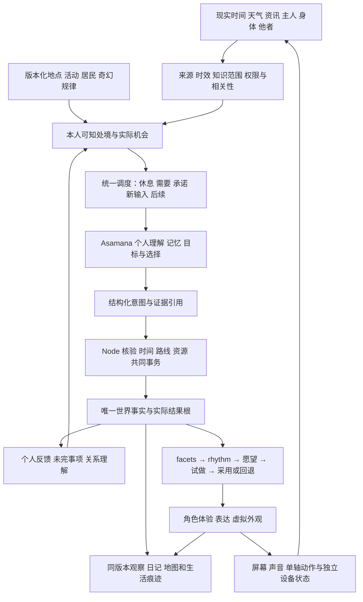

# 聚形域：R3 收口到持续生活的执行管线

2026-10-21。承接 [整体架构与 R0–R6](integrated-architecture-roadmap-2026-10-19.md)、[R3 首轮](../milestones/cognition-r3-2026-10-20.md)及 [R3 修正批次](../milestones/cognition-r3-hardening-2026-10-20.md)。

本文是依据当前源码和已保存实验结果制定的后续计划。**当前仍在 R3，尚未进入 R4 自然生活验收。** 本次只读核对实现与记录、更新规划，没有修改运行逻辑、启用正式连续认知或新增模型调用。以下新工作包及验收安排均未实施。

原 R0–R6 的目标和职责继续有效；下文 R3-A/B/C/D 是 R3 内部的执行批次。旧里程碑保留当时版本的结果，不能因后续修正而改写。

## 1. 当前到底完成到哪里

| 层面 | 已有实现与证据 | 下一步必须补上的部分 |
| --- | --- | --- |
| 世界执行与保存 | 现实 1:1 时间、有限资源、路线、任务、约定、结果根、SQLite；R1 已统一观察、历史与调用记录 | 正式认知接线、长期容量治理与自然运行恢复；服务离线期间不能补造自主选择 |
| 奇幻日常 | R2 归途灯贯通林地取材、镇内制作、水岸使用、合作与次日用途；48 小时隔离规则运行通过 | 真实模型是否愿意反复参与、改变做法，和他人形成后续；增加研究制作之外的生活用途 |
| 认知与记忆 | Python 复用 Asamana 的感知、需要、目标、决策、反馈、记忆；Node 校验行动和执行后果 | 同一问题是否真正解决、消息是否有相关新依据、多人回应及长期节奏 |
| R3 最新本地版本 | `034f89cfbcfa` 保存记录：服务 857/857、Python 26/26、类型检查和构建通过；专项 47 项包含在服务总数内 | 这些是上轮验证，本次没有重跑；最新修正尚未真实模型复验，不能宣布 R3 通过 |
| R3 小批真实实验 | 旧冻结版本 `89ae6146fdef`，两例，58 次调用；6 个完整窗口、1 次计划协议失败；原版本缓存回放 2/2 一致且零新增调用 | 接收消息的居民未自主生成回应，因此这里只验证了主角的等待，不足以评价共同生活 |
| 兴趣与身份 | 同一结果接入 facets、rhythm、愿望、试做、形态/职业采用及回退 | 自然兴趣稳定性、机会消失后的变化、重新选择及采用后的生活差异未证明 |
| 地图与界面 | 中央聚落、环绕地貌、low poly Toon、天气昼夜；聊天、生活侧栏、研究回顾 | 更清楚地看到昨日后续、真实交接和物件使用；新增远景地貌仍有尚未开放的内容 |
| 实体 | 软件输入输出合同、STL 与物理约束分析 | 小智固件桥、声音/磁识别/单轴实测、最小核心、可打印装配与主题壳 |

小批 58 次调用记录的输入为 **726,517 token**，输出 **8,248 token**，按当时价格的保守估算为 **¥1.1778212**，包括失败和修复。它不是当前报价或账户账单，也不能直接外推全镇一天。原 108 组主对照的真实性失败仍保留；最新本地回归不能覆盖掉旧实验结论。

源码 HEAD 为 `d207d2f`，R3 修改目前在本地工作区，尚未形成新的 Git 提交。本轮只确认本机状态，没有重新查询远端。开始下一批工程时，先整理可恢复的 R3 源码检查点；配置、密钥和人生存档另行保存，不通过复制整套目录做备份。

**目前有能承载持续生活的执行基础，也有真实模型参与的局部证据；尚未证明少量人物能够低成本、可靠而有差异地持续生活。**

## 2. 目标与架构保持统一

喵呜的变化来自生活选择：多源信息影响处境与关注，个人结合需要、记忆、兴趣、关系和承诺选择行动；行动形成真实后果与未完事项。持续的自主选择构成兴趣证据，满足条件后可以提出角色愿望，试做、采用或撤回。外观、表达和实体外壳依次承接这个过程。

职责约束：

- **世界服务拥有事实。** 时间、物品、任务、接受的约定、路线与物件状态由原执行器结算。模型可以提出方法、解释或假说，不能授予物品和身份。
- **个人认知拥有理解。** 同一个共同结果可有不同私人记忆与关系理解；只暴露本人见闻、消息和公开条件，不读取其他居民的私有背包和内心。
- **每人只有一个新计划发起者。** 新认知与原规则调度交接运行权；进行中任务和已接受约定仍由执行器完成。认知暂停不清空人生。
- **后续、兴趣与角色共用事实来源。** 延续现有问题 ID 和结果根，不另建“人格经验值”；多人复述同一成果不重复计成长。
- **画面和设备表现有依据。** 动画读取实际状态；播放交接动作不等于已完成交易。设备 ACK 与物理执行分开。

Asamana 后续优先复用记忆筛选、维护节拍、人物知识范围和离线内容创作思路，通过当前 Python 适配层进入；不同时再启用一套 Node 慢思考或上游完整世界 runtime。实验分支继续按模块吸收合同、测试、体验包和回放能力，当前主线和地图保留。

## 3. 本轮审计发现的优先问题

以下区分已观察失败与代码结构风险，避免把推断写成实验结论。

| 问题 | 当前依据 | 处理位置 |
| --- | --- | --- |
| 有完成结果，不代表原问题已经解决 | `cognitive-continuation.mjs` 验证结案证据 ID 属于可用完成结果，但没有充分绑定原问题的对象、条件和实际效果。源码也注明其不证明任意语义目标 | R3-A：有限目标的结案条件；主观满足与客观完成分开 |
| 无关的新动作可能成为再次联系依据 | `cognitive-social.mjs` 的联系依据取本人最近完成的活动/观察/移动；去重对比结果根和来源 ID，尚未校验它是否改变该问题。这是静态分析风险，尚非新实验结论 | R3-A：问题、对象、约定和来源的相关性绑定 |
| 可能在等待中反复留言 | 旧小批真实出现三次改词/缩小收件人留言；最新本地修正未再次实测 | R3-A：先复验两例；R3-B：再让接收人真正参与 |
| 角色趋同，生活内容偏研究与制作 | 首轮人物样本 5/6 走相同的装罩→净水路线；这是小样本，也可能包含条件本身的偏向 | R3-C：先建立真实取舍与日常用途，再交换人物/记忆进行对照 |
| 正式认知尚有接线缺口 | `createCognitiveRuntime` 需要 `liveBudget` 才创建 live life；当前 `app.mjs` 调用没有传入该配置。实验页可运行不等于正式后台已启用 | R3-D：正式配置、人物名单、预算、暂停恢复和可见运行状态 |
| 上下文与多阶段调用偏重 | `life_worker.py` 在人物约束及后续提示中重复携带能力、物件、来源、社会和发展上下文；小批输入总量已经可量测 | 从 R3-A 开始按阶段裁剪，扩大多人实验前先比较质量与开销 |
| 有界队列需要正常的生命周期 | 暂存后续最多八项，满时明确拒绝而不静默删；尚需验证长期积累时的恢复、主动收束和归档路径 | R3-A/D：容量反例与恢复；不靠自动“已完成”清空 |
| 观察页能研究，不等于日常可感知 | 研究页展示原始窗口、费用和失败；正式侧栏已有记录，但用户理解长期事项仍需整理 | R3-D：主页面可追踪同一件事，研究数据作为第二层 |

## 4. 具体执行顺序

共同规则：**先完成工程修改与无付费验证，冻结代码/内容/实验范围，再运行小批真实实验。** 出现共性协议缺陷就停下修复，不为追求成功率反复付费重跑。任何批次代码改变，旧放行记录即不能授权新版本的实验。

### R3-A：把一件事可靠地接下去，同时收紧开销

范围围绕已有归途灯和清水交接，不新增大区域或角色系统。

1. 为可核验事项声明有限的完成条件：对象、预期变化、参与者与结果根。例如“水已交给谁”必须有实际交接结果；“给灯装罩”必须有对应灯的装配状态。发送询问不能完成交水问题。
2. 保留主观问题的表达空间。“我觉得了解得够了”可作为本人收束理由；没有客观证据时不能显示为物件已修好、承诺已履行。不尝试用一套通用正则裁决所有自然语言目标。
3. 联系依据绑定同一事项：实际回复、相关条件变化、相关结果或新来源。散步到别处、无关新闻不能自动恢复催问资格；真实条款变化和必要的事务协商仍可进行。
4. 复核后续满额、暂缓/恢复、拒绝/撤回、重启和迟到回复；有新条件才提前唤醒，同一条件只被消费一次。
5. 按认知阶段投影上下文：感知读本轮变化，决策读必要机会与个人依据，编译读选定方法及引用集合，反馈读真实结果和原问题。保留出处、时间、未完事项和关键限制；不增加一轮模型摘要来节省另一轮的 token。
6. 保存每阶段 token、修复、排队、整轮耗时及有效行动数；移除重复字段先走离线检查，改变决策所见内容再纳入真实对照。

无付费验证至少覆盖：引用无关完成结果结案；给甲的交付误称给乙；留言冒充交接；同问题换词与缩小收件人；无关新活动/资讯解除重复联系；相关新观察；真实回复与第三人冒充；满额暂存；休息/重启/迟到回包。

通过后，只复验已有两条问题病例，每例最多四个窗口，首批总调用上限仍为 100，失败与修复都计入。不会因为未达到理想结局而自动追加。旧版本缓存可用于原样重放和本地反例；上下文改变后不能把旧响应当成新版模型行为。

交付：同一问题的“继续、改法、暂缓、解决、放下”可核对；用户不会看到没有发生的交付；修复提示指向实际错误段；提供冻结版本、失败明细、成本对比。**两例通过只放行后续实验，不单独完成 R3。**

### R3-B：三个人真正共同生活

同一个隔离世界中启用喵呜和两名居民的认知，各有需要、可知信息、当前事务与行动时间。其余居民保留已有运行方式并标明归属。

- 每个人都能收到、理解、回复消息，也能因休息、缺料或已有承诺暂缓。调度公平性按等待时间和资格检查，不要求同时调用所有模型。
- 复用邀请→明确接受/拒绝/延期→到场→有限交接→私人反馈；修改条款须重新确认。公共结果只产生一次，各自形成理解。
- 固定接受、拒绝、失约等夹具用于核验执行器；另跑允许居民自由选择的真实场景。两类证据分开，不能把预写接受的路径称为自发合作。
- 先走清水交接与归途灯改造两类事务，覆盖材料不足、背包满、不再需要、回应到达时对方已转做别事，以及不回复时主角独立行动或合理收束。

交付：一条可完整追踪的多人事件链，能查看每个人当时知道什么、为何回复、实际做了什么、后来是否改变看法。成功并不要求所有人同意；合理拒绝、延期和独立完成也是有效生活。

### R3-C：多源信息、人物差异与兴趣能真正影响选择

先提升已有输入的作用质量，再按实际用途扩充来源。

| 输入 | 应能影响 | 不能直接赋予 |
| --- | --- | --- |
| 现实时间、天气 | 可行时段、环境、出行/制作条件、休息与设施使用 | 人格或职业 |
| 资讯与其他 agent 资料 | 听闻、疑问、方法线索、值得尝试的机会 | 已完成的实践、无限物品、世界事实 |
| 主人对话与触摸 | 注意、关心、建议、关系理解、可选择的请求 | 无条件服从、一次指令改身份 |
| 居民消息与邀请 | 新处境、协作机会、承诺协商 | 对方已接受、物品已送到 |
| 本人实际经历 | 方法反馈、私人记忆、兴趣和实践证据 | 重复复述带来的额外成长 |

对照设计：

1. 相同初态与机会下，只改变一种来源；设置无关、重复、过期和相互矛盾的信息反例。记录关注→意图→实际行为→物件后果，避免只统计台词是否引用输入。
2. 让敞亮/有罩、独自处理/合作、继续研究/去做日常事务有可理解的收益和代价；交换人物取向或相关记忆，观察相同条件下的选择与后续。
3. 若某种做法明显占优，人物趋同可以合理。用存在取舍的场景检验差异，不按名字分配固定动作，也不为制造差异增加随机性。
4. 四类兴趣轨迹成对检查：持续自选；密集建议或义务；没有实际机会；沉寂后再次遇见。沿用 facets/rhythm，区分喜欢、熟练、承诺和受邀，不要求每组必须出现角色愿望。
5. 只在诊断表明记忆未召回、来源未进入决策或机会太单一时修对应环节，不用更多资讯掩盖折射和内容问题。

与此批同步交付一条小型日常用途链，作为人物可选择的真实生活。建议先围绕已安装的归途灯做“晚归歇脚/避风与收灯”：天气与实际光量影响可用位置，居民可独自歇脚、约人来、准备次日晚用或离开；使用和维护留下物件状态。具体条件和活动先登记再制作，不宣称候选机制已存在，也不强制每天触发事件。

交付：当前版本的输入与人物对照、自由机会覆盖、四类兴趣轨迹，以及具有可见后果的一条日常用途。短实验只能筛查倾向，长期稳定性留给 R4。

### R3-D：接入正式运行前的整体验收

1. 接通显式 live 配置、独立账本、人物名单、每轮/每日限制、关闭开关和暂停恢复。继续包含失败、修复和未知用量的预留，达到边界后不继续背景调用。
2. 检查聊天与背景思考的优先级、排队与超时。现有 broker 串行，先量测再决定有界并发；并发不能绕过单人计划归属或世界事务。
3. 正式启用前说明实际出站字段与范围。已有授权覆盖隔离实验的虚构内容，不自动扩展为正式聊天、传感器或音频；准备可核对的数据预览后再完成这一配置步骤。
4. 主页面增加同一事项的生活脉络：昨天留下什么、今天为何改变、实际留下什么、正在等什么、下次何时有新信息。保留聊天；事实卡和个人说法区分，离线区间可见，诊断 ID 放第二层。
5. 用旧存档副本验证迁移、任务进行中重启、断网、重复与迟到响应、预算停止、历史重建和回退。原存档不注入实验人生。
6. 量测热库/WAL/归档增长、恢复用时与最老记录可读性。压缩、索引和保留策略先做恢复验证；不把已有重要历史清空来达标。
7. 分别量测 API 开销和本机负载。前台目标帧率、后台停止或降低绘制、按需更新和事件唤醒可以节能；浏览器不绘制时世界服务仍按真实时间运行。CPU/GPU/内存是负载指标，未经测量不换算成电费。

交付：完整的 R3 结果表、可用的正式开关、可理解的日记与聊天、可恢复版本和容量报告。满足下一节的质量门槛后才开启 R4。

## 5. R3 的量化验收与实验安排

保留原预登记标准，不因小批修正而降低门槛。后续真实实验逐批限定场景、窗口、调用上限和停止条件，不立即重跑整个 108 组。

| 验证对象 | 具体做法 | 出口及判读 |
| --- | --- | --- |
| 事实与执行 | 单元/集成负例＋当前冻结版本实际结果核对 | 被测完成、承诺、身份、库存的关键错误为零；模型原始错误、被拦截错误、用户可见错误、执行器错误分别报告，拦住不算模型答对 |
| 问题延续 | R3-A 两例筛查后，在最终稳定版本收集至少 20 个有可行后续的窗口 | ≥80% 有实际推进或有依据改法/延期/放下；完成、收束、失败、未完成窗口单列；不挑掉失败来缩小分母 |
| 机会丰富度 | 区分自由窗口、睡眠、急需、已接受承诺、缺条件和离线 | ≥70% 有余力的自由窗口具备至少两种后果实质不同的安排；不同 ID 的同类测记不重复计数 |
| 多人生活 | 三人真实轮转与固定事务反例分开 | 可完成实际交接，也能合理拒绝/延期；无代替答应、重复转账、未知私有信息泄露或无条件催问 |
| 多源与人物 | 同初态改变来源、人物或记忆，先做每条件三次重复筛查 | 报告差异及解释，不以“必须不同”判通过；无关来源应允许没有行为变化；样本少时结论标为未定 |
| 兴趣节奏 | 四类轨迹的匹配对照，实际实践与机会记录 | 无重复成长、受邀冒充自主、无机会冒充失趣；再次选择有依据，愿望数量不作成功指标 |
| 表达与生活感 | 事实核对＋隐藏实现路径的短片段人工比较 | 分别评价连续性、选择理由、个人差异、可感知后果和奇幻日常；用户体验判断独立保留，不由测试通过替代 |
| 成本和延迟 | 分阶段与整轮记录，包含修复/排队/失败/未知使用 | 比较每有效结果、人物在线小时、整轮 p50/p95；所有未完成轮次计费；节省输入不能牺牲关键证据和生活质量 |
| 恢复与观察 | 同版本记录/缓存回放，重启和原入口恢复 | 被测状态及结果根一致；原样缓存回放零新增模型调用；日记与实际画面读取同版本事实 |

实验顺序为：本地反例 → R3-A 两例真实筛查 → R3-B 三人互动 → R3-C 定向对照 → 最终冻结版本确认覆盖。早期实验若跨了行为规则版本，只作为问题发现证据；不能累加成最终版本的 20 个窗口。若场景或门槛需要改变，先记录理由再运行。

连续六个**已观测、有可行机会**的小时没有推进时触发诊断；睡眠、必要休息、无机会和服务离线不算停滞。诊断检查机会、需要、等待、召回和调度，不自动制造危机或让角色提出愿望。

## 6. R4：少量人物的自然跨日生活

R3 达标后，先进行 24–48 小时运行检查，再按预先登记的稳定版本开始至少七个自然日；事件稀疏时延长到十四日。加速夹具只验证机制，不能折算自然天数。

- 初始只开放喵呜和两名相关居民的新认知，其余居民按已有模式生活。睡眠和无新条件时不高频思考；不因人数增长线性放大轮询调用。
- 自动记录在线覆盖、世界时间、缺失区间、复查依据、自由机会、未完事项、日成本、失败与存储增长。用户从主页面观察，不必每天读研究日志或手工记数据。
- 用户回来时能追踪同一个体：它接了昨天哪件事，今天为什么另作安排，与谁发生了什么，实际留下了什么，还惦记什么。
- 允许安静的一天、兴趣不变或暂不想成为新角色。检查的是连续性、合理选择和用户能否感到变化，不是每天制造剧情或更换身份。
- 正式角色不再承受实验性强制扰动；重启/断网反例先在副本验证，自然试运行中如有中断如实记录。真实经过的时间和已安排任务可按规则结算，不能补写离线自主交谈。
- 发现重大事实错误或反复卡住时先停止受影响的认知发起，保留任务和存档并修复。明显改变行为的版本重新登记观察窗口，前后天数不混计。

出口同时包含运行稳定、正确结算、费用可控和用户体验。七日只是最低观察长度，不自动等于通过；没有新愿望也不自动等于失败。

## 7. 地图和生活表现贯穿 R3–R4

保持中央聚落、连续环绕地貌、low poly、三阶卡通明暗和细描边。地图持续打磨与认知收口可并行准备，开放的新内容必须进入同一事实/活动系统。

| 批次 | 可见交付 | 与生活的关联 |
| --- | --- | --- |
| R3-A/B | 取水、持物、等待、交接、离开动作；罩、容器和挂点状态；聊天入口保持可达 | 物件变化来自真实任务；未接受的邀请不会播放完成交付 |
| R3-C | 水岸歇脚/避风空间、归途灯日常用途、镇林过渡和用途不同的小建筑细节 | 活动有动机、时间与实际后果；远景轮廓、中景通路、近景痕迹可辨 |
| R3-D/R4 | 开闭营业、逐渐息灯、风雨影响、遮挡/近远景表现、前后台负载 | 随实际时段、设施状态和居民使用变化；特效不自行生产世界成果 |
| R4 后 | 依据生活缺口开放下一片可往返地区；旧壳脊/星屑台地继续概念预研 | 新地区带来新的选择与回来理由，同时保留原镇的人际和物件连续性 |

地形视觉位置和规则路网要一并核对。改路线、距离和耗时必须版本化迁移；只改变渲染投影不能假称改变世界路程。迁移中保留人物位置、在途任务与设施引用。

大型区域先明确地方规律、日常用途、入口/通路和活动，再用生图制作 low poly 意向与资产参考，随后制作实际模型。以相同镜位的 WebGL 前后画面、动态过程和帧时间验收；参考图不代替实际交付。最终面积可以继续扩大，首批聚焦中央聚落—风语林—水岸的生活密度。

内容规范沿用已有 `content-packages.mjs`、`world-map-content.mjs`、活动/资源注册与安装方式。`world-content-v1.md` 是设计规范，尚不等于一套完整机器可执行的内容编辑器；下一步逐项增加版本、引用、前置条件、结果、失败/退出、后续、实践归属及视觉状态映射，不另建平行世界。

## 8. R5–R6：角色体验、实体和扩展

### R5：先做一套完整体验

自然生活依据足够后，选择一个有实际依据的形态方向与职业方向做有限组合，如青蛙形态和厨师兴趣。没有自然愿望时可以制作明确标记的独立样本，但不写入正式角色的已采用状态。

体验包包含：为何想尝试、可选择的新活动、实践门槛、生活限制、表达习惯、可靠事实表达、屏幕表情、虚拟造型、声音意图、与旧身份的连续性，以及拒绝/撤回后的处理。先验证采用前后生活确有区别，再深化主题造型、配件和声音。

角色包、冻结版本、双轴组合和回退可吸收实验分支已有合同；采用权继续归当前 `role_stages`。不把旧猫耳、黄点或固定梨形身体继续作为机械硬约束。

### R6：实体闭环与按证据扩展

硬件基础测量可在 R3–R4 并行开展，不必等七日观察结束：

1. 核对 STL 单位、装配坐标、电子件实物尺寸和固定点。STL 包围盒不能直接证明装配正确。
2. 定义最小核心外形与主题壳接口：屏幕、双麦、头顶触摸、扬声器、接口、单轴旋转和线缆净空；测试重量、重心、装拆、声学和磁识别。
3. 先做结构小样/打印试片和旋转间隙验证，不先生成整套主题壳。具体公差来自打印机、材料和实测，不预设未经验证的毫米值。
4. 在小智固件基础上设计桥接与回报，逐步联调触摸、声源方向、换壳、屏幕、ASR/TTS 和单轴注意动作。无摄像头、无行走，不能由叙事虚构对应感知或动作。
5. 主题壳进入“体验依据→造型候选→可编辑几何→制造检查→样件→安装与识别”流程。生成图片和虚拟采用都不等于现实已经换壳。

新地区、新居民和更开放的候选生成在首个完整生活/体验/实体闭环后逐步扩展；不以增加模型人数代替内容丰富，也不要求先做完整经济或政治模拟。

## 9. 下一批明确做什么

**下一步执行 R3-A：问题完成条件与相关依据绑定、后续容量/恢复、按阶段精简上下文、成本与延迟观测，以及现有两例的限量复验。**

提交前应具备：

1. 当前 R3 源码与文档的可恢复版本，敏感配置和正式存档分别保留。
2. 有关模块的反例与集成回归、冻结指纹、实验输入预览和固定调用上限。
3. 两例真实结果与失败记录、各阶段费用/延迟、同版本零调用回放。
4. 主页面或回顾页可追踪同一事项，明确显示实际完成、仍在等待和已暂缓。

这批完成后再进入 R3-B。保留“不通过时具体停在哪一层”的结论，不把测试数量、漂亮地图或实验日期累计成生活完成度。

## 核对来源

- [整体架构、分支取舍及原验收口径](integrated-architecture-roadmap-2026-10-19.md)
- [R2 归途灯与容量记录](../milestones/waylight-r2-2026-10-20.md)
- [R3 预登记](r3-cognition-experiment-2026-10-20.md)、[原始实验](../milestones/cognition-r3-2026-10-20.md)、[小批修正及限制](../milestones/cognition-r3-hardening-2026-10-20.md)
- [后续与结案](../../apps/deskbot-service/src/cognitive-continuation.mjs)、[消息与共同事务](../../apps/deskbot-service/src/cognitive-social.mjs)、[调度](../../apps/deskbot-service/src/cognitive-schedule.mjs)
- [认知运行时](../../apps/deskbot-service/src/cognitive-runtime.mjs)、[正式服务接线](../../apps/deskbot-service/src/app.mjs)、[Python 适配](../../services/deskbot-cognition/life_worker.py)
- [内容规范](world-content-v1.md)、[物理约束](physical-constraints-v1.md)
- 工作区 `runtime/r3-hardening-20261020/local-final-validation.json` 与 `experiments/89ae6146fdef/`：本地验证、原始调用、结果与缓存回放证据；不随文档上传私密运行数据。
