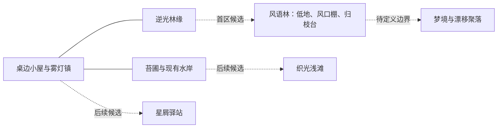

# 聚形域世界与风语林首区草案

2026-10-12 · 6A 并行概念设计 · 本文的新区域、规律与内容尚未实现

雾灯镇是聚形域中已经有人生活的聚落。更远的地方可以容纳光粒凝聚的古怪造物、不同的风景与地方习惯。世界设计要让喵呜有出门的理由、在场的生活、留在那里的事情，以及回家的联系。初始猫型是它当前的造型，未来角色仍由兴趣、前提和本人选择进入试做。

## 世界基底

1. **共通基础：** 正式世界共用上海现实 1:1 时钟、持久身份与行动后果。光粒造物具有有限材料、凝聚和维护条件，具体规律由区域内容和执行器定义。
2. **地方差异：** 苔圃的明暗、水岸的回声和广场的余辉已经有实际规则；林深、星空和梦境可形成不同的探索方式。地区间的资源、传闻和居民往来把生活接在一起。
3. **可探索的未知：** 背景传说、个人猜测、现场观察与正式测记保留各自来源。角色可以理解不同、试错或修正，世界不按任意说法改写规律。
4. **故事的发生：** 作者提供习惯、旧物、尚未解释的痕迹和机会。角色如何安排、是否合作、是否持续返回以及后来留下什么，由实际选择和执行形成，不预定它必须成为哪一种角色。

## 空间关系草案

下图为概念空间，通路、位置、访问条件与耗时尚待 6B 地图合同设计；它不是当前可行路线。

熟悉的镇内日常先深化，再逐批开放边缘。远方可以通过可识别的传闻和远景出现；可进入时再安装实际内容。正式观测期间保持地图版本稳定，扩建保留旧地点、对象和人生引用。

## 首区候选 风语林

这是逆光林缘之外一个可以反复返回的小区域，工作名和美术方向尚待评审。它不承担所有森林角色的变形入口，也不规定去过这里就喜欢森林。

| 部分 | 地方特色与生活用途 | 需要实现的条件和后果 |
| --- | --- | --- |
| 林间低地 | 树冠间有缓慢漂移的光叶；可安静观察、休息、照料并记录前后差异 | 实际光照、风、潮湿、可观察对象和有限恢复；休息不算研究成果 |
| 风口棚 | 旧架子与不同遮挡方式留下材料痕迹，适合制作和比较自己的收集架 | 有限材料、设施容量、制作/安装/调节/测记/维护/收起；每件造物绑定本人实际任务 |
| 归枝台 | 居民可以整理带来的东西、交换材料、讲述不同见闻 | 实际到场、随身材料、明确交接及各自消息；故事不会自动赠送物品或建立承诺 |

候选规律：风、遮挡与光照会改变光叶纹路的显现和收集条件。6B 需要先设计能被观察区分的变量、稳定/变化窗口和有限结果，再确定具体规则。当前尚无该物理规则、材料和测记能力，不将本文文字当作运行事实。

## 第一条可生活的事务

“想弄清这片林子在不同风光下留下什么纹路”只是一个入口。它可因消息、旧经历、朋友邀请或自主探索而被注意，也可以没有兴趣、只来休息或与朋友见面。

| 步骤 | 可选择的经过 | 回顾与表现 |
| --- | --- | --- |
| 发现与前往 | 有权限的消息、林缘观察或个人想法；确认通路和时间，决定前往、暂缓或先准备 | 清楚呈现为什么出门，旅行实际耗时与抵达 |
| 在场生活 | 观察、休息、与居民交谈、整理材料，或制作不同用途的有限收集架 | 普通日常也有动作和状态；不每次强迫进入研究 |
| 留下造物 | 沿工坊与当地设施制作、携带和安装；也可求助、改办法或收束 | 架子、工具、安装位置和当前状态来自实际结果 |
| 复看与试验 | 在明确窗口回来测记；天气或条件改变可调整方法或暂缓 | 前后记录与痕迹可比较，问题与出处不会因等待而丢失 |
| 带回与分享 | 实际收起或交接材料、讲述自己知道的部分；他人可以有不同看法 | 家与镇里看得到带回之物；个人印象不修改对方记忆 |
| 后来继续 | 维护、留种、再次观察、独自或共同返回，或明确放下 | 自主返回、需要、受邀和义务分别进入原发展账本 |

此链需要与现有苗圃、工坊、水岸或夜灯至少一条链形成实际用途连接，避免成为一次性参观区域。最后选择哪种连接，以内容卡和有限材料循环评审为准。

## 人物与视觉设计交付

首区先安排已有居民的合理往来，给其欲望、顾虑、主要事务和休息留位置。观察者、照料者和修补者可以有不同理由和做法；不是给每个人换一句同功能台词。新增人物须有完整生活与表达依据，再计入运行容量。

空间延续现有可触碰的 low-poly 基础，增加局部材质、层次、工具、造物痕迹与可辨认动态。光粒、风中摆动、逐渐亮暗和湿润变化要对应状态；模型描述不会直接生成场景成果。6B 交付真实地形、道路、区域摆放和过程动作，并核对路线坐标、遮挡、相机与昼夜表现。

完整人物、表情、声音与主题打印壳另按身体结构联合设计。原猫耳、胸口光核或比例属于当前数字样本，物理锚点优先核对内部安装、圆屏、麦孔、触摸、接口及单轴运动净空。

## 6B 前置评审

- 地区特色能否从实际方法和后果看出，并允许安静、探索、交往与维护？
- 同一规律在不同天气、材料、伙伴和旧经历下是否带来不同经过？
- 资源和状态能否连接镇内生活，支持后来返回，又不强迫每天忙碌？
- 拓扑、旅行时间、执行条件、视觉位置、来源与恢复能否保持一致？
- 内容的新鲜感与持续兴趣能否在后续对照中分别观察？

具体执行与验收顺序沿 [故事与地图拓展排期](shaping-field-expansion-roadmap-v1.md)。此草案用于下一阶段评审，6A 仍先完成连续性修正及固定失败案例核对。
