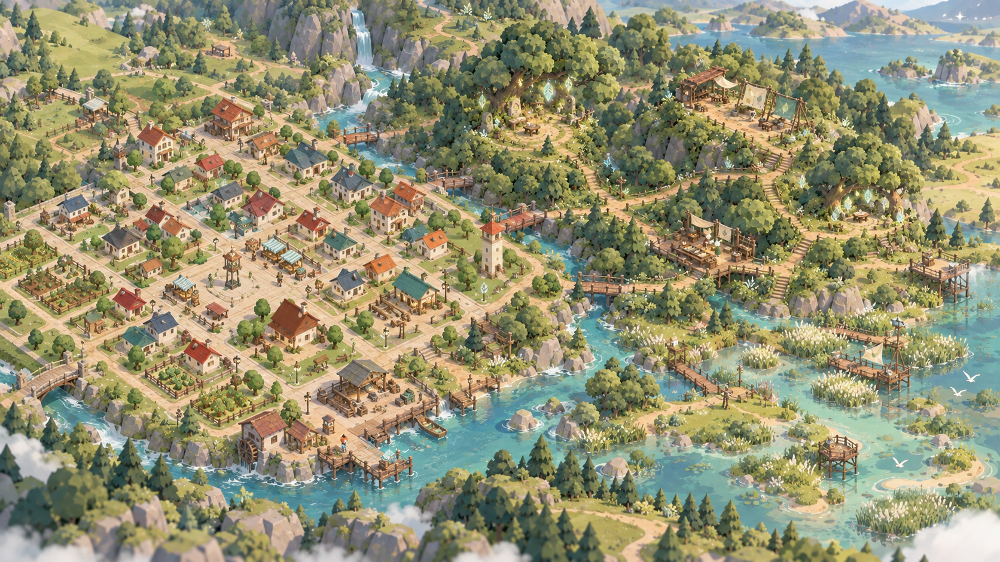
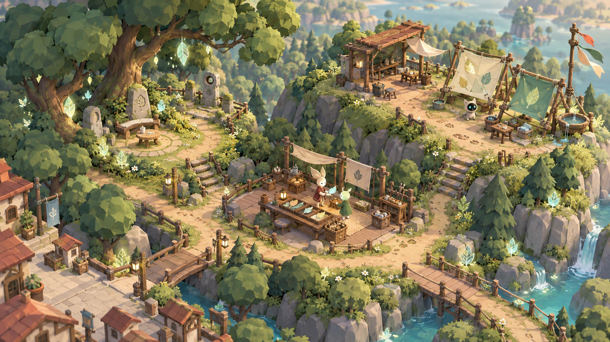
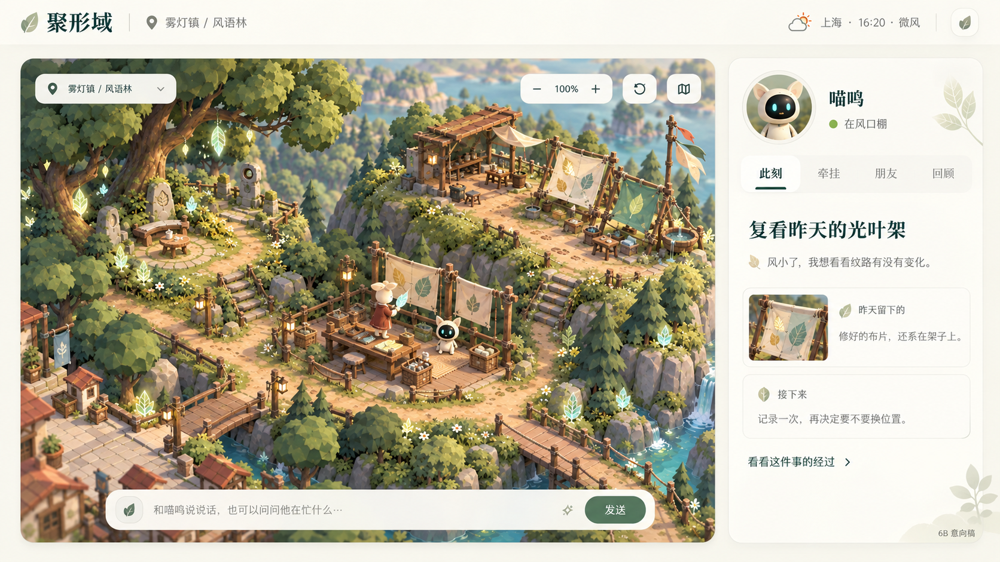
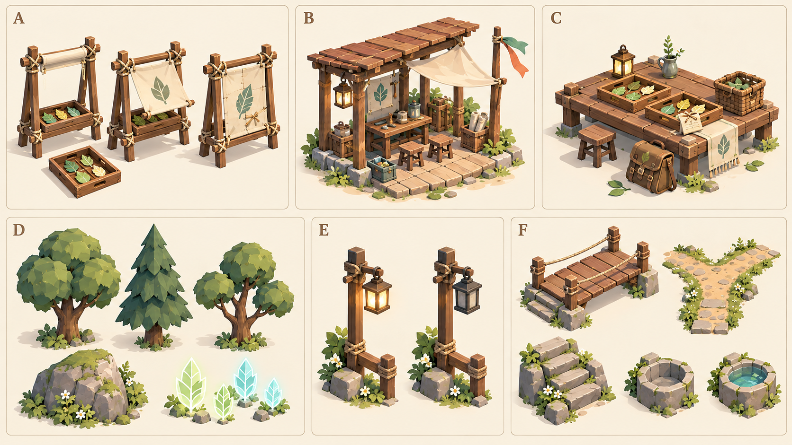
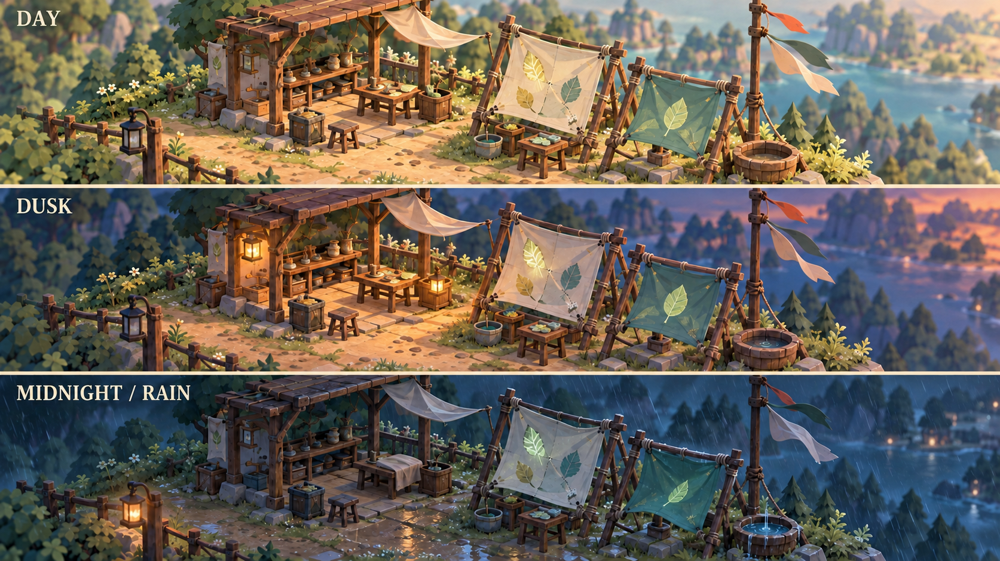

# 6B 聚形域首区与日常界面实施方案

2026-10-12 起草，2026-10-13 首批落地 · 计划与视觉参考

实施更新：6B.1 内容卡、6B.2 首批实际地图、有限活动、low poly 模型和日常界面已接入本地正式世界。[实际截图与验证](../milestones/shaping-field-stage6b-first-region-v1.md)、[内容与资产合同](windleaf-content-v1.md)记录交付范围。下面的生图仍是原方向参考，完整美术深化、6B.3 人物差异与自然生活质量没有因此自动验收。

6B 的目标是完成一个能够真正生活、留下痕迹并反复返回的新区域，同时把日常界面做得清楚、可感知。首区暂用“风语林”工作名，接在现有逆光林地之外；三处生活空间与镇内材料、人物和经历相连。具体名称、奇幻规律、地形尺度和细节以内容卡及实现复核为准。

本方案沿 [原排期](shaping-field-expansion-roadmap-v1.md) 细化，承接 [6A 修正](../milestones/asamana-cognition-stage6a-v1.md)、[世界草案](shaping-field-world-sketch-v1.md)与 [内容规范](world-content-v1.md)。本轮使用内置 image_gen 完成五张选用参考，包含补充的扩展总图，并校正状态图的白天路灯；[完整提示词与来源](6b-image-prompts-v1.md)保留生成方式与引用。

## 全图尺度与分批制作范围

初版把“一个地点、三个区域”直接写成首区范围，未交代整个地图与资产覆盖，范围表述过窄。风语林近景图只表达三处生活空间的细节；它不替代现有镇区，也不限定聚形域只有这个大小。六组资产图同样是首区状态组件的例子，不是全地图资产清单。

补充总图表达“熟悉镇区 + 林地生活区 + 水岸连接 + 后续远方”的连续地理关系。现有完整镇区是尺度基准，新旧建筑和树木使用一致尺度；不通过缩小镇区或人物制造地图变大。图片不是现有地图的精确复制，楼栋数量、桥梁、水磨坊与水域布局不作为当前设施或资源来源，最终以稳定地点、正式地形和路线评审为准。

| 层次 | 制作范围 | 开放与生活依据 |
| --- | --- | --- |
| 现有雾灯镇 | 保留全部既有地点、区域、道路和居民事务；按资产风格逐步补足局部细节 | 原存档与任务连续；家、苗圃、工坊、市场、水岸仍有用途 |
| 6B 风语林及过渡带 | 一片具有林缘、低地、风口、溪侧与回镇路径的完整林地；三处核心活动空间分布其中，不能挤成一座小院 | 地形连通、可往返路线与设施实际制作；三处先完成不同条件、行动与留痕，再按内容卡增加节点 |
| 水岸与织光浅滩候选 | 总图保留连接和拓展空间；6B 完成必要的林地溪侧与镇区过渡，其余浅滩另批交付 | 远景、岸线装饰与可进入范围分别注明；资源、通路、活动接齐才开放 |
| 星空、梦境等远方 | 保留在世界级规划与故事认识范围；不限定整个世界为第一张图 | 后续独立规则与内容版本，不在 6B 伪装成可进入区域 |

空间设计先以现有镇区可行走范围为参照，比较新林地的实际路径长度、分岔、地形和有效活动空间，内容卡冻结时确定尺寸。当前图没有地形测量数据，不能从画面像素或建筑数量换算面积倍数。6B 的交付目标是镇区以外有一个完整生活区，并保留后续扩展接口；不是无限地图，也不是先把镇区压成三栋房子。

面积扩展必须同时增加环境差异和选择：林间与风口在风、遮蔽、潮湿及观察条件上有区别，溪侧与镇内资源和往来相连。路途中可以停留或改道，昨天留下的物件有明确位置。单纯复制树木、铺大地面或增加标点不计为新生活内容；装饰树林也不自动成为可采集库存。

工程上先解决地图边界。现有场景是 120×120 网格，兼容坐标层把地点元数据限制在 0–100，并限定 `jev-town-map-v1` 展示点在 10–110。扩建需要明确新地理/展示版本与范围，把旧坐标变换、路线/耗时、场景投影、相机边界和存档迁移一起验证；只扩大后端坐标会被现有转换截断。现有行为数据、地点 ID 和旧物关系保留，详细方案进入 6B.2-1。

## 美术约束：沿用现有 low poly，以运行场景定效果

用户确认继续沿用 low poly，便于不同奇幻方向共享风格和资产。现有 `buildScene.ts` 已使用盒体、楔形屋顶、低分段圆柱/锥体和多面体树冠构造场景，并通过几何合批、实例化窗口等减少绘制成本；`TownScene3D.tsx` 使用正交相机与实际光照。6B 沿这条实现路线扩展，不把生图中较密的植被、木纹、瓦片和花草逐件复制到运行世界。

| 方面 | 正式场景的制作约束 |
| --- | --- |
| 造型与配色 | 简洁而明确的轮廓、可见的低面数形体、统一色板；树种、屋顶和设施靠形体/色块差异识别 |
| 精致感 | 来自比例、构图、道路与高差、少量功能细节、使用痕迹和状态变化；远景减少细件，近景保留可理解的部件 |
| 奇幻感 | 光叶纹样、有限光粒、凝聚造物与局部色彩；发光依据状态，不能用遍地霓虹或粒子遮挡活动 |
| 动态 | 风带/叶簇轻动、水面/水位、灯光渐变、收集架开合、覆盖/收起、人物动作；共享环境输入和实际任务状态 |
| 静态与可动件 | 静态地形/建筑/植被优先合批或实例化；需要开合、取放、修补的部件保持独立，不能为合批破坏交互 |
| 渲染与范围 | 大地图不等于全图同时显示全部近景细节或运行所有动态；验证远近可见性、阴影范围、材质/灯数及资源释放 |

完整地图制作前增加一个**实际引擎样板片区**：一段镇区到林缘的路、一处低地/高差、一棵或一组树、一个工作棚、一套收集架与雨盆，加现有喵呜的行走/停留表现。样板使用正式 Three.js 构造和状态接口，不用概念图充当背景。先对比白天、傍晚、午夜雨风以及开合、收工、缺材料等状态，再复制同一套模块制作完整林地。

样板验收同时看全图、正常生活视角和近景：全图路线清楚，日常视角能辨认人物与正在做的事，近景能看见实际部件与留痕。记录相同设备与相机下的帧时长分布、绘制调用、三角形、活跃灯/粒子、加载时间和驻留资源；先取得现有场景基线，再确定新增预算，不预先宣称生图密度能流畅运行。先交运行截图/状态比较及测量，再批量扩建，避免到整图完成后才发现风格或性能不合适。

## 首批核心活动空间

首批三个核心活动区域用于验证生活闭环，不作为地面面积上限，也不作为最终地点数量上限。它们位于完整林地内，并通过过渡地形与镇区相连；新增地点和通路的注册粒度以空间及活动内容卡确定。先深化既有居民的往来和选择，首轮按喵呜与两位已有居民组织案例，具体运行人数由第六阶段成本实验决定。更远的星空、梦境与完整织光浅滩继续分批制作。

| 空间 | 生活用途 | 运行与场景要表现什么 |
| --- | --- | --- |
| 林间低地 | 观察、休息、照料、复看和独自停留 | 光照与潮湿、可观察对象、光叶变化、安静活动与留痕 |
| 风口棚 | 制作、安装、调节、测记、修补和收起自己的造物 | 收集架开合、布片随风、工具使用、损耗与实际修补、雨水容器 |
| 归枝台 | 整理、交接、分享、协商与返回前准备 | 实际携带的物品、托盘与标记、双方明确的交接、各自视角 |

早期候选单一地点 ID `windleaf-grove` 未采用。首批实际登记 `windleaf-edge`、`windleaf-lowland`、`windleaf-shelter`、`windleaf-return-platform` 四个地点，各自有内部区域，入口分别接原逆光林地与潮痕旧路。旅行走正式通路与真实耗时；实际坐标和地形见内容卡。溪流装饰不授予取水库存，未制作桥段不作为可行通路。

## 参考一 首区局部近景

采用可触碰的低多边形造型基础，增加地形层次、明确路径、局部材质和使用痕迹。奇幻落在发光叶纹、收集架与造物之间的关系里。图中相互连通的三个空间用于评审生活布局，不是最终路线、碰撞或相机数据。

参考图细节密度高于现实现：实际制作要减少远景植物、重复使用树冠/栏杆/石块，近景再保留修补缝、工具与叶纹。微小纹理优先由共享材质表达，避免逐个建模。图片中的角色与猫耳只是比例参照，完整形象和打印壳仍待独立联合设计。

## 参考二 日常界面

主画面约占桌面可用宽度的七成，侧栏保留喵呜和少量生活信息。聊天常驻，不因展开回顾或缩放地图消失。字号、对比度、键盘焦点和窄屏布局以原生界面实现，生图文字不作为最终排版或功能代码。

| 界面部分 | 6B 改动 | 数据与交互依据 |
| --- | --- | --- |
| 顶栏 | 缩小大标题；保留聚形域、当前地点、现实时间与天气 | 原地图、时钟与来源状态；失效数据清楚呈现 |
| 世界主视口 | 更清楚的近景焦点、简单地图控制、按需地点提示 | 同一场景坐标、真实位置和任务；未到达不显示已抵达 |
| 此刻 | 当前实际在做什么、一句可理解的理由和状态 | 任务与个人选择；等待/打算和执行分别说明 |
| 牵挂 | 昨天留下的物件、问题与朋友事务，复查/暂缓原因 | 同一后续编号、最初依据、最新实际结果；不靠预写文本制造过去 |
| 朋友 | 当前可见或有实际交往的居民、明确约定和各自关系理解 | 公共位置与本人记录；不展示伙伴私有需要或记忆 |
| 回顾 | 为什么改变安排、哪些已经发生、还有什么未兑现 | 实际结果与个人理解分层；开发审计保留在第二层 |
| 聊天 | 常驻输入、历史与发送状态；在侧栏和地图操作后仍能交流 | 保留现有发送/错误/历史流程；图中文案只是虚构示例 |

窄屏把侧栏改为可展开的生活面板，聊天入口始终可见；不要求在手机上照搬桌面双栏。逐项核对当前聊天、生活观察、人物选择、角色愿望与试做入口，避免界面更新丢失已有能力。

## 参考三 模型与造物拆分

图中的 A–F 是可动和可持久对象的拆分示例，实际资产清单覆盖整个新旧地图。先统计现有几何、材质和可复用部件，再建立族类、变体、状态、实例数量与近远景预算，避免把每棵树都当独立新模型，也避免只有六件道具而没有区域环境。

| 全图资产族类 | 需要覆盖的部件与变化 |
| --- | --- |
| 地形与地表 | 镇区边缘、林缘、林间低地、坡地、溪岸；草土石、湿润与踩踏痕迹 |
| 通路与跨越 | 主路、分岔、林径、台阶、桥段、护栏；路线真实可达，连接处无断路 |
| 镇内建筑与生活设施 | 既有住宅、广场、市场、苗圃、工坊与水岸空间；统一基础风格并保留功能差异 |
| 植物与生态 | 多种树冠/树干、灌木、地被、苔、光叶、溪侧植物；生长与发光状态按已实现规则接入 |
| 林地设施与造物 | 工作棚、观察/休息点、收集架、归枝台、盆、托盘；可使用、维护、覆盖与收起 |
| 生活道具与痕迹 | 材料、工具、容器、储放、携带物、修补件、个人标记；与持有、消耗和实际结果相连 |
| 水、光与天气表现 | 岸线、水面、水位、路径灯、工作灯、风带、雨与有限光粒；共用环境与工作状态 |
| 人物活动表现 | 前往、停留、观察、使用工具、搬运、整理、交接和收工；正式动作范围与任务同步 |

这八类是资产覆盖要求，首批交付与结构计数已在内容卡和验收报告中列出。更多地被、桥段、人物动作与造物变体仍待后续深化；基础网格、实例与动态部件分别计数，不能从生图里的微小细节推定全部都会建模。

| 资产组 | 模型与状态拆分 | 依赖 |
| --- | --- | --- |
| A 收集架 | 木架、可移托盘、可动布片、修补层；开/半合/合、使用与收起 | 本人资产、材料、动作、实际状态与任务 |
| B 风口棚 | 重复立柱、屋顶、工作台、工具与风带 | 设施容量、使用者、天气和收工状态 |
| C 归枝台 | 台面、座凳、篮子、样品托盘、携带物和标记 | 持有者、真实放置与交接；标记不凭空制造样品 |
| D 环境件 | 少量树形、石块、地被与局部光叶 | 可复用几何、共享材质、分层细节与有限光粒 |
| E 灯与路标 | 非发光外壳、发光部位、光源；亮/灭/渐变 | 实际工作和安全照明状态；OFF 时发光材质和光源同时关闭 |
| F 道路与雨盆 | 桥段、分岔路、阶梯、雨盆、水面与湿润层 | 路线、地形、实际水位和天气；装饰水面不授予库存 |

优先沿现有 Three.js low poly 场景构造方式制作共享几何和状态组件；如使用外部建模再明确 glTF/GLB、命名、原点、缩放和材质接口。生图文件不转述为已经生成 3D 模型，更不作为打印外壳的结构或公差文件。

## 参考四 时间天气与经营状态

| 情境 | 光照与灯 | 动态与痕迹 |
| --- | --- | --- |
| 白天 | 环境日光为主；无需的人工灯关闭 | 布边与风带轻动，叶纹与实际状态对应 |
| 傍晚仍在使用 | 日光减弱，使用中的工作区逐渐点亮 | 人物还在工作时保留工具和现场节奏 |
| 午夜收工、雨风 | 工作灯渐灭，保留必要的有限路径照明 | 工具收好、样品覆盖、布带风动、木面湿润与雨盆水位变化 |

灯光由时间、环境和实际使用状态共同决定；有人夜间继续工作时不能仅因“午夜”自动关灯。渐变是既定状态的呈现，不提前提交收工或入睡。图像存在轻微几何变化，正式实现用同一套模型和状态投影验证，不以切换三张背景图片代替动态世界。

## 分步实施与每步出口

| 顺序 | 工作包 | 必交付内容 | 可验收的结果 |
| --- | --- | --- | --- |
| 6B.1 方向与内容卡 | 扩展总图、局部参考、区域布局、界面层级；清点全图资产，细化光叶规律、资源来源、居民理由和故事机会 | 现有镇区尺度基准、首区尺寸/路径草案、资产族类/变体/状态/实例清单、活动与后续卡、假说/背景/规则区分 | 每个区域能说明生活用途、选择与后果；总图、近景和开放范围一致 |
| 6B.2-1 地形与空间验证 | 先处理现有边界/坐标限制；正式路线、地图扩展与存档迁移；完整林地、回镇过渡、道路、平台和设施的基础模型 | 新旧地理/展示变换、可行路径、实际旅行、相机/缩放/遮挡/标记、旧地点保留 | 镇区保持原有尺度与事务，能真正走进首区与返回；服务坐标、旅行动画和场景位置一致 |
| 6B.2-2 奇幻规律与有限活动 | 把候选规律落实为可核验变量、测记与方法；沿原资源与任务执行器接入 | 观察、制作、安装、调节、测记、修补、收起等第一批方法；明确材料和时窗 | 同一问题有不同做法；失败能说明条件；没有用台词补成果 |
| 6B.2-3 状态模型与过程表现 | 先验收原生 low poly 样板片区，再按资产组批量制作模型、材质和动作；接入光照、风雨和工作灯 | 样板运行截图/状态比较/性能基线；开始/进行/暂停/受阻/结束，以及本人造物和后来变化 | 样板在全图/日常/近景均清楚；操作一处布片、样品或水位，画面与任务、结果一致，能看懂昨天留下的东西 |
| 6B.2-4 日常界面落地 | 原生实现顶栏、生活侧栏、常驻聊天、近景提示和窄屏布局 | 世界、聊天、此刻/牵挂/朋友/回顾；保留旧入口与错误状态 | 用户不翻审计日志也能看懂当前活动与后续；键盘、窄屏和长文本可用 |
| 6B.3 共同生活与人物深化 | 深化首批已有居民，与工坊/苗圃/水岸/夜灯至少一条链产生实际连接 | 前往、不同选择、材料/成果往来、协商、复看和自主暂缓 | 同一前态有不同合理经过；邀请、答应、履约和各自记忆可追溯 |
| 6B 出口 整体验收 | 隔离回放、少量模型对照、场景检查、恢复与性能测量 | 同一内容版本的证据、失败、费用、延迟和画面 | 达到首区生活闭环入口，再交 6C 兴趣/愿望与 6D 综合对照；不替代自然七日 |

保留原排期的 6B.1 世界设计、6B.2 首区实际制作和 6B.3 人物深化编号。6B.2-1 空间与 6B.2-2 规则可以在同一内容卡冻结后并行推进；状态字段及动作接口确定后进入完整表现。6B.2-4 界面可先针对既有世界做原生布局验证，再接新区域。发生规则或形状改动时同步更新内容卡和场景状态，不把最后接线当成独立收尾。

## 首条生活闭环与方法范围

第一条事务暂定“昨天留下的收集架，今天的纹路有什么变化”。机会可来自实际旧物、消息、天气或自主探索；用户建议会影响它，但不自动安排或保证持续兴趣。

1. 决定先观察、准备、前往或暂缓；旅行真实耗时。
2. 在当地休息、与居民交换见闻，或选择制作并安装造物。
3. 开合、换材料或位置等方法只开放已有可核验规则；没有条件时可以求助或离开。
4. 等到明确窗口，实际测记并比较；天气变化或伙伴的不同办法可形成变体。
5. 留下需要维护的造物，或实际收起、带回、交接；改动持久保留。
6. 后来按原问题返回、改变做法或明确收束；接触、主动返回、义务与需要分别进入原兴趣账本。

首批光叶凝聚、蓄光、纹路、潮湿、损耗与恢复公式已在内容卡及 `windleaf-life.mjs` 固定实现；后续材料变体沿相同合同增加。木料、布、紧固件和托盘复用原库存；新材料具有明确来源、容量与消耗，任何实验前态初始化单独注明。

## 验收矩阵

至少覆盖晴天/风起/雨天、白天/傍晚使用中/午夜收工、材料充足/缺料、独自/受邀/明确合作、前往/取消/受阻/恢复、旧物仍在/物件已改变。使用有针对性的覆盖组合，先不穷举全部交叉或让每个居民全天调用模型。

- **事实合同：** 重复结果不重复计实践，取消和重启不生成免费物件，过去版本可追溯，私人视角不泄漏。
- **选择与后续：** 当有余力时有至少两种实质不同安排；同一问题能换办法、返回或明确暂缓；新地图不会自动发放角色资格。
- **可感知性：** 从画面能指出正在做什么、改变了哪个对象、昨天留下什么；未到达、尚在等待与实际完成可区分。
- **表现：** 灯光、风带、布片、水位、湿润与工作动作读取相同状态；无任务时允许安静，动效不持续抢夺注意。
- **界面：** 聊天始终可达，角色发展与旧生活入口保留；窄屏、键盘与错误反馈核验。
- **性能：** 与既有场景在同一设备/相机下比较首次加载、帧时长、绘制调用、活跃几何/粒子/灯和连续驻留资源，先定基线再设预算。图中的远景密度不直接变成运行资产数量。
- **模型质量：** 案例先固定，提供者费用、重试、失效采用与整轮延迟全部记录；叙述仍有错误时逐项报告，不以任务成功等同全文可靠。

首批内容与场景已依本方案落地；下一批进入居民理由、不同办法、协商与真实模型对照。长时间自然观察前同时处理已测得的存档增长与留存设计。完整人物、表情、声音与实体打印壳保持原后续设计入口。
