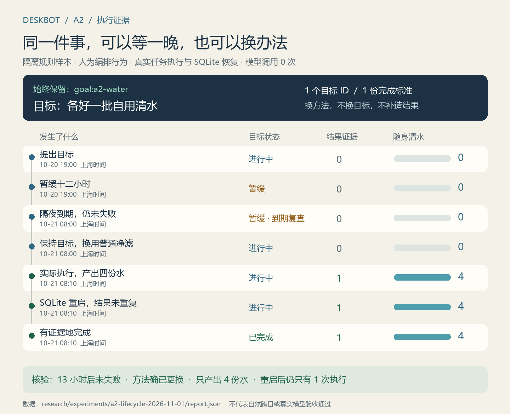

# A2：同一个目标跨方法、跨夜与重启

2026-11-01。承接 [工程交付管线](../design/engineering-delivery-plan-2026-11-01.md) 的 A2。完成范围为目标身份、结果标准、方法、复查与位置来源；地图、角色造型、实体固件及正式新认知启用不在本轮范围。

## 交付结果

新目标协议复用现有 `goal_bindings` 和 Asamana 短期目标队列。Node 固定目标 ID 和完成标准，Python 在原需要/进度调用内提出显式转换。新增方法不会通过近似文本归并，也不会因六小时过去或队列变长自动失败。

自用清水标准允许普通汲水与借灯净滤互换；实验条件保持精确。通知与发送实测字段分开验证，开放研究不能由一次活动结案。个人复查时钟不会改写社交截止，睡眠和工作优先，重复到期提示不循环唤起模型。

位置知识区分亲见、历史亲见、实际告知与未知。来源/时间随线索保存；过时线索不读取远处人物的真实位置来“更新”。共享合同、状态归属、错误分类和接入规范见 [目标与位置接口](../../documentation/cognitive-goal-lifecycle.md)。

图来自 [机器可读记录](../experiments/a2-lifecycle-2026-11-01/report.json)。测试时间为 10 月 20 日 19:00 至次日 08:10（上海）；人为推进 13 小时，并非服务自然运行了一夜。目标和标准各只有一个：先考虑借灯、暂缓、次日改用普通净滤，实际只产出四份水；SQLite 关闭/重开和重复结算后仍仅一项完成任务。

## 验证层次

| 验证 | 本轮结果与边界 |
| --- | --- |
| 生命周期 | 同目标跨方法、跨夜复查、暂缓/恢复/放下、条件不兼容、开放研究不误完成、近义文本独立、同标准复用 ID、历史迁移和禁止降级写入。 |
| 双语言接缝 | Node 与 Python 对同一组转换正反例作相同判断；非法身份、完成声明、时钟和方法被拒绝。 |
| 完整工作进程 | 真实 Python 子进程走感知/目标/决策/执行/反馈，模型回答用固定桩；不是真实 DeepSeek 采样。 |
| 沟通结果 | 实际测记→完成通知→完整摘录：通知不满足“发送读数”，指定摘录送达后才完成；失败反馈与 SQLite 恢复不重做动作。 |
| 位置知识 | 只读投影、不窥远处、实际接收范围、亲见优先、30 分钟陈旧/24 小时未知；初始阈值未校准。 |
| 可重跑样本 | `goal-lifecycle-check.mjs` 执行真实有限配方及 SQLite，输出七个时间点、一个目标/标准/结果，0 次模型调用。 |

完整 `npm test`：架构 4、Python 92、Node 947、语音 16、前端 326，合计 **1,385 项**；类型与生产构建也纳入同一门禁。旧实验回放显式使用旧合同，不改写旧响应或统计。配图由 `scripts/render-a2-evidence.py` 读取上述 JSON 绘制，172 KB 左右；不提交依赖、临时 SQLite 或正式人生数据。

## 离目标还差什么

这次证明的是**程序允许、验证并保存连续选择**，尚未证明模型在长期运行中会自然做出好选择。原真实矩阵 `5cade88ab56a` 仍是完成 18/20、有效 15 个、因关键语义错误停止；本轮没有新增提供者调用，没有提高它的通过率。

下一步 A3：冻结新源码/合同/内容/模型配置，重新运行原四例各五窗口，不接续旧失败窗口凑数。有效至少 16/20 且无关键事实错误才通过；报告所有失败、修复、用量和延迟，关键错误立即停止。之后才依次进入三人双向生活、成熟地区机制包、正式运行与备份恢复、自然多日节奏，以及形态/声音/外壳设计。

已知限制：仅明确声明的清水储备具备跨方法等价，其余具体任务仍使用精确标准；开放研究不自动判定“已理解”；历史目标不会修复旧模型曾经合并的身份。位置时效是初始政策。大量地区接入、生活节奏、上下文大小与全天费用仍需后续测量，不能由单元测试或本样本推断完成。
