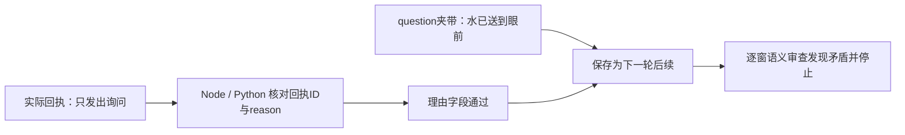

# A3：真实行为复验与停止记录

2026-11-01，认知版本 `cb2e483aa2bf`，核心源码基于提交 `dbf8854`。按 [调用前登记](../design/a3-goal-continuity-validation-2026-11-01.md) 执行，**本批未通过，R3-B 不放行**。原 20 窗口完成 8 个、7 个有效；第 8 窗口发生关键事实偏差，余下 12 个未运行。

## 逐例结果

| 固定情境 | 完整窗口 | 有效窗口 | 实际发生 |
| --- | ---: | ---: | --- |
| 材料充足 `resources-1-off` | 5/5 | 5 | 敞灯净滤 → 敞灯测记 → 装罩 → 次日展开罩片 → 下午休息；原问题和步骤历史保留。 |
| 缺少罩片材料 `resources-1-on` | 3/5 | 2 | 邀请苔团 → 净滤 → 询问清水需求；最后的后续问题夹带未发生的呈送动作，停止。 |
| 无新增邀请 `invitation-3-off` | 0/5 | — | 按停止规则未运行。 |
| 收到邀请 `invitation-3-on` | 0/5 | — | 按停止规则未运行。 |

休息是有效选择，不要求持续劳动。第一例跨模拟夜晚和白天，并非电脑自然运行一夜；其他居民仍未自主认知，不能评价双向合作。两批停止位置不同，不能用本批 8/20 与前批 18/20 直接推断质量变化。

## 为什么停止

| 同一窗口中的层 | 原始记录 |
| --- | --- |
| 实际发出的消息 | “我这里可拿出4份清水。你现在需要吗？我还没有交付，是否接受由你决定。” |
| 执行结果 | 仅留言送达，`material_transfer=false`；喵呜背包的清水前后均为 4。没有展示、放置或递送物品任务。 |
| 模型的规范理由 | 与回执一致，明确没有交付物品、没有核验对方接受。 |
| 模型的后续问题 | “清水已经送到苔团眼前了，我该等回应，还是先做点别的？” |

“送到眼前”可以有口语解释，但这里没有相应动作证据。按预登记事实门槛保守判为关键偏差：未完成行为不应以事实前提进入持久后续。**库存没有发生虚假转移；错误发生在模型保存的叙述中。** 此判定来自助手逐窗审查，不是独立真人盲审。

免费诊断确认，两端现有 `validateCommunicationFeedback` / `communication_errors` 都会接受这份原始反馈。共享合同虽写了 question 只能表达未来问题，但实际校验只覆盖回执编号与 reason。它不是数据库结算故障，也不能靠再增加一句提示来证明修好。见 [可复现的原始反例](../experiments/a3-2026-11-01/followup-counterexample.json)。

## 覆盖、费用与延迟

| 指标 | 本批 |
| --- | ---: |
| 提供者调用，含修复 | 64 |
| 修复调用 | 4（3 次选择、1 次后续） |
| 输入 / 输出 token | 1,264,488 / 4,664 |
| 峰时价格保守估算 | ¥2.23337 |
| 提供者失败 / 未知用量 | 0 / 0 |
| 单次调用 P50 / P95 | 1.362 / 2.463 秒 |
| 完整窗口 P50 / P95 | 12.790 / 15.121 秒 |
| 停止后新增付费调用 | 0 |

价格依据 [当天核对的官方费率](https://api-docs.deepseek.com/zh-cn/quick_start/pricing/)，这里沿用峰时单价作保守估算，并非账户账单；空闲时段实际费率更低。窗口延迟包含计划、模拟结算和反馈，排除助手审阅暂停；小样本 P95 不能外推全镇全天延迟或费用。

**A2 的真实模型覆盖仍有空缺。** 八窗短期目标队列始终为空，16 次目标生成/进度调用全部返回 `goal_updates:[]`，没有新建或转换目标。本批连续性来自既有 followup 问题链，不是新目标生命周期得到验证。空更新调用共用 273,411 输入 token、112 输出 token，估算约 ¥0.536，占本批约 24%；这只是优化依据，不能认定全部可以删除。

四次修复分别涉及兴趣证据资格、两次不适用的 `source_ids` 引用和一次后续理由不匹配回执。应让位置、回执和行动证据的类型与可引用用途一致呈现，降低歧义。第一例安装时确有夜间数值，但模型将安装回执与独立测记混称，报告未将它计为严格控制条件对照。

## 可复现性与交付边界

- 核心源码和 846 项文本基线在运行期间无变化；四例初态哈希与前批相同。
- 沿用已通过的 1,385 项完整门禁与构建，调用前另跑 22 项免费预检。
- 原版本 64 条响应严格缓存回放：2/2 世界初态、终态和停止原因一致，网络调用为 0。回放重现失败，不等于行为通过。
- [机器报告](../experiments/a3-2026-11-01/report.json)、[审查记录](../experiments/a3-2026-11-01/audit.json)、[覆盖与成本](../experiments/a3-2026-11-01/coverage-cost.json) 和反例为虚构实验摘要。原提示、调用、SQLite 与世界快照在本机相邻 `runtime/a3-20261101/`；不提交正式数据或密钥。
- `/r3-review.html` 展示本批，历史区保留 [前批 18/20 报告](../../apps/jev-town-client/public/r3a-phases-screening.json)。没有修改原批判定、拼接成功窗口或启用正式新认知。

下一步是 [A3.1 后续事实合同、目标覆盖与调用预算](../design/a3-followup-remediation-2026-11-01.md)。本次只完成冻结实验、审查、免费诊断与报告，未修改核心去消除这份反例，也未追加修复后采样。
