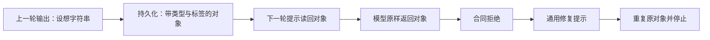

# A3.2：新冻结真实复验与独立目标实验

2026-11-02，按[采样前登记](../design/a32-refrozen-acceptance-2026-11-01.md)完成冻结、离线门禁、有限真实采样、逐窗审阅、停止诊断和同版本回放。**实验已执行，R3-A 验收未通过；正式新认知未启用。**

## 结果

| 分母 | 计划 | 实际结果 | 判定 |
| --- | ---: | --- | --- |
| 原行为矩阵 `70e67a6d129f` | 4 例 × 5 窗 = 20 | 进入 2 窗；完整且有效 1 窗；1 窗反馈失败；18 窗未运行 | 未通过 |
| 目标专项 `ad779612c364` | 4 例、最多 16 窗 | 已准备并离线验证；原矩阵未过，0 窗真实采样 | 全部未覆盖 |
| 标准离线门禁 | 1,399 项 | 架构 4、认知 Python 94、服务 Node 959、语音 16、前端 326；类型检查和生产构建通过 | 工程检查通过，不代替行为验收 |
| 严格缓存回放 | 14 条响应 | 首尾世界哈希及停止原因一致；0 新调用 | 回放通过，失败仍按失败记录 |

原 A3 的 8/20 完整、7 有效保留；不同冻结版本不合并窗口。这一轮只有一个完整窗口，不能推算长期可靠性或对照处理效果。

## 本轮交付

- 冻结从手工维护的依赖清单改为允许目录内的完整源码快照，覆盖 263 个服务、Python/Asamana、合同、地图和预登记文件。修复旧清单遗漏新协议依赖的问题；配置密钥和正式存档不在快照中。
- 四个原场景的世界初态与 A3 完全相同。原矩阵与目标专项有独立版本、预算、分母；失败后不追加抽样。
- 新增 G1 无预置目标、G2 白天改用等价取水方法、G3 睡前目标与 SQLite 关闭重开、G4 实际测记后的开放研究夹具。目标维护与自然形成分别标记。
- 每窗记录目标采用前后状态、真实任务结果和后续意图。跨夜不会重置需要或改写约定截止；目标转换仍由模型提出，夹具不补答案。
- 增加 6 项有实际世界与 SQLite 的夹具/冻结检查，保留每次请求、响应、修复和停止证据。

## 看到了什么

第一窗，喵呜选择向苔团发出聊天邀请，随后想借灯净滤。实际回执明确只有送达，没有对方接受、共同活动或物品交付；“窄缝留光”的想法单独标为未验证。该窗有效。

第二窗，喵呜读回原问题，在没有等到回复时继续净滤，执行器消耗 4 份原水、增加 4 份清水。动作完成且只结算一次；随后反馈阶段的协议失败，反馈未采用，任务仍以 pending 结果保留。它不能算第二个完整窗口。

## 为什么停

模型原输出与一次修复输出完全相同：

```json
{
  "unverified_idea": {
    "text": "也许归途灯的罩片不必全遮……",
    "epistemic": "unverified",
    "label": "未验证设想"
  }
}
```

输出合同要求 `unverified_idea` 是 1～160 字的字符串；上面是服务端保存并读回的对象。模型把上一轮读模型中的形状复制成命令。Node 和 Python 一致拒绝，错误为 `followup_intent_invalid`。



免费探针只把该对象替换成自身的 `text`，其余字段不变，两端编译均通过且世界未改动。**探针不是模型改正后的答案，也没有被采用为正式结果。** 完整原文、提示片段和探针见[捕获反例](../experiments/a32-2026-11-02/followup-shape-counterexample.json)。

此外，新意图提示仍携带旧 `continuation.rule` 中要求 `question/reason` 的说明；新合同只列可选字段名，没有列出设想的机器可读类型；修复只反馈笼统错误。这些属于命令、存储与提示投影的接缝问题。现有拒绝机制奏效，但协议的连续使用仍不够可靠。

## 调用与费用

14 次真实调用，含 1 次修复；178,582 输入、1,059 输出 token，其中输入缓存命中 23,552。供应商失败和未知用量均为 0。按[官方高峰单价](https://api-docs.deepseek.com/zh-cn/quick_start/pricing/)估算上界 **¥0.31947408**，不等同于账户账单。

单次调用中位数 1.230 秒、P95 4.032 秒；两窗供应商调用合计 21.261 秒，不含助手审阅等待。两次目标形成均返回空队列，第一窗空队列维护跳过；第二窗中断，不能把它计为完整反馈成功。此次样本不足以推算省费比例。

## 后续出口

按 [A3.3 接缝修正方案](../design/a33-command-readmodel-boundary-2026-11-02.md)先免费处理输出命令与持久化读模型的分离、明确字段类型与错误、连续读回回归，再另行冻结复验。目标专项仍须单独覆盖，R3-B 三人双向持续生活仍未放行。

证据：[审阅与分母](../experiments/a32-2026-11-02/audit.json)、[调用账](../experiments/a32-2026-11-02/coverage-cost.json)、[冻结登记](../experiments/a32-2026-11-02/registration.json)、[离线门禁](../experiments/a32-2026-11-02/validation.json)、[源文件一致性](../experiments/a32-2026-11-02/source-freeze-check.json)、[回放验证](../experiments/a32-2026-11-02/replay-check.json)。审阅人为当前助手，不是独立真人盲审。
