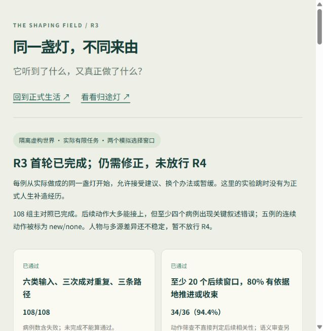

# R3 首轮：真实选择、后续与兴趣对照

2026-10-20。承接 [R0–R6 管线](../design/integrated-architecture-roadmap-2026-10-19.md) 与 [R2 归途灯](waylight-r2-2026-10-20.md)。**首轮实验和局部修复已完成，R3 尚未整体验收，不放行 R4。** 自动测试通过、库存受保护，不等于每段模型叙述都可靠，也不等于持续生活已经足够丰富。

后续同日的[修正与小批复验](cognition-r3-hardening-2026-10-20.md)单独记录版本、58 次调用和剩余问题。本文保留首轮历史；当前运行器增加同版本本地验证清单与有限病例门槛，旧实验命令不能直接视为新的付费放行。

入口：[R3 验收页](http://127.0.0.1:5173/r3-review.html)。可切换六类输入、三个产品路径、三个重复，以及三名人物；逐轮查看来源、计划、实际结算、灯的变化、后续和复核提示。原失败不会被新版成功样本替换。



## 1. 本轮接入了什么

- `life_worker.py` 将 R2 已传入但未使用的归途灯规律和个人取向接入决策与意图编译。沿用 Asamana 的需要、目标、决策、记忆和反馈，没有新增另一套世界或人格系统。
- 新实验直接调用现有认知桥、来源分级、实际任务、有限库存和发展证据账本。所有初态、原请求/响应、代码指纹、费用和终态保留；缓存缺失时明确失败，不偷偷补调。
- 实际任务标题取执行器方法名；`share` 标为留言。完成结果冻结背包，区分开始时预扣和完成时增减；重复结算不覆盖原观测。旧任务的模型标题也不再作为向其他人物证明“做成了”的证据。
- 消息字段和后续时间的修复提示指出具体合同错误；仍经过原校验器，不自动猜时间、改库存或把无效字段当成合法动作。
- 新验收页使用可审查的虚构实验摘要。正式生活与聊天入口保留；服务已加载本轮修复，实验没有启用正式连续认知，也没有写入正式人生。

执行链仍是：来源分级 → 本人感知/理解 → 需要、目标与已有后续 → 意图编译 → Node 核验、预扣、实际任务 → 冻结结果 → 私人记忆/后续 → 兴趣与愿望证据。同一结果根继续关联这些环节。

## 2. 设计与分母

[预登记](../design/r3-cognition-experiment-2026-10-20.md) 在正式付费前固定：

- 六类输入 × 无/有干预 × 三次重复 = 36 个起点；规则、旧模型选择、新认知各跑一次，共 **108 条主病例**。
- 每例两个计划/结果窗口，有限任务按时结算；超过两小时执行上限保留进行中，不补造其他 NPC 的行动。
- 同处境三人各两次，共 **6 条人物病例**；四种兴趣前史各一例，共 **4 条真实兴趣病例**，另有四条确定性发展轨迹。
- 规则/旧选择可以一次执行多步计划，新认知每轮一个当前能力。这是产品路径比较，不是同动作空间、同预算的模型优劣试验。
- 前史、天气、人物、库存和机会由实验明确编排。没有读取正式聊天或传感器记录。测试日期推进不代表现实中已经生活数周。

主矩阵与人物版本 `50d5d9fae7b7`；有效兴趣版本 `c5cd23e0ab29`。两组均没有协议/执行异常。正式生活中启用哪些人物，不由这些实验自动决定。

## 3. 看到了怎样的效果

### 输入与实际选择

下表只统计同一重复中两个窗口的**动作序列是否不同**；没有将理由不同计入。每格分母为三对，小样本包含随机性，没有统计显著性或严格因果结论。

| 干预 | 规则 | 旧模型选择 | 新认知 |
| --- | ---: | ---: | ---: |
| 风雨 | 0/3 | 2/3 | 0/3 |
| 主人建议 | 0/3 | 3/3 | 1/3 |
| 公开知识 | 0/3 | 2/3 | 0/3 |
| 他者邀请 | 0/3 | 1/3 | 2/3 |
| 头部轻触 | 0/3 | 1/3 | 0/3 |
| 材料短缺 | 0/3 | 1/3 | 3/3 |

新认知多数先装罩再取水；缺罩片时会取水、留言求助或继续等待。建议有一次改变为先观察，邀请有两次改变为沟通。风雨虽然没有改变动作序列，仍通过实际环境改变灯的湿润、磨损与亮度；这属于环境后果，不能算成角色主动改法。资料与触摸被理解，不代表已经产生有趣、稳定的生活变化；无关输入也不应强制打断原安排。

旧路径首先普遍处理原需要/供给计划，第二窗口才进入后续选择；不同路径动作数与调用次数不能直接判胜负。旧模型的更多序列差异可能包含随机选择，不能据此认定其来源理解更好。

### 后续与个体

- 36 个可用第二窗口中，32 个实际接续原问题，2 个有依据地先沟通或求助；合计 **34/36，94.4%**。另一个虚报交付，一个重复取水却没有处理先送水的后续，不计通过。这是 Codex 对保存记录的复核，非独立人工盲评。
- **5 个语义上继续的动作却被模型标为 `new/none`**。实际做了事，但后续可能被错误归档。上面的行为比例不等于结果根连续性通过。
- 72 个自由窗口均有至少两类实质选项。取水和净滤合并一类；改变物件与实际可留言的对象另列。只证明这个编排现场的机会，不能代表自然全天。
- 三人六例中，**5/6 都先装罩再取水**；苔团一次先取水再装罩。人格理由不同，稳定的行为区别尚未证明。

### 兴趣

| 编排前史 | 真实模型的两个动作 | 账本与边界 |
| --- | --- | --- |
| 已形成主动照料 | 浇水 → 排水 | 实际根增加，`invested` 保持；两轮不证明长期稳定 |
| 四次受邀照料 | 整理照料 → 分取苔芽 | 五次受邀与一次主动分开；只到 `trying`，没有直接形成身份 |
| 曾经没有机会 | 分取苔芽 → 留种 | 前史 `held`，恢复可行方法并实际返回后 `invested` |
| 沉寂后收到资料 | 分取苔芽 → 整理照料 | `parked` 后实际返回；未做相同前史“无资料”对照，不能全部归因于资料 |

没有为了成功率要求提出新角色；四例均未选择新愿望。部分“准备做对照”仍停在备料，不能称为完成了奇幻研究。保留了四条零费用规则轨迹、两次真实执行器试做，以及现有记忆归档/私有召回回归；本轮没有新增长记忆检索质量的付费盲评。

## 4. 失败和修复

原矩阵至少发现四个关键叙述错误：

1. `weather-1-off`、`weather-3-on` 的第二轮把已经预扣原水后的结束库存又减一次。
2. `resources-1-on` 第二轮只有留言送达，四份清水仍在背包，却声称已交给苔团。旧执行器将模型标题写成“已实际完成”，进一步放大误解。
3. `invitation-3-on` 第二轮理由称自己此前已经答应，而该例只有来信与装罩，没有实际回复/双方接受记录。

实际库存及客观承诺未被这些叙述修改；**关键自由文本错误为零的门槛仍未通过**。这是发现下限，不承诺其余文本绝无错误。

局部修复版本 `3ff3f5517f1d` 复验上述三类场景：天气和邀请两例完成；材料例在第二轮把 `message_parts` 错套进 `speech` 对象，被校验器拦下，原失败保留。补强顶层字段提示后的 `a4bdbbf99532` 单例完成净滤 → 留言，明确说明“留言已送达，水仍在背包，尚未收到回复”。这一复验核对了留言与交付边界，不替代原 108 组全面再测。

现有社会系统已经支持明确接受后的有限礼物/协助交接。下一批要改善意图到合适合同的选择；不能因为普通留言能送达，就把它当作完成交接的替代路径。

另外保留：

- 首批协议试跑 `68b9117e0de0`：缺必填 `delay_hours`，两例停止。明确字段提示后才开始正式矩阵。
- 无效兴趣夹具 `1724f318cfcc`：跳时未完成七日补算游标，当前苗床与旧状态打架。修正夹具后换版本重跑；旧结果不用于兴趣结论，费用照计。

## 5. 时间、费用和回放

| 批次 | API 调用 | 峰时保守估算 |
| --- | ---: | ---: |
| 原协议试跑 | 21 | ¥0.306 |
| 主矩阵 + 人物 | 826 | ¥12.664 |
| 无效兴趣夹具 | 71 | ¥1.302 |
| 修正兴趣夹具 | 71 | ¥1.221 |
| 结果修复三例（含一条协议失败） | 52 | ¥0.890 |
| 消息合同修复一例 | 17 | ¥0.272 |
| **合计** | **1,058** | **¥16.655** |

总输入 11,016,819 token，总输出 120,433 token。所有 API 请求返回用量；协议错误发生在返回后的校验，因此 API 成功不等于病例成功。失败及无效夹具计入开销。

主矩阵与人物批次：单 API p50 **1.390 秒**、p95 **2.037 秒**；主矩阵新认知整轮 p50 **16.439 秒**、p95 **19.690 秒**。整轮包含多次决策/反馈调用；仅串行隔离样本，不是全镇并发或对话延迟承诺。

按 [DeepSeek 官方价格](https://api-docs.deepseek.com/zh-cn/quick_start/pricing/) 2026-10-20 核对的峰时、实际缓存命中计保守估算，实际账户账单未知。配置与响应使用 `deepseek-flash` 别名，响应没有提供不可变模型构建号；不把本轮和十月早期的差异全部归因于架构。

主矩阵/人物 114 条、有效兴趣 4 条、局部修复 3 + 1 条，**122 条原初态/终态和异常类别均可零新增调用重放**，包含一条原协议失败，不把它计作行为成功。新源码改变指纹后不能冒充旧实验；旧冻结源码、缓存和检查结果在本机版本目录保留。

原始证据在仓库外 `runtime/r3-20261020/<version>/`：`results.json`、`replay.json`、`replay-check.json`、`calls/*.json.gz`、`worlds/*.json.gz`、`frozen-sources.json.gz`。全部约 78 MB，没有复制正式大库。公开页面只带虚构摘要，不包含密钥或正式人生。

## 6. 运行方法与检查

在 `client` 根目录：

```powershell
# 免费：准备当前源码版本的夹具和出站内容
node services/deskbot-cognition/evaluations/r3-run.mjs
# 免费：仅规则；每个版本单独保存
node services/deskbot-cognition/evaluations/r3-run.mjs --rules
# 真实调用须已有数据范围/费用授权；可先缩小到一例
node services/deskbot-cognition/evaluations/r3-run.mjs --real --arms=cognition --case=resources-1-on
# 当前版本缓存回放：缺缓存就失败，绝不补调
node services/deskbot-cognition/evaluations/r3-run.mjs --replay --arms=cognition --case=resources-1-on
node services/deskbot-cognition/evaluations/r3-verify-replay.mjs --input=../runtime/r3-20261020/a4bdbbf99532
```

`--personas` 与 `--interests` 选择附加批次；`--arms=cognition,bounded,rules` 比较三条路径。不要将代码升级后的新版本目录用于核对旧缓存。旧版复现需要在独立目录恢复基线 `d207d2f` 与该批冻结源文件；仅运行默认准备或 `--replay` 不会付费。

修复后：后端 **843/843**、Python **21/21** 通过，前端 TypeScript 与生产构建通过；保留既有大 chunk 警告。新增回归覆盖误导标题、旧任务证据、冻结背包、预扣/完成增量、重启重复结算和兴趣补算一致性。浏览器检查了来源切换、失败提示、人物对照和实际排版。

## 7. R3 后续顺序

1. **后续语义与事实收口。** 原问题、当前动作、终止理由、等待对象分别绑定：避免同一事被 `new/none` 归档，以及“想送水却等取水方法可用”。扩到 4–6 个窗口，包含先沟通、明确接受、实际交接、拒绝/超时与自行改法。成功文本与实际记录逐项复验。
2. **人物做法与来源反事实。** 让照路、留暗、维护、取水、分享成为有不同成本和后果的真实选择；不通过随机强制分支或换台词制造人格。固定前史做人物交换、无资料/有资料、记忆召回消融，检验为什么改变或合理保持。
3. **兴趣节奏与调用节拍。** 在相同机会条件下比较自主返回、受邀和无机会；增加需要/材料变化及安静窗口。保留长记忆证据，减少无需重算的阶段调用，以同一场景质量/成本复验优化效果。
4. **重新评估出口。** 关键完成/承诺/库存错误清零，连续问题不误归档，分歧与后续足够可解释后，再在明确正式出站范围下进入 R4 自然七日。地图和物件反馈可继续细化；完整角色、美术、声音和打印壳仍以可依赖的生活证据为基础。
