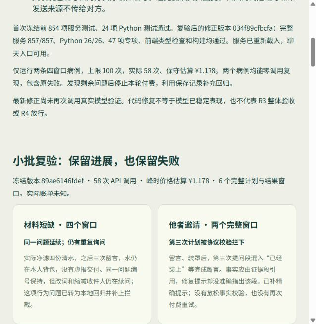

# R3 修正批次：稳定后续、真实交接与复查节奏

2026-10-20。承接 [R3 首轮](cognition-r3-2026-10-20.md)。本轮按“先改完、验证、冻结，再少量实验”执行；没有重跑 108 条主矩阵。**工程修正已完成，R3 整体质量仍未验收，不放行 R4。**

入口：[R3 验收页](http://127.0.0.1:5173/r3-review.html)。页首为本次修正及小批结果，下方保留首轮原始矩阵与费用，不把旧成功或旧失败改成新版结果。

## 1. 在原架构内完善

| 环节 | 修改 | 权限与边界 |
| --- | --- | --- |
| 后续身份 | 同一问题持有稳定 `followup_id`、原问题及实际结果根；转做别事暂存，支持恢复。明确放下或引用实际完成证据才结案 | 暂存最多八项，满后明确报错，不静默删除。完成证据证明“有这个结果”，仍不能证明任意语义目标已解决 |
| 下一步与条件 | `next_step` 区分活动、约定与交接选项；等待必须绑定真实可见对象，不能把交接清水写成等取水 | Python 与 Node 都验证，角色仍可改变方法、解除等待、暂缓 |
| 清水交接 | `give-water` 复用既有邀请→明确接受→实际到场→有限库存/容量核验 | 留言不交水。拒绝、沉默、缺料、背包满均不生成交付 |
| 复查频率 | 相同就绪条件和未变邀请只提前唤起一次；保留请求的复查时间，新来源、结果与条款变化仍可唤起 | 等待与休息不增加实践；避免每十分钟因同一就绪条件调用模型 |
| 做法的代价 | 同一归途灯规律计算敞亮/有罩的照度、耗光及净滤门槛，向人物公开取舍 | 不改变物理定律，不按人物名字指定不同动作；这只是决策条件，尚未证明稳定人格差异 |
| 话语修复 | 修复提示指出具体 `message_parts[i]` 中的完成断言；完成事实用服务端证据段引用 | 不放宽校验，不把事实改成“猜想”标签就放行 |
| 未回应联系 | 同一问题按收件人记录最后实际联系及依据；无回复、新实际结果或本次引用的新来源，不靠换词、缩小收件人或改称“当面”重发 | 不自动替角色选择活动。明确的有限交接提议、真实回复及新实际观察仍可继续；此规则不是通用语义相似度判定 |
| 回复接线 | 发送端 `sent:<task>` 与收件端 `message:<task>:<recipient>` 明确关联 | 核验真实收件人，第三人不能伪装回复；个人问题编号和未发送来源不放进他人的收件记录 |

仍沿用来源分级 → Asamana 个人需要/目标/记忆 → 意图编译 → Node 事实核验与任务结算 → 私人反馈/后续 → 原兴趣和愿望账本。没有另建人格数值，也没有给正式人生注入实验经历。

## 2. 先验证，再冻结

首个冻结版本 **`89ae6146fdef`**：

- 服务测试 **854/854**、Python **24/24**、前端 TypeScript 和 Vite 构建通过后，才生成本批验证清单。
- 两个既有问题病例：`resources-1-on`、`invitation-3-on`；每例最多四个窗口，只有新认知路径。
- 最多 **100 次调用**。实际命令显式限定病例、路径、窗口数和验证清单。
- 版本指纹包含相关源文件、实验运行器与窗口数；`--real` 必须读取同版本的本地验证记录，并符合其中的病例、路径和调用上限。更改代码会使旧记录失效。
- 只发送已授权的虚构人物、世界、输入和实验记忆；没有正式聊天或传感器记录。

验证清单及日志位于工作区外层 `runtime/r3-hardening-20261020`。这套检查用于避免忘记先测试，不替代人对实验范围和费用的授权。

## 3. 小批实验的实际结果

| 病例 | 实际完成 | 观察与失败 |
| --- | --- | --- |
| 材料短缺 | 四个计划/结果窗口 | 净滤四份水 → 三次留言；同一问题编号保留，水仍在本人背包，没有虚报交付。但通过改词、改称当面和缩减收件人继续询问，尚未走向交接或独立行动 |
| 他者邀请 | 两个计划/结果窗口；第三次计划失败 | 留言 → 实际装罩。第三次提问段包含“已经装上”等完成断言，应由已有证据段表达；修复提示没有准确指向该段，重试仍被协议拒绝，未产生第三个任务 |

合计 **6 个完整窗口，1 次未通过的计划**，不是八个成功窗口。第二例不是“实际没有装罩”，而是编译输出违反了事实与自由表达分段的协议。失败原文、错误类别和调用成本都保留。

这两例的其他居民没有自由安排并生成回复；因此无人回应不能用来评价居民的社交意愿。它能暴露主角等待期间的重复行为，不能证明多人共同生活已经成立。

| 用量 | 记录 |
| --- | ---: |
| API 调用 | 58 |
| 输入 token | 726,517 |
| 输出 token | 8,248 |
| 缓存命中输入 token | 174,080 |
| 缓存未命中输入 token | 552,437 |
| 峰时价格保守估算 | ¥1.1778212 |
| 用量未知的调用 | 0 |

全部用量来自提供者返回；实际账户账单未知。费用包括失败计划的编译与一次协议修复。这里不能直接外推全镇一天成本。

原版本缓存回放 **2/2**：初态、终态及错误类别一致，读取 **58** 条缓存，新增提供者调用 **0**。其中一例原本失败，回放一致不代表行为成功。

## 4. 复验后的本地修正

发现上述问题后停止本轮付费，使用保存记录补充回归。版本 **`034f89cfbcfa`** 补齐未回应联系约束、真实回复编号关联，以及具体段落的修复提示；这部分**没有再做真实模型复验**。

- 完整服务测试 **857/857**。
- Python **26/26**。
- 后续、调度、社交和 R3 专项 **47/47**，已包括在完整服务测试内。
- 覆盖真实发送/回复链、换词并缩小收件人、重启后约束不丢、失败/休息不构成新依据、新实际观察可继续，以及明确清水交接提议仍可成立。
- 原有库存、共同事务、兴趣/愿望、地图投影、历史重建与重启回归通过。
- 最新前端类型检查、构建和浏览器核对见 `documentation/tests.md`。已有大 chunk 警告没有在本轮处理。

最新版本只做免费准备并保存源码指纹，没有为它生成继续付费的放行记录。首个验证清单绑定旧版本，不能用于新代码。

本批实验、压缩请求/响应、前后世界、源码及日志约 **3.1 MiB**（最后的免费准备和截图另计）。不复制整套项目、不保存额外大库快照。

## 5. 下一轮的窄范围目标

1. 先验证本次两类修正：无人回应时能转向有依据的行动或明确暂缓，真实回复能被正确接收；事实段不再混入无出处的完成断言。
2. 再安排三个角色都参与的有限交接，覆盖接受、拒绝、延期、材料不足与不再需要；不能只让主角等静止的接收人。
3. 对归途灯安排真正有代价差异的状态，在同条件下交换人物与来源，检查做法和后续是否持续不同；不把随机动作或不同台词计成人格差异。
4. 补齐资料影响、兴趣维持/暂缓与自主返回的成对对照，并核查上下文大小、无效轮次和费用。达到原 R3 门槛后再讨论 R4 的少量人物自然跨日试运行。

每一批先冻结修改和检查结果，再限定病例与调用上限。发现共同协议缺陷时停止该批，以保存响应做本地修复；不为追求成功率反复付费重跑。

## 本机证据

- `runtime/r3-hardening-20261020/validated.json`：首次本地验证及实验范围。
- `runtime/r3-hardening-20261020/experiments/89ae6146fdef/results.json`：真实批次原始结果及费用。
- 同目录 `replay.json`、`replay-check.json`、`calls/*.json.gz`、`worlds/*.json.gz`、`frozen-sources.json.gz`：回放及来源。
- `runtime/r3-hardening-20261020/local-final/034f89cfbcfa`：后续本地修正的免费准备与源码指纹。
- `runtime/r3-hardening-20261020/local-final-validation.json`、`service-final.json`：最终本地检查及服务恢复核验，不包含继续付费的病例放行。
- `backend-full.log` / `backend-final.log`、`python.log` / `local-followup-python.log`：两次冻结的验证记录。

这些路径相对工作区外层，而非 Git 仓库；密钥和运行原始数据不随文档提交。
