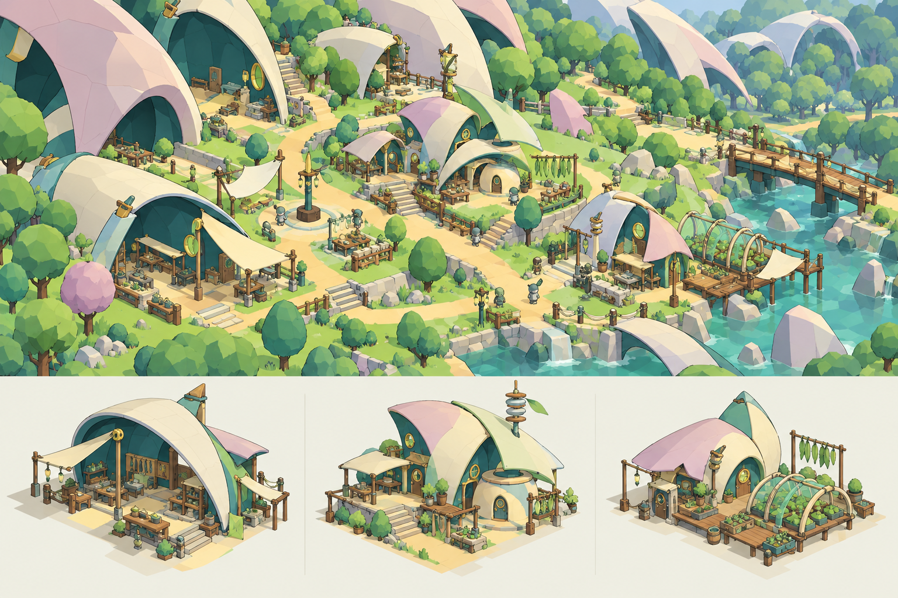
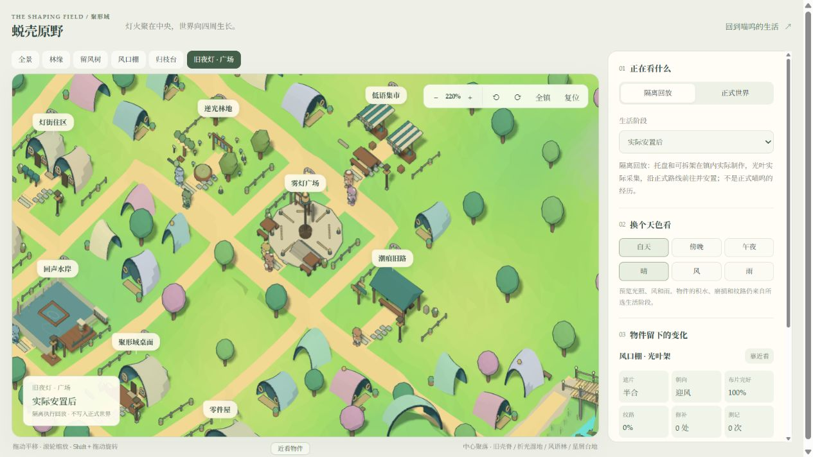
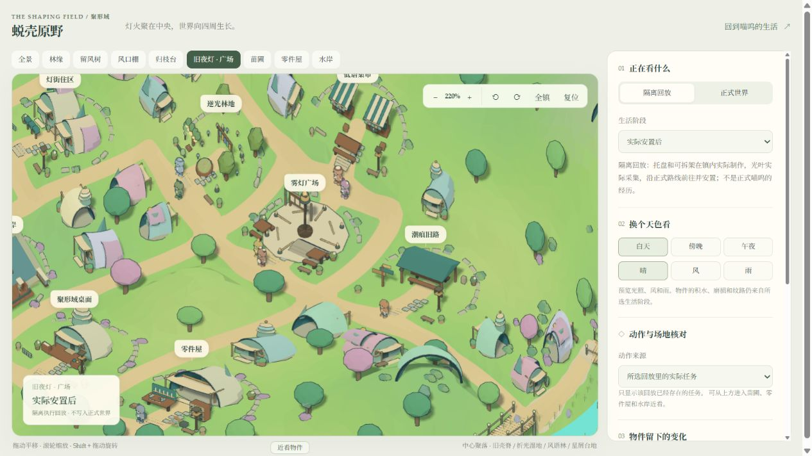
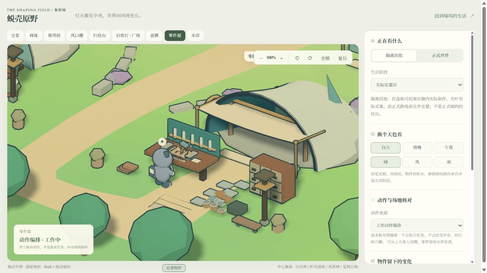
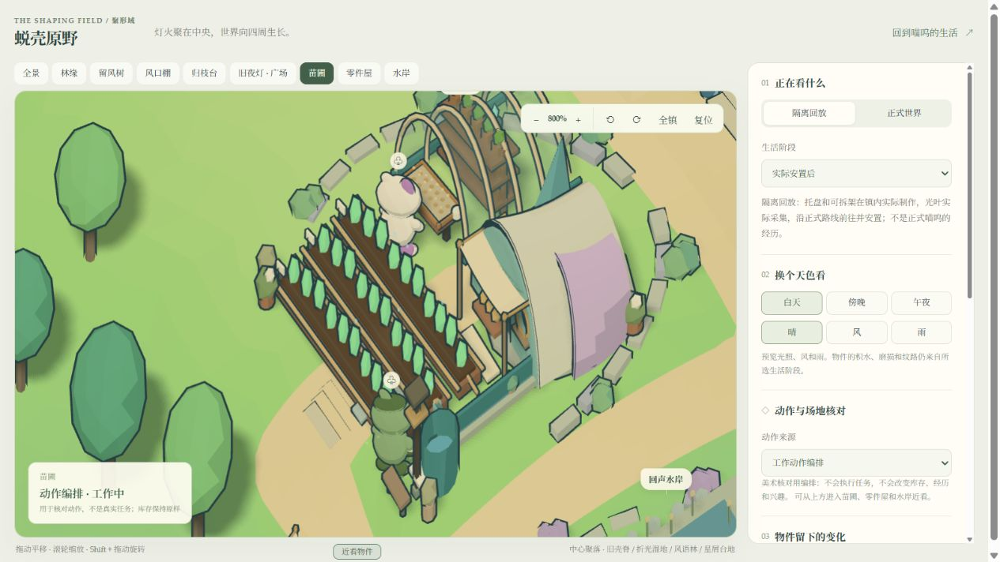
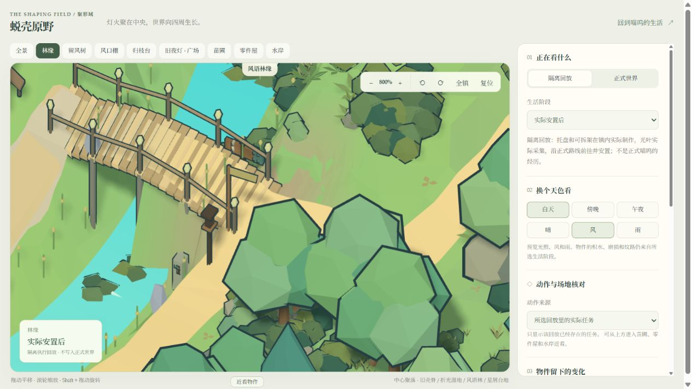
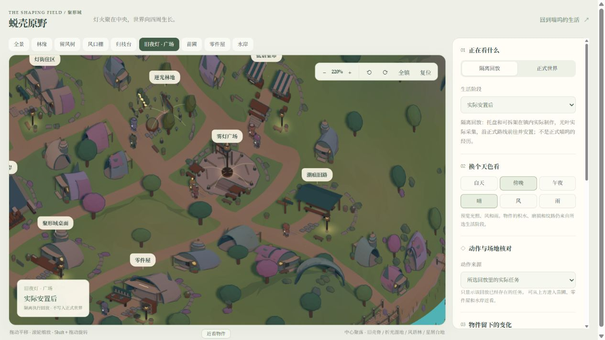
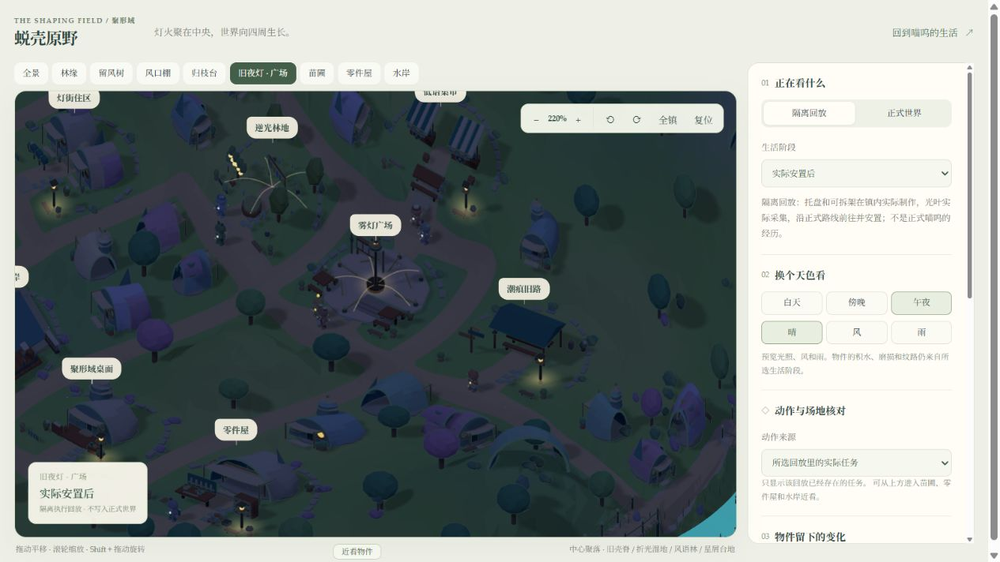
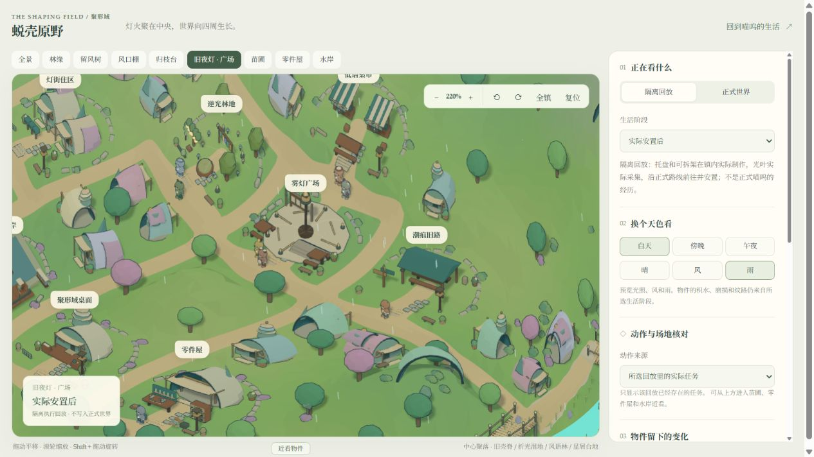

# 蜕壳原野：第一轮空间与生活呈现打磨

2026-10-19，本地实现与验证。延续恢复后的主线及选定的 low poly 方向；本轮是地图与呈现迭代，不代表整体管线 R1 的统一观察、存储与认知整合已完成。

## 美术意向与实际画面

根据当前运行截图，用生图生成一张局部美术参考，推敲错层壳屋、薄壳雨篷、温室、顺坡街巷和镇林过渡。提示词与图一起保留，生成图只作为造型意向。

[完整提示词](../../documentation/images/round1-2026-10-19/art-direction.prompt.txt)

下面是相同浏览器视口、相同广场定位入口及 220% 缩放的实际 WebGL 画面。地图变形后地物位置会随布局变化，未手动拼接或修图。

## 完成内容

- 中央聚落采用有界的连续弯曲，弱化原棋盘轮廓；路面用边界裁切代替整格填充，交汇及地点入口适度变宽。角色、路径、标签、设施与交互锚点共用映射。
- 镇区和林缘使用同一地表配色场，林地局部色逐渐进入；院落后侧添加低挡土石、零散灌木与门前休息台，两处既有林地出口继续保留。
- 壳屋形成基础拱壳、错层侧室、顶部灯井和叠瓣四种轮廓，增加实际门窗开口、前廊、细支撑与窗台。苗圃温室使用与透明壳面一致的拱肋，零件屋保留开放工作间。
- 物件库存继续读取服务数量，木料、布卷、水罐和篮筐替代重复的色块。外观容器不是额外资源。
- 工作台在匹配地点、对象与活动 ID 的任务运行或暂停时保留未完成工作；运行时工具动作，暂停时放下，取消或结算移除任务呈现。浏览器不能完成制作或增加库存。
- 苗床的湿沟槽和干裂只读取已保存的 `moisture`。点击“下雨”或播放浇灌动作不会改变土壤数据。
- 变形同时处理工作站的站立、面向与林地到达锚点；修正工作台前长凳挡住站位的问题。
- 验收页新增苗圃、零件屋、水岸定位，以及明确标注的工作/暂停动作编排。编排独立于真实任务，正式世界模式始终使用正式任务。

## 昼夜与天气

新门窗继续使用原昼夜与运行状态通道。傍晚窗灯逐渐亮起，午夜大部分住屋熄灯，公共路径灯保留；实际夜间工作保留工作光。风雨仍使用现有环境投影和过期机制。

以上天色与天气由验收页控制，不表示当时上海实况，也不写入人物经历。正式页检查时天气显示“等待新天气”，因此本轮不把画面预览算成实时天气获取已通过。

## 验证

- 客户端全量：55 个测试文件、310 项通过，命令 `vitest run --maxWorkers=2`。覆盖地形和旧林地接头、任务与库存、锚点变换、光照、暂停/取消/逾期、减少动态效果及既有生活与角色投影。
- 默认高并发第一次运行出现 5 项 5 秒超时，没有断言不符；限制两个 worker 后完整通过，没有放宽断言或测试时限。
- `tsc --noEmit` 通过，Vite 生产构建通过。研究回放页仍有大包体警告，加载体积优化未在本轮完成。
- 1265×713 浏览器实际检查全景、广场、工作间、苗圃、白天、傍晚、午夜和雨天；交互核对工作与暂停由验收入口提供，新增回归验证停止动作及无状态副作用。
- 5173 前端和 4311 后端已启动。正式地图接口返回 200；正式页显示 13 位居民、14 个地点与可用聊天输入。本轮未发送验证聊天，未把正式聊天/传感器记录提交给新的模型实验。

广场日间镜位的 240 帧滚动样本：

| 测量 | 改造前 | 本轮 |
| --- | ---: | ---: |
| 绘制调用 | 650 | 667 |
| 绘制三角形（包含描边和阴影等绘制） | 766,448 | 844,908 |
| 活跃几何 | 566 | 577 |
| 纹理 | 7 | 7 |
| 帧间隔中位 / P95 | 7.0 / 13.9 ms | 18.6 / 19.3 ms |

两次采样的后台工作和服务状态不同，帧间隔不能作为严格的性能回归结论，也不能作为低配置设备承诺；工作量确实增加，后续继续关注。需固定设备、生产包、后台任务和时间窗口做可重复测量。截图不替代长时稳定性测试。

## 仍未完成与后续

本轮增加场景可读性和已有生活的可见痕迹，没有新增地区准入、活动配方、人格规则、付费认知或实体外壳。原地点 ID、存档、资源与旅行时长保持原合同。外圈湿地、旧壳脊、星屑台地仍需内容卡与实际生活链。

实际画面尚未达到参考图全部建筑复杂度。聚落的功能设施、部分院落石沿仍可继续去重复；新增大地标应先做局部意向，再做资产与状态合同。

正式检查仍看到多人围绕餐桌等待与设施占用冲突，喵呜的稳定投入尚未形成。这属于下一轮需要优先验证的生活调度与机会问题，不能因为地图更精致就判定持续生活目标达成。按整体管线继续统一观察数据、保存/回放与运行指标，再打通一个真正有日常用途和跨日后续的新区域。

[地图验收](http://127.0.0.1:5173/windleaf-review.html?sample=installed&sceneMetrics=1) · [正式生活与聊天](http://127.0.0.1:5173/?mode=deskbot&deskbotUrl=http%3A%2F%2F127.0.0.1%3A4311&view=journal) · [整体架构与开发管线](../design/integrated-architecture-roadmap-2026-10-19.md)
