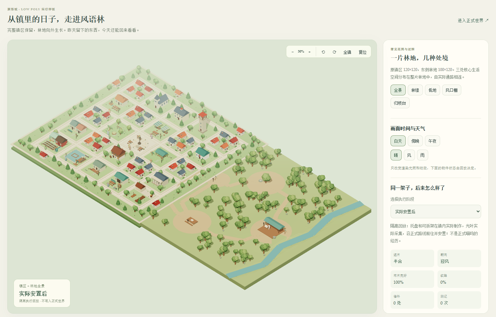
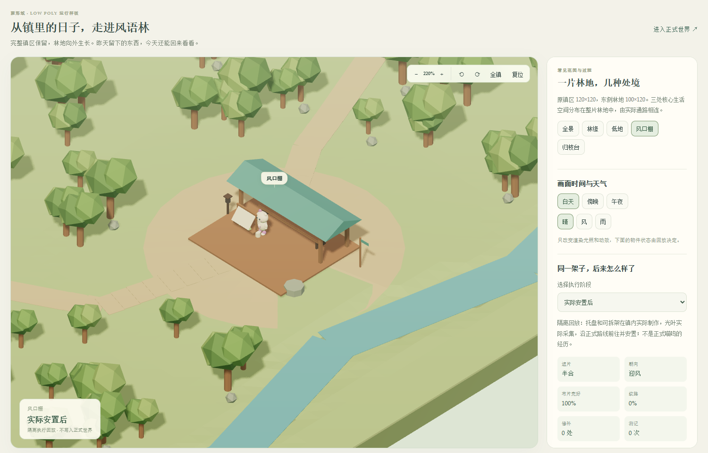
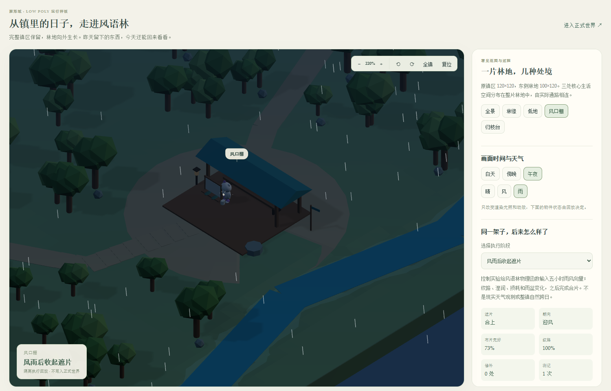

# 6B 首批可执行林地与界面验收

2026-10-13 · 本地运行版 · 6B.1 与 6B.2 首批交付，6B.3 与自然跨日质量仍未验收

后续场景和规则已在[留风树与旧夜灯第二轮迭代](shaping-field-stage6b-windleaf-fantasy-v2.md)中更新。本文保留首批实现和当时的测试记录。

雾灯镇的十个旧地点、布局与事务保留，镇外增加风语林缘、林间低地、风口棚和归枝台。场景使用真实 low poly 几何和状态投影，地面从 120×120 扩展至 220×120。追加迁移不补发旧资源或经历，不重置身份、库存与任务。

完整规则、空间与资产覆盖见 [内容卡](../design/windleaf-content-v1.md)，原方向与排期见 [6B 方案](../design/stage6b-delivery-plan-v1.md)。

## 已实现

- 新增四个地点、四个内部区域、六个目录对象与六条通路；旧地理与新增空间共同由服务授权旅行，显示同一条正式折线。
- 十二种光叶生活方法复用实际耗时、材料预留、取消归还、对象权限、持久任务、共同结果与原兴趣账本。材料与光叶有限，安装前不追补生长；三十分钟比较窗口进入认知等待合同。
- 每套架子有本人、固定架位和出处；遮片、转向、损耗、修补、测记与收起表现为实际状态。回收再安装保留同一架体编号与磨损，新光叶批次与旧测记分别记录。
- 完整林地地形、高差、溪床、道路、树群、开放工作棚、测记石、归枝台和雨盆已建模。静态设施合批，树冠实例化，动部件独立。现有昼夜和有效天气延伸到新范围，工作灯读取实际工作；休息或暂停不伪装营业。
- 日常界面缩小头部、增加世界可用空间、保留聊天与旧入口，并提供林中旧物入口。回调变化不再重建整座场景；状态切换保持画布与镜头。
- Node 现场机会描述读取真实对象；新地点不回退成桌边故事。Asamana 认知适配器看到当地方法、本人造物与测记、材料和等待条件；没有新增模型写世界事实的权限。

## 验证与范围

服务全量最后一次运行 782/782 通过；随后增加回收磨损保留规则及一项回归，相关库存和林地组 19/19 通过。前端路线、实际活动、原场景及新林地四个组 25/25 通过；Python 合同与适配器 19/19 通过。前端源代码/生产配置类型检查与生产构建通过。构建仍有大块警告，主要为独立认知与林地回放夹具；这些不是日常界面首屏必须载入的全部数据。

Computer Use 和浏览器控制工具均因 kernel assets 路径错误无法初始化。改用已安装 Edge 的无界面开发回归保存实际截图：JavaScript 页面错误为零，状态切换保持同一画布；390px 视口无横向溢出。正式页面只填写未发送草稿，检查展开回顾后聊天可见、草稿保留及聊天按钮恢复焦点，发送测试消息为零。

正式服务已验证为 14 地点、6 区域、24 内部区域、27 目录对象，新方法 12 项且通路可达。持续身份仍为 `shaping-001`。迁移时光叶来源为零、个人架为零；隔离回放不会偷偷成为正式喵呜的过去。正式认知持续回路仍为 0 位启用，没有在此次操作中自动开启付费人物运行。

## 实际模型与渲染开销

| 结构统计 | 原镇区 | 扩展后 |
| --- | ---: | ---: |
| Object3D Mesh 数 | 338 | 383 |
| 三角形计数（含隐藏槽位与实例） | 79996 | 100298 |
| 实例总数 | 357 | 702 |
| 唯一几何对象 | 335 | 380 |
| 唯一材质对象 | 337 | 382 |

上述为 Node 构建模型的结构统计，不等于 GPU 绘制调用。树冠共享几何，旧设施还有较多各自材质，后续可在保持独立状态的前提下继续整理。

同一设备、1500×960 视口、相同角度、白天晴天、各自全景，采样窗口为 240 帧。由于全图范围不同，物件在全景中的像素大小也不同；这不是固定物理缩放的 GPU 成本实验。

| Edge 无界面采样 | 原镇区 | 扩展后 |
| --- | ---: | ---: |
| 帧间隔中位 | 8.0 ms | 8.0 ms |
| 帧间隔 P95 | 8.1 ms | 8.1 ms |
| renderer 绘制调用 | 430 | 460 |
| renderer 绘制三角形 | 250304 | 284680 |
| 已上传活跃几何 | 272 | 278 |
| 纹理 | 5 | 5 |

这些是有限窗口的实际开发采样，包含阴影等绘制开销。没有独立测量 GPU 时长、温度、低配置机器或长时间驻留，不能据此宣称所有情况下都有固定帧率。

## 回放与下一批

[运行验收页](http://127.0.0.1:5173/windleaf-review.html?sample=installed&sceneMetrics=1) 提供六个生活阶段及原镇区渲染基线。阶段由隔离世界的实际制作、采集、旅行、安置、测记、修补和收起生成；风雨比较另有明确的五小时合成天气向量，维修材料前态单独声明。费用调用为零，未发送正式聊天或传感器记录。

本版完成了首区的可执行生活链与基础视觉接口，尚未证明它会自然形成丰富生活。接下来按 6B.3 深化已有居民为何来、怎样做、是否拒绝或改约，以隔离真实模型对照比较方法与返回差异；再进入兴趣/愿望对照和稳定内容版本下的自然跨日观察。完整环境细节、造物变体与角色表现仍需继续设计。

现有 SQLite 存档备份约 2.55 GB，已成功保存一致性副本并记录追加迁移。开展长时间自然观察前，应先核对快照/事件留存、恢复开销与存储增长，设计保留历史可访问性的归档方式；本轮没有删除历史数据。
