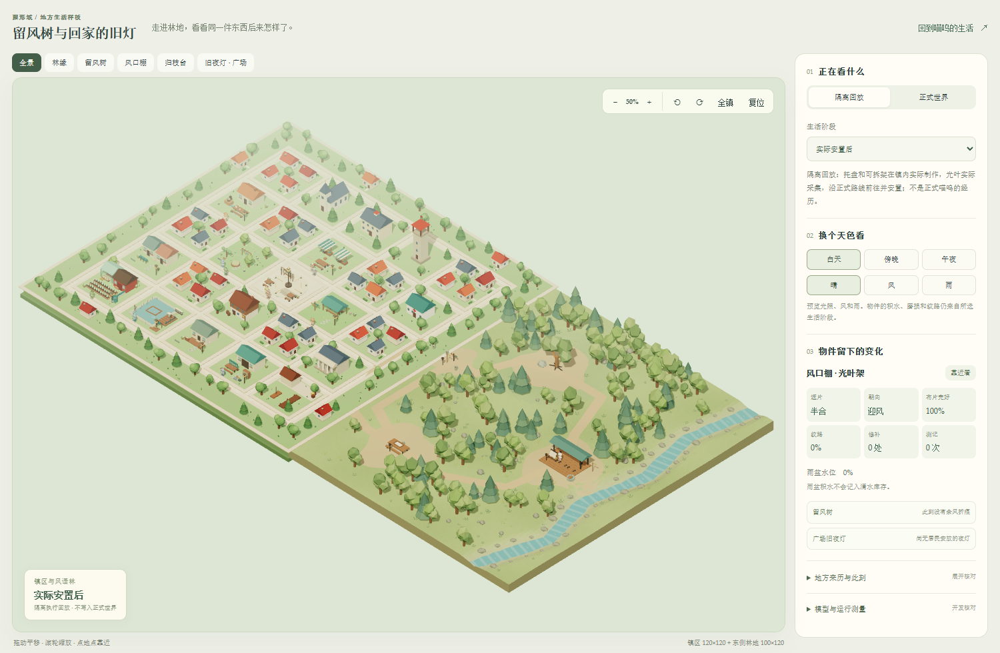
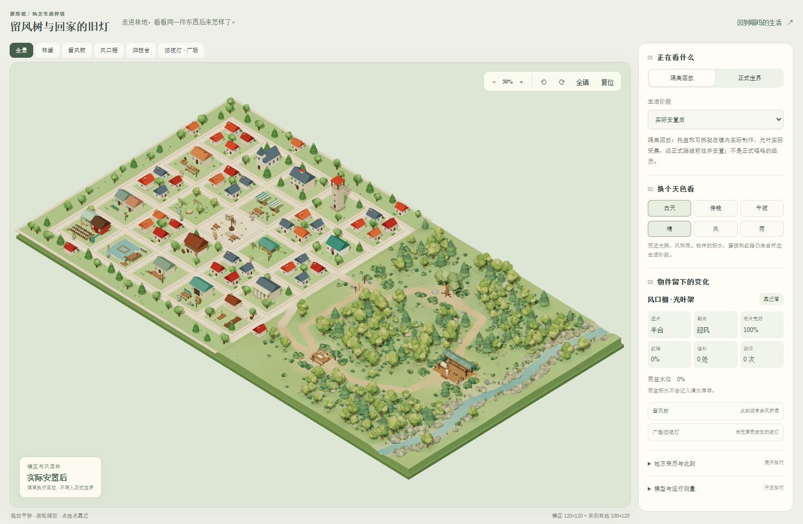
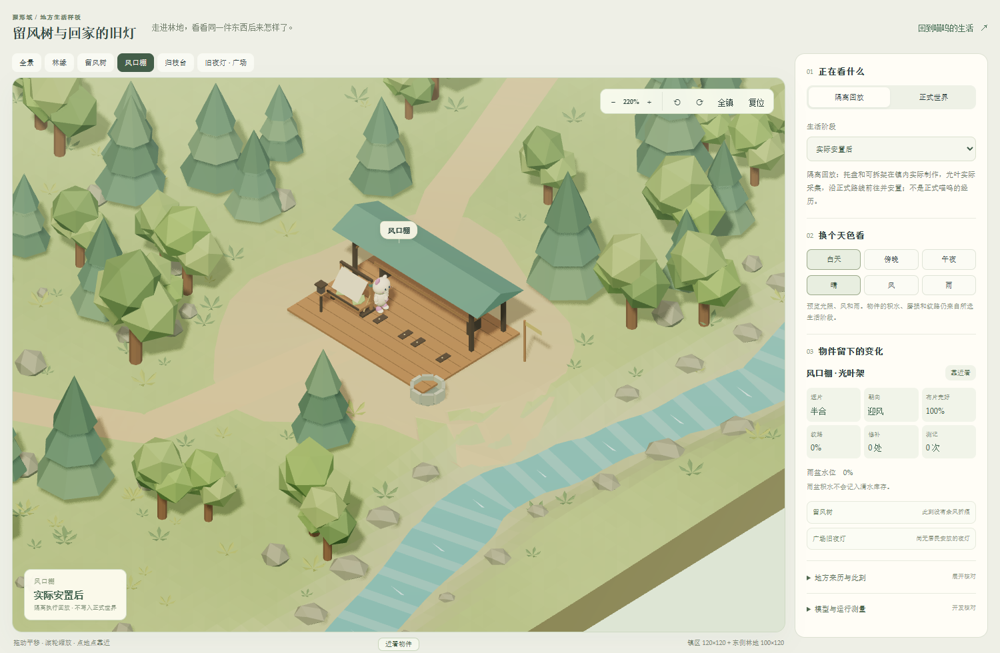
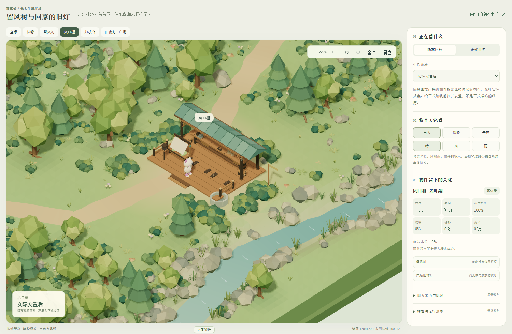
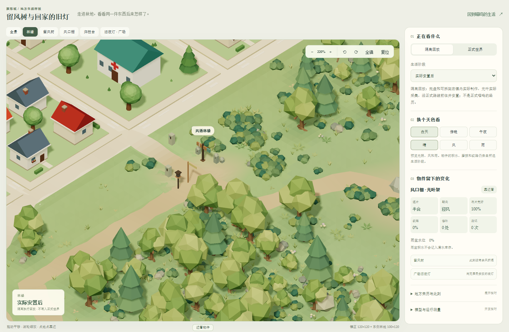
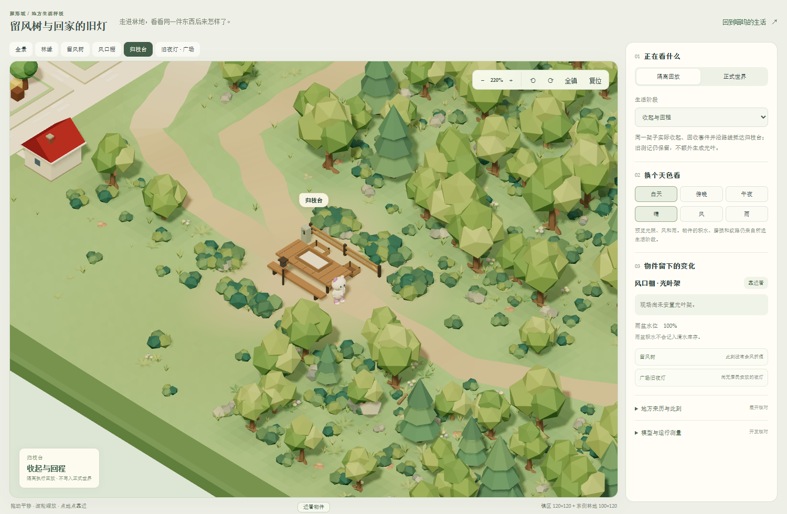

# 镇区与风语林的融合、密度修正

2026-10-15 · 6B 视觉复核迭代

上一版的实际画面没有落实参考图中的连续地形和分层密度。旧镇东边的凸起草台遮住了新路，林地还有独立内侧墙；林中缺少灌木层，场所周围留白过大。此次修正从地形与空间组织入手，继续保留 220×120 的总范围、旧镇建筑和六条已登记路线。

## 同机位对照

以下均为浏览器实际 WebGL 截图，使用相同视口、回放与观察机位。

| 上一版 | 本次修正 |
| --- | --- |
|  |  |
|  |  |

## 地图如何接起来

镇区和林地共用贯穿全宽的底座，删除旧 x=120 内侧墙。原镇 x=112 以东的高草台替换为渐变草地，两处出镇口按已有路线切到街面，不再把小径藏在人行道下。铺路颜色逐渐过渡为土径，小径边缘宽度有轻微变化；所有路线中心和服务端旅行规则保持一致。

林缘从较小的树与灌木过渡到成熟林木，避免沿旧边界排出整齐树墙。树下苔色和落叶地表随实际林木群分布，工作空地的颜色逐渐融入周边草地。

## 密度和场所细节

植被分为成年阔叶树、针叶树、幼树、灌木、蕨草、草叶、芦苇和岸石群。186 株树与地被使用确定性群落布置，植被合为 12 个绘制批次。棚侧、棚后、雨盆边、归枝台和留风树周边另有按实际设施足迹设计的低植被岛，避开通路和操作位置。

棚顶增加分片与接缝，棚架补齐檐口、斜撑、台钳、固定钩具、空收纳格、侧凳、矮栏与踏步。缩窄并后移屋顶，正常镜头下能看见更多工作台。归枝台增加木连接、后栏和空筐；观察石与旧路牌增加结构细节。固定设施仍与实际材料库存分开，未安装的个人架位继续保持空位。

晴天雾距移到主要场景之后，避免正交相机下整片场景被灰绿雾色冲淡；雨天仍根据云量收紧能见距离。溪水采用连续色带，岸边由大小石群与芦苇形成层次。

## 人物与场景接地

从人物实际腿部几何及缩放读取静止脚底，林地行走以可见路面为基准，入口做短距离过渡。工位站立高度取真实棚地板，避免把架体变换原点误当成地面；人物朝向、行走和身体动画继续保留。到达地点后的静止展示位置也要避开桌体、树干和路牌，不能只把角色放到地点中心。

## 验证范围

本次属于场景表现修正，没有修改生活规则、认知配置、资源库存或存档迁移。验证覆盖两处出口路面的射线命中、统一底座边界、植被通行净距、设施操作净空、个人架转向后的站位、人物脚底与地板关系，以及十种既有生活回放的昼夜风雨画面。

前端完整回归 53 组、300/300 通过，生产源类型检查与 Vite 构建通过。构建仍提示既有独立回放页面的大数据包，以及依赖库注释提示；这些提示未阻断构建。本轮无需调用模型 API，也没有把验收动作记入正式角色历史。

视觉检查使用 1500×980 与 390×844 视口，实际切换回放保留同一 WebGL 画布，页面错误为零，移动端没有横向溢出。全景绘制工作量约 52.6 万三角形、519 次绘制调用，含原镇、人物与阴影等整个场景；这不是植被模块单独的计数。与上一版约 30.6 万三角形相比，细节增加有成本，仍应在目标低配置设备及长时间运行中继续测量。

本轮明显缩小了参考图与实景的密度差距，但没有把概念插画当作可直接交付的 3D 资产。专门雕刻的地标轮廓、远景山体和未来区域仍未实现；当前保留四处林地场所和既有生活因果，不把概念中的远方地点标成已开放。

[打开场景](http://127.0.0.1:5173/windleaf-review.html?sample=installed&sceneMetrics=1) · [上一版规则与生活回放](shaping-field-stage6b-windleaf-fantasy-v2.md)
