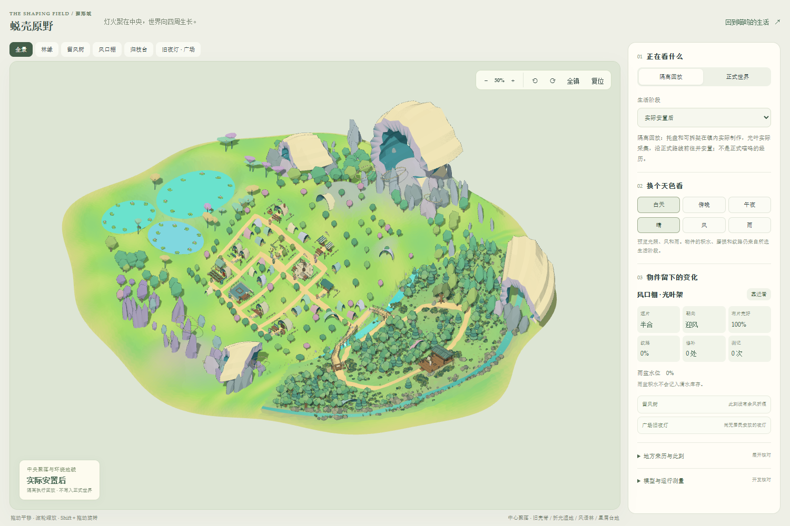
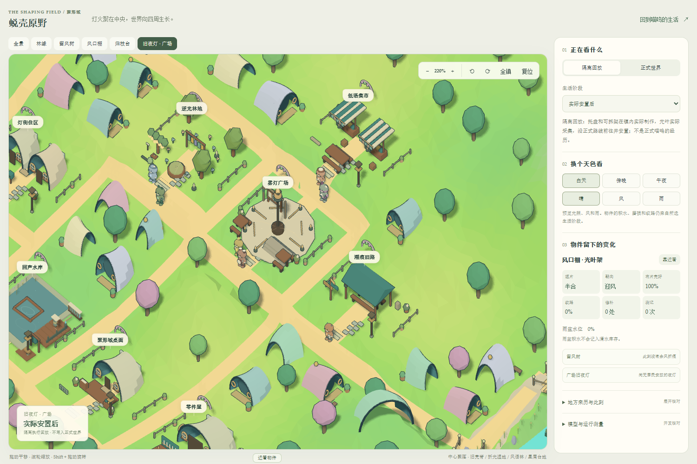
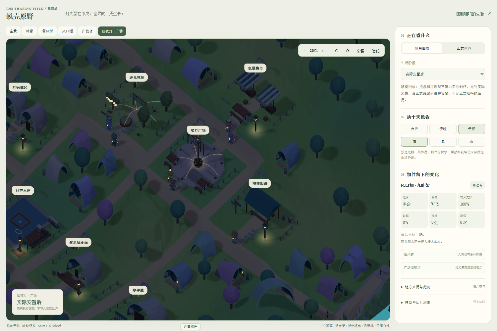
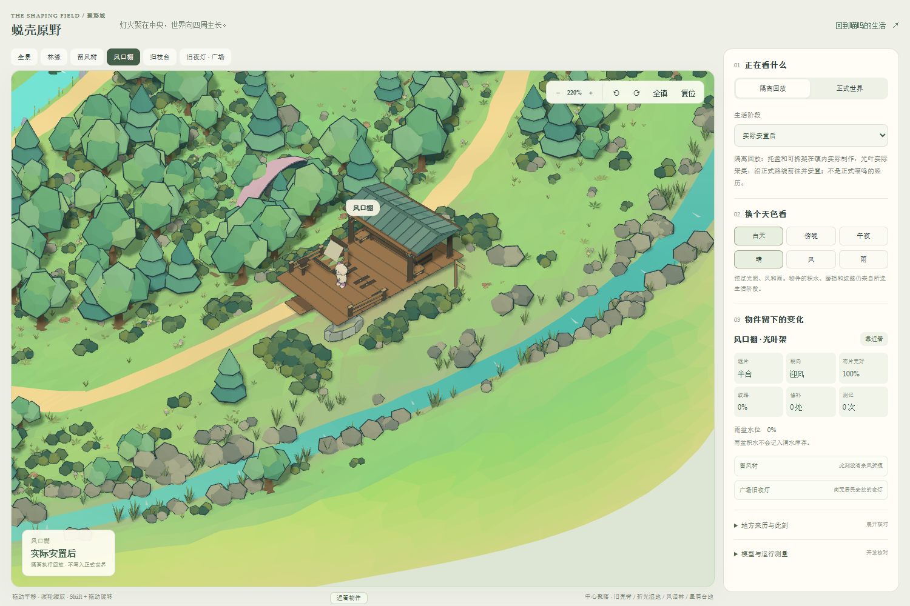

# 蜕壳原野：中央聚落与环绕地貌

2026-10-19 · 6B 视觉重建第一版 · 实际 WebGL 实现

本轮采用用户选中的 C 方向，并按后续意见解除旧方形布局限制。聚落在偏中心位置，原有风语林向东侧弯曲展开；旧壳脊、折光湿地和星屑台地形成其他方向的远近层次。这里记录程序实际生成的模型与截图，概念图不作为交付效果。

## 本轮实现

- 连续起伏的三角面地形与不规则外缘；旧镇和林地共用高度与坐标映射。原 220×120 逻辑空间不再直接决定画面轮廓。渲染取景包络为 310×280，这不是新增可执行地图的面积。
- 中央聚落的壳拱住屋、圆窗、门前踏石、院落矮栏、花盆和公共设施；四处大型中空旧壳与散落的壳板、岩鳍形成远景地标。
- 西侧浅池、杯状植物与浮叶，南侧岩鳍、环形遗物和轻微悬浮的碎片；森林仍保留乔木、幼树、灌木、蕨类和岸石层次。
- 两条既有进出林地的路线加上真实桥面、桥栏和桥墩；路径、人物脚底与工作位置使用同一高度。路面、林间空地及工作台地的相交问题有几何验证。
- 不透明模型共用三阶 `MeshToonMaterial`，重要模型使用细反向外壳描边；纯色材质、正交镜头和硬边阴影。风、雨、夜间光粒、设施灯、住屋熄灯和工作灯继续运行。
- 场景预览默认显示全景，保留白天、傍晚、午夜及晴、风、雨切换，并可只读查看正式存档。

## 生活状态与几何的连接

渲染转换不修改地点 ID、邻接关系、路线准入、旅行时长、任务、库存或角色发展。喵呜与居民的实际选择仍由原服务决定；模型的文字不能创建新桥、新活动或新资源。

风口棚的光叶架、遮片、磨损、补丁、测记、雨盆积水、留风树的风痕，以及带回广场的内衬，保留原状态对象与更新通道。只有确实运行的任务才显示对应工作效果。道路中的人物朝向用变换后的切线计算；工作站站位取真实地板；交互热点跟随台地上的人物高度。

新增外圈地貌明确标为装饰。折光湿地的水面不能作为清水库存；悬浮碎片不算居民获得的材料或经历。它们需要后续的区域内容卡、活动前提、时间与资源后果、邻接准入和居民动机，才成为新的生活场所。

## 验证与限制

- 前端完整回归：54 组、305 项通过。覆盖坐标往返、路线连续性、实例动画不累积漂移、物件引用、桥接头高度、工作站、路面射线、光照状态以及既有界面和生活投影。首次与构建、浏览器并行运行时，旧路线穷举测试触发 5 秒超时；降低到两名测试 worker 独立重跑。末轮补充减少动态效果时灯光立即响应的检查，相关 5 项通过；新增一项未计入先前的 305 项总数。
- 服务恢复专项：51 项通过，覆盖健康接口、重启与迁移、地图、风语林、风痕与连续后续。没有在本轮重新运行整个服务测试集。
- TypeScript 检查及 Vite 生产构建通过。独立研究回放页面仍有大包体警告，未宣称完成加载体积优化。
- 浏览器检查：1500×1000 桌面与 390×844 移动视口；全景、聚落、林地、昼夜风雨、正式世界只读和聊天输入通过，无页面脚本异常；移动文档宽度等于视口。聊天只检查草稿输入，未代用户发送消息。
- 画面工作量随机位和天气改变，约 71–76 万个绘制三角形；阴影、人物和描边计入。帧间隔受同机后台测试影响，不能把单次截图采样当作低配置设备性能结论。

当前仍是程序化资产第一版。中央街道还保留原有生活网络的规则性，壳体住屋的类型、地标细节和各地生活密度仍可继续细化；还没有达到概念图的全部造型复杂度。实际角色美术、实体壳体和打印结构未在本轮变更。

## 恢复记录

原部署目录在本轮开始时已不存在。恢复使用 GitHub `f127a221323f997d654188abd2f82554ce93ecf7` 的完整历史，再叠加留存的 2026-10-15 工作副本；基线 605 个文件完成哈希核对。随后才进行本轮场景修改。

最新找到并通过 SQLite 完整性检查的人生备份为 **2026-10-13 11:24（上海）**。使用复制恢复，原备份保留。10 月 13 日之后的生活记录尚未找回；源码恢复日期不等于人生存档日期。本机 API 密钥由用户重新填写，真实 DeepSeek Flash 连通探测已通过；密钥、人生数据库、聊天截图和运行日志均不进入公开源码。

## 下一轮顺序

1. 用户核对空间结构、材质和远近景比例，确定哪些地标值得做专门模型。
2. 给外圈地区设计日常用途、特殊规律、进入条件、路程与前置经历，先选一个地区接入真实生活链。
3. 用同一多源情境比较进入新地区前后的选择与后续，记录成本、延迟、重复等待及跨日持续性。
4. 在生活证据足够后再细化角色、表情、声音与可打印壳；新地图本身不算兴趣或愿望质量已经达标。

[打开蜕壳原野](http://127.0.0.1:5173/windleaf-review.html?sample=installed&sceneMetrics=1) · [正式生活与聊天](http://127.0.0.1:5173/?mode=deskbot&deskbotUrl=http://127.0.0.1:4311&view=journal)
