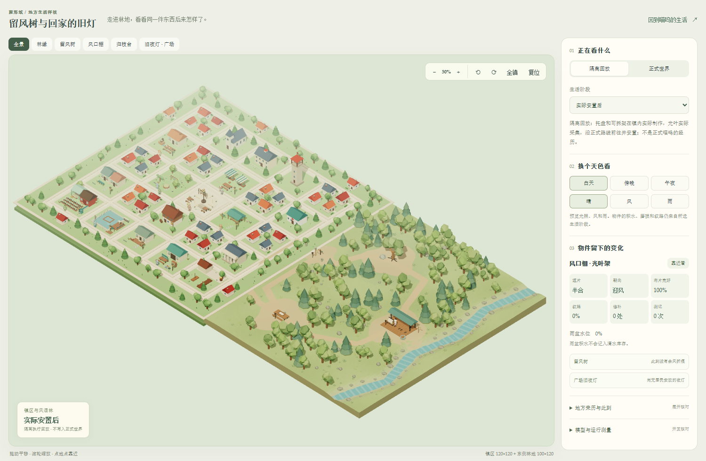
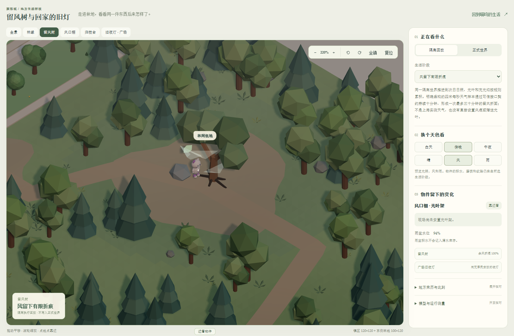
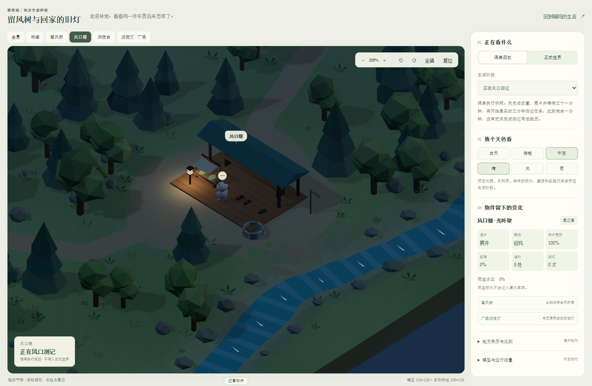
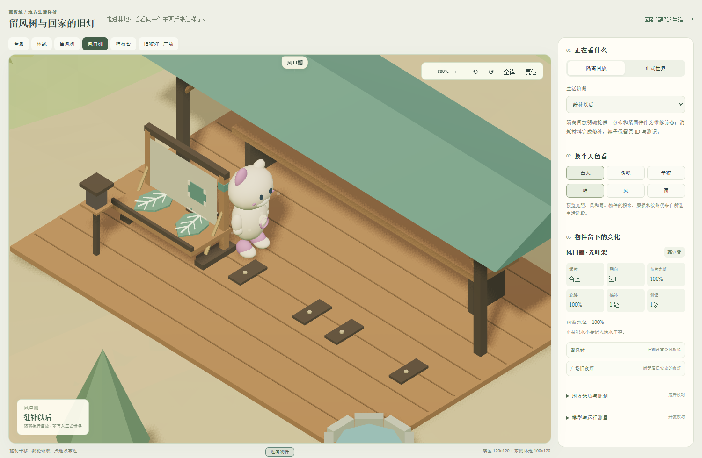

# 留风树与旧夜灯的地方生活迭代

2026-10-13 · 6B 第二轮场景与规则交付

聚形域的第一段奇幻生活现在连接了留风树、风口棚、归枝台和镇中旧夜灯。风能暂时留在树间，采得的光叶能改变已有夜灯的使用方式，工作、风雨与修补会留下可见变化。仍保留完整原镇及东侧林地的 220×120 地面，没有把远方概念区当成已开放地点。

## 经过的天气怎样进入生活

留风树已有光叶至少一片、蓄光至少 0.2，并经历来自受信天气窗口、风速至少 3m/s 的连续十分钟后，枝间形成半透明折面。折面逐渐消散，最多保留三十分钟；形成后冷却两小时。天气未知、过期或中间缺失时不能凑足连续时间。已形成的折面仍能在风停之后短暂存在，重启读取同一游标，不重新生成。

实际采得的光叶一片和布料一份，能用于本人已安装的余辉夜灯，制作需八分钟。灯衬在六个真实小时内逐渐退去，最多将夜间耗光速度从每小时 0.045 降至 0.028，同时降低最多 15% 亮度。它不补充电量、不制造新灯、不替代苗圃明暗对照；灯、标本和制作任务的出处继续保留。取消未完成任务退还预留材料，拆灯不会返还用过的叶片。

## 地方和物件的可见变化

林地使用有起伏的连续地表、小径、不规则空地、自然溪岸、阔叶树、针叶树与蕨类。通路继续与服务器登记的六条路线一致，植被避开通路与操作区域。普通树、岸石和棚内固定工具属于场景设施，不额外增加可采库存。

风口棚有三个明确的安置位置。未安装时保持空位；架子的遮片开合、迎风转向、叶片纹路、湿润颜色、布片破损、补丁和测记来自实际状态。雨盆为中空模型，水面高度与积水匹配。归枝台分别显示实际存放的木料、布、紧固件、光叶和架体套件。工作灯按现场运行任务渐亮、熄灭，角色站到本人架子的操作侧，脚下高度跟随棚台。

验收页扩大场景，提供地点导航、物件特写、十个回放样本，以及正式存档只读模式。光照和风雨按钮只预览画面，不能改写积水、风痕、材料或经历。返回日常生活入口仍通向喵呜的聊天与观察页。

## 故事怎样保留不确定性

五个对象增加地方内容：留风树、旧引光框的相似缺口、旧手艺的用途，以及灯穗偏向照亮归途、影栖偏向保留暗处的初始取舍。它们分别带有作者背景、作者赋予的居民取舍或未证实假说标签。现场认知可读取这些内容，但它们不冒充居民已经说过的话、相遇、争执、任务或亲历。

旧引光设施是否曾通向远方，仍是未证实的线索。潮痕浅湾和星尘驿站保留在概念规划，没有新增入口、资源或自动任务。

## 验证与边界

- 服务端完整隔离回归 795/795 通过，前端 48 组共 285/285 通过；生产源类型检查及生产构建通过。
- 回放执行 20 项活动、8 趟旅行，全部完成；另保存测记到期前一分钟的真实运行快照。可信合成天气证明九分钟不形成、十分钟形成、三十分钟后失效。
- 夜灯回放实际执行取苔芽、制托盘、两小时对照、测记、制标本、携带、装灯及灯衬。新增链没有赠送材料。旧维修对照所需布料与紧固件的预置仍明确声明。
- 1500×980 与 390×844 视口使用本机 Edge 开发回归检查实际 WebGL 画面，页面错误为零，状态切换保留同一画布，移动端无横向溢出。雨盆俯视射线检查确认水面未被实心上盖遮挡。
- 隔离执行 API 调用为零，未把回放写入正式喵呜的过去。本轮没有开启付费居民连续认知。
- 发布后正式服务核验通过：仍为同一身份、14 地点、27 目录对象，原有架体与夜灯列表保留；五处地方内容已可读取，追加迁移记录 `past_events_created: 0`。日常页聊天可见、草稿保留、入口恢复输入焦点，验收发送消息为零。

以上验证说明规则、物件和画面的因果关系可以运行，还不能证明长期生活叙事已经丰富。下一轮需要在这些稳定地方中比较不同居民的选择、改约、放弃、带回用途及隔天再来的差异，再安排自然跨日观察。发布前已保存约 3.74 GB 的一致性存档备份；开展长时间观察前仍需处理增长与恢复开销。新的外壳和角色造型继续排在这些验证之后。

独立验收回放数据较大，生产构建单独载入；日常界面不导入整套回放。截图是实际渲染结果，不能替代低配置设备和长时间运行的性能测试。

[打开运行验收页](http://127.0.0.1:5173/windleaf-review.html?sample=windtrace&sceneMetrics=1) · [上一轮交付](shaping-field-stage6b-first-region-v1.md)

后续复核发现镇林接缝、植被层次和人物接地仍有不足，实际修正与同机位对照见 [6B 地图融合与密度修正](shaping-field-stage6b-fusion-v3.md)。
