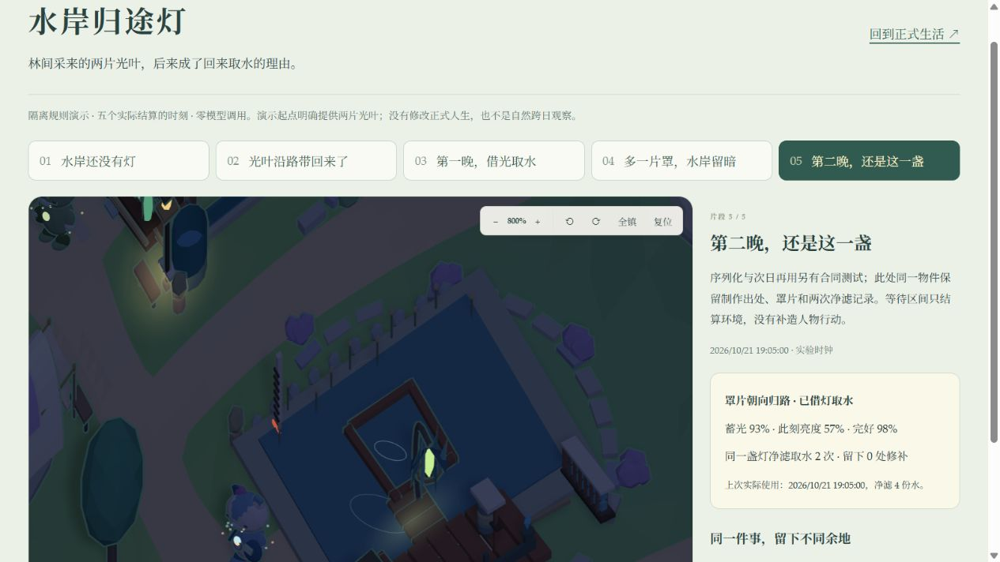

# R2 首条共同日常：水岸归途灯

2026-10-20，本地实现与规则验证。接续 R1C 与 R0–R6 总管线；这是 R2 的首条内容闭环，不是自然七日验收，也不表示已经启用全镇连续模型生活。

## 交付的生活内容

中央聚落的材料、风语林的光叶与回声水岸的浮框共用原有库存、道路和执行器。喵呜希望让光叶有日常用途，灯穗关心晚归时的照明，苔团希望浮圃一侧留暗。以上是作者定义的初始取向，不作为实际对话、承诺或稳定兴趣存档。

归途灯有两种初始做法：敞亮款用光叶 2、木料 1、紧固件 1、布 1；有罩款多用布 1。实际到场后分别制作 20/25 分钟。新灯蓄光为零，要经历白昼才能夜用。使用同一物件五分钟净滤 4 份原水，再经实际运输送往需要清水的苗圃或厨房；每人至少隔两小时才能再用。

已做成的灯可以再缝罩、安装、展开/合罩、修补。罩片是能实际装入随身袋、交接和消耗的物件。缝罩 15 分钟，安装 10 分钟；不能在未建灯时空做罩。修补 15 分钟，实际消耗布与紧固件，只改善原物件的完好度，保留身份、出处、蓄光和使用记录。罩片每次至少留六小时再改，完整的灯不能反复修补刷记录。

灯白昼每小时蓄光 0.14，遮罩时为其 80%；夜间敞开/有罩每小时分别消耗 0.04/0.025。罩片降低亮度，但更挡雨、受强风损耗更慢。实际操作还检查浮框完好度、水位、灯光、材料、占用与相同物件 ID。条件在进行中失效会失败并退回预留材料，不产生清水。天气来源和过期窗口沿用既有环境结算，不凭空补历史天气。照明/暗岸累计量是奇幻规则中的暴露指标，没有把它当成植物健康或人物感受。

## 与已有架构连接

- `waylight-life.mjs` 定义有限规律、活动、状态和本地机会；状态放在原世界 `floating-frame.waylight` 与 `waylight_life` 中。没有另一套人生数据库。
- `living-resources`、`life-planning`、`realtime-world` 负责真实路线、采集、备料、预留、到期结算和取消退款。新活动使用既有结果根、记忆/能力证据、操作历史与回放。
- `autonomous-life` 只在需要允许时提供机会。新制作分数 32/33，低于既有后续 34 和采用后实践 36+，不会用新内容掩盖已有经历。取水与修补以实际缺水/损耗为条件。作者机会不直接标成自主稳定兴趣，开合不获得实践证据。
- `social-life` 的邀请、答复、到场、制作、交接和安装继续使用同一个约定。灯穗与苔团可以拒绝、延期或接受；协商延期后仍需对方重新确认。此合作提供 180 分钟执行窗口，包含真实往返。没有把“答应”当成“物件已改变”。
- 连续认知的本地上下文/社交可行项接入归途灯；只提供自己可见的物件与自己的记录，不把远方物件直播或他人私有记忆塞给人物。本轮未开启正式连续认知，也未做新的真实模型对照。
- 旧存档只增加空挂点和空记录，人口、库存、已有任务与经历不重置。正式观察快照、物件详情和 3D 读取同一状态。

## 实际呈现

延用 low poly、三阶卡通光照和细描边。弯枝挂点、编织叶片、灯芯、方向罩、刻线与修补片依实际物件出现。工作木板接上原浮框与岸边栈台，挂点和人物操作站位都有可见支撑。亮度、罩片、磨损、补丁和使用次数来自存档；动画时间只能轻摆，不能制造灯或新增经历。修复了卡通材质同步覆盖灯芯亮度的问题，也调整了罩的朝路开口。

正式首页的“水岸留下的一件小事”保留原聊天，并可进入水岸。`/waylight-review.html` 提供五个已执行的隔离片段：空挂点、采料制作、第一晚使用、自己缝罩安装、第二晚使用。演示明确预置两片可采光叶，等待段只推进环境；与正式人生分离。合作路径通过以下独立运行核验，没有伪装成该五片段中发生过的对话。

## 48 小时隔离规则对照

使用 `scripts/measure-waylight-life.mjs`，十三名居民、上海时区、每五分钟运行一次，24 小时处序列化重启；两组起点都明确提供 20 份饭与 8 份果实，期间不补给。只改变归途灯规则是否启用。没有调用模型，没有使用正式聊天或传感器数据。

| 指标 | 未启用 | 启用 R2 |
| --- | ---: | ---: |
| 完成用餐 | 32 | 30 |
| 极饿采样人分钟 | 0 | 0 |
| 归途灯实际活动结果 | 0 | 4 |
| 次日晚间实际使用 | 0 | 1 |
| 库存非负/容量核验 | 通过 | 通过 |

R2 运行中，喵呜在首日 20:25 编成敞亮灯；灯穗次日 09:30 缝好罩，实际带回，10:05 交给苔团，10:20 安装完成。喵呜次日 22:35 用同一盏灯净滤 4 份原水。最后物件仍保留最初制作根，罩片已装，完好度约 98.2%。用餐少两次不自动代表质量更好；两组在该起点下都未出现极饿样本，不能推广为正式旧存档的供给问题已解决。

这是一组规则成对运行，检验“能走通”和有限性，不证明模型叙事、角色差异、现实输入因果或自然持续生活质量。自行处理演示累计两次用灯，自动运行累计一次；两种口径不混用。

## 存储与清理

本轮先收口 R1C 发现的容量问题。24 份历史数据库备份由 29.469 GB 压为 3.428 GB，逐份解压字节数与 SHA-256 一致后删除原始副本。另清理 665 个可再生成的旧实验数据库/暂存文件，约 3.115 GB。合计针对原文件释放约 29.16 GB；新增本轮恢复包、源码和实验报告会占少量空间。正式数据库、真实人生、密钥配置、STL、唯一美术参考与源码均保留。

新写入 `canonical-world.checkpoints` 使用有版本、长度和 SHA-256 的 gzip JSON 包；标量索引元数据保持可查询。读取兼容既有未压缩记录，不改变世界哈希或增量合同。损坏、未知格式、元数据被改与超量展开都明确失败。**旧代码不理解新压缩包**，恢复新库必须同时使用匹配的新代码；没有宣称能任意降级程序。

同类单独历史/存储实验结果如下。保留约 3.01 MB 世界与四十项有界变化，每 24 条检查点，SQLite FULL/WAL，不运行领域 reducer 和人物调度。R2 迁移增加少量空字段，故并非逐字节完全相同的初始化；两次机器负载也不同，不作严格速度优劣结论。

| 条数 | R1C 未压缩 DB | 本轮 DB | 写入 P50/P95 | 重启 | 最新历史页 |
| --- | ---: | ---: | ---: | ---: | ---: |
| 1000 | 138.84 MB | 31.42 MB | 90.41/142.36 ms | 151.03 ms | 2.26 ms |
| 10000 | 1344.08 MB | 278.19 MB | 87.01/134.86 ms | 321.51 ms | 10.26 ms |

一万条 DB 减少约 79.3%；417 个检查点的实际封装 JSON 为 190.71 MB，增量 60.92 MB，当前世界 3.01 MB。三个抽样位置重建都通过；16/15/4 条分别约 2.91/2.37/0.75 秒。实验 DB 在报告与恢复验证完成后已清理，保留脚本和报告。没有删除或重写正式库的早期历史；旧库仍约 4.4 GB。本轮不等于冷热生命周期治理或长期无人值守容量全部完成。

部署前再次用 SQLite 在线备份保存当前人生，独立检查 integrity、记录数与当前世界哈希。4.383 GB 的副本压成 495.33 MB，完整解压后再次核对上述指标，并验证恢复工具拒绝覆盖已有文件；随后删除多余原始副本与恢复临时库。`scripts/archive-local-checkpoint.py` 支持校验后压缩，以及恢复到**新的离线路径**。旧批量归档的校验信息在本机 `backup-archives.json`，不使用它假装已上传 GitHub或异地保存。

本机容量复查时，D 盘可用空间由约 19.13 GB 到 47.49 GB，净增加约 28.36 GB；含新增恢复包与本轮产物，和“删除/压缩原文件 29.16 GB”的口径不同。

## 验证、边界与后续

- 后端全量 837/837 通过；收尾增加“未建灯不得先缝罩”的约束后，相关生活/社交 29/29 通过。覆盖真实材料、取消、条件失效、重启、延后重确认、拒绝和双方实际交接。
- 前端全量 325/326 首次通过；原有全地图路线遍历在同时负载下超过五秒。限制单 worker、15 秒上限后，路线与最终归途灯两文件 11/11 通过（整次 5.89 秒）。TypeScript 和 Vite build 通过；已有研究页大 chunk 提示仍存在。没有把沙箱临时缓存/回环网络失败计作产品回归通过。
- 浏览器检查了空挂点与第二晚夜灯，截图来自实际 WebGL。正式页显示午夜上海天气、13 人、原聊天输入框和新后续入口。原存档没有灯，也没有复制演示库存或行为。连续认知仍是 0 人；原有规则/有限模型选择继续运行。
- 最终正式服务健康正常，历史序号 15119 从检查点重放三条操作通过哈希核验。最终源码恢复包逐文件解压验证；公共源码发布包含实现、实验脚本、说明和截图，正式人生、密钥和本机恢复包单独保留。
- 当前只对三名角色开放这组操作。人物差异和拒绝路径已具备，真实模型是否选择得有趣、输入能否改变做法、自由窗口有多少、是否反复等待，仍需要 R3 的成对样本。此次没有证明 ≥70% 自由窗口具有两种实质选择等总管线门槛。

下一步进入 R3：围绕同一灯、旧方法与不同人物，固定初态比较规则/有限选择/新认知；加入天气、收到邀请、主人建议、重复/过期输入和材料不足的对照。跟踪实际任务与物件差异、兴趣证据来源、合理放下/延期、调用成本与整轮延迟。自然七日窗口仍在版本稳定且正式出站范围明确后开始；主题壳和完整角色美术继续等待可依赖的生活依据。

本机详细结果位于工作区 `runtime/r2-20261020/`：`waylight-final/report.json`、`compressed-history-10k/report.json`、清理清单、测试日志、`pre-deploy/` 压缩恢复包及 `archive-recovery-verification.json`。这些运行资料不随公共源码提交。
