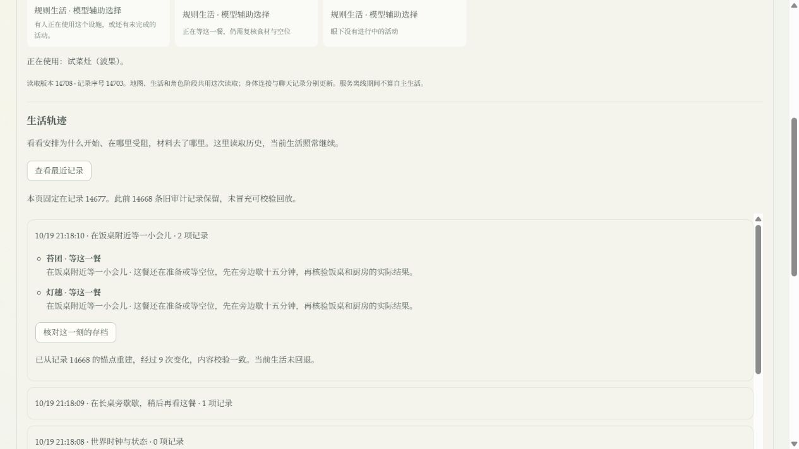

# R1B：可核对的生活轨迹与有限进餐协调

2026-10-19，本地实现，承接 [R1A](world-observer-r1a-2026-10-19.md) 与 [R0–R6 管线](../design/integrated-architecture-roadmap-2026-10-19.md)。本批完成核心操作记录、增量历史、检查点重建，以及同一存档下的进餐协调对照。正式服务已使用原存档重启；没有启用新的连续认知，没有把实验结果写回人生。

## 这次能看到什么

正式入口展开“生活与画面已同步”，再点“生活轨迹 → 查看最近记录”。可以看活动开始/完成/受阻、材料预留/消耗/归还、库存净变化、安排来源、等饭条件及补给计划。每页固定在读取时的记录序号，翻页不会混入后来发生的事。选择“核对这一刻的存档”，服务从检查点和记录重建该版本、核验内容；当前世界继续运行，不回退。

这是第二层诊断入口，聊天与原生活侧栏仍保留。轨迹关联的是一次已提交的世界操作，不把一段摘要文字当作发生过的事件，也不声称覆盖了被 HTTP 层直接拒绝的所有请求。

## 实现与边界

`persistent-world` 新提交记录使用 `foundry.world-mutation-record.v0.2`。`world-delta` 对有稳定 ID 的数组记录增删和字段变化，其他数组采用区间替换；用稳定 JSON 表示计算前后 SHA-256。保留 `updated_at`，支持记录过期裁剪、排序和空数组，确保重建的是当时可持久化的完整状态。

`world-history` 在进程首次提交、每 24 条变化或已知基准不匹配时建立检查点。实存档核验 42 条变化约需 6.34 秒，因此验收时将原 120 条间隔缩短到 24 条，以控制常规读取耗时；原检查点不删除。检查点、当前事实、变化、回合账本和记忆归档在同一 SQLite 事务提交；事务失败不会留下半个检查点或前移内存序号。重建检查父序号和每一步哈希，缺失或损坏就报错，不调用模型、不按今天的规则重演旧事件。更大存档下的延迟和写入成本仍需量测，不作恒定延迟保证。

- `GET /api/world/operations`：只读操作分页，最大 50 项，游标锁定世界和历史头，支持时间正序/倒序。
- `GET /api/world/replay?sequence=…`：只读状态重建，返回检查点、经过记录数与校验结果。
- `world-operation-trace`：任务、资源、安排、有限模型请求状态和补给计划共享操作/事件/关联 ID。库存是一次操作内的**净变化**，不假称完整的内部转移流水；补给意图明确为软计划，不是已经入库的饭食。
- 旧 v0.1 行原样保留。新范围开始前，只有首个检查点恰好覆盖的前态可以核对，更早记录仍为旧审计，不补造回放。第一次正式检查点前有 14,668 条旧记录。
- 当前权威世界仍整份保存；旧数据库未压缩或清理。本批减少新历史重复写入，不代表现有约 4 GB 存档会立刻缩小，也不代替一万条记录的长期 DB/WAL 增长测试。
- 观察者的全镇轨迹不进入人物模型上下文。新连续认知正式登记仍为 0 人；现有规则生活与有限模型选择继续沿用原配置。

## 进餐协调：让等待受到真实条件唤起

以前长桌按单设施独占，取放材料也可能各等一轮生活调度。本批将物理能力明确为六个座位，饭食份数与座位数分别检查。每个实际进餐任务预留一份饭和一个稳定座位；暂停仍占座、保留材料，取消归还对应饭食，完成十分钟进餐才影响食欲。厨房仍独占，一锅光果餐仍需二十分钟并产出三份。

新增只对本引擎自身、可打断的等饭观察/休息任务生效的唤醒：饭和座位实际可用时，提前结束等待，重新选择合法安排。用户暂停、旅行、工作、已接受社交约定和连续认知人物不被取消。排队参考食欲与上次实际吃饭时间，但没有宣称已经实现充分公平。

有界派发允许一次执行最多八个即时步骤，遇到需要时间的任务就停。每次在副本中尝试，失败整体撤回；不会跳过旅行、做饭或用餐时长。忙碌人物不再消耗本轮可派发的八人名额。

六个稳定座位同时传到 3D 工作点，经中央地形映射后仍位于同一张桌子两侧。一个人完成或取消不会让其他人的位置重新编号。旧存档里正在进行的进餐只补座位元数据，不重新扣料或计算完成时间。

## 同一前态的六小时对照

读取 R1A 冻结存档，13 人、14 地点，起点 11 人食欲指标大于 0.9，长桌饭食为 0。保留真实路线、库存、任务、关系和需要消耗；关闭旧模型选项与新认知，仅在内存跑规则对照。对照源码为 R1A 已验收源码包。源状态 SHA-256：

`1ef1ce347737c0dfd8ab59adf6670c825cef3a9125a3c9349fb7ab8f40655d23`

先保持上次五分钟采样口径，做五个消融：

| 五分钟调度版本 | 实际用餐 | 首餐分钟 | 结束时极饿人数 | 等饭人分钟（采样） | 完成的等待检查 |
| --- | ---: | ---: | ---: | ---: | ---: |
| R1A 原规则 | 8 | 140 | 3 | 2010 | 91 |
| 只增加座位 | 9 | 120 | 2 | 1875 | 85 |
| 只唤醒等饭 | 8 | 120 | 3 | 1875 | 87 |
| 只连做即时步骤/跳过忙碌者 | 9 | 90 | 2 | 1670 | 114 |
| 三项组合 | 9 | 90 | 2 | 1455 | 98 |

五分钟版本表明吞吐和调度均有影响，单加座位并不能解决。组合等待时间下降，但等待检查次数上升；不能拿动作条目数量当生活丰富度。此轮结果早于稳定座位元数据与最终唤醒范围收紧，保留为探索消融，后面的最终一分钟配对为交付代码的主要行为结果。

随后按正式生活循环的一分钟节奏，在**同一存档**做 R1A/组合配对。正式系统还包含任务到期、模型返回等唤醒；这仍是有限的加速规则试验，不是整个线上调度的逐调用复制。

| 一分钟调度版本 | R1A | 本批组合 |
| --- | ---: | ---: |
| 六小时实际用餐 | 9 | 11 |
| 首餐分钟 | 91 | 83 |
| 实际做饭次数 | 3 | 4 |
| 六小时末极饿人数 | 2 | 0 |
| 等饭人分钟（采样） | 2023 | 1609 |
| 极饿人分钟（采样） | 2588 | 2232 |
| 自选安排人分钟（采样） | 302 | 357 |
| 完成等待检查 | 136 | 109 |
| 有饭/空位唤醒次数 | 0 | 6 |

等饭采样量减少约 20.5%，极饿采样量减少约 13.8%；新增一锅饭来自真实材料和时长，没有注入食物。所有库存边界通过，模型调用 0 次。人分钟按每轮末状态近似累计，“自选安排”只按计划类别计数，不等于有意义的实践或叙事质量。

**个体差异仍有问题。** 苔团首餐从 182 分钟推迟到 347 分钟，咚芽从 309 分钟推迟到 348 分钟；虽然缝缝和簌簌从窗口内没吃到饭改善为 258 分钟吃到，总量改善并不保证每个人改善。所有初始饥饿者最终吃到一次，也不足以说明日常节奏已经自然。

组合试验 593 次变化全部重建通过，终态哈希 `bf0349689716f3905d686b48afa7e54f8f8265b8740bf7f57f83e6df54ae3db9`。相同变化用旧整数组表达约 127.60 MB，新增量及其封套约 10.97 MB，减少约 91.4%。**只比较相同变化的 JSON 字节数，排除检查点、当前状态、操作摘要、索引和 SQLite/WAL 开销；不是数据库压缩率。**

脚本 `scripts/compare-meal-coordination.mjs` 输出每人指标、每小时状态、操作 JSONL 与可核对的完整实验回放。原始产物保存在工作区 `runtime/r1b-20261019/experiment-v1/` 和 `experiment-minute/`，不进入公共仓库。

## 验证、部署与恢复

- 后端全量首跑 811 项，808 通过：两项旧断言需要适配新的非行为元数据/真实预留库存，一项是随机端口被 fetch 拒绝。修正前两项断言后，包含这三项的 37 项相关回归全部通过，没有放宽库存守恒。最终座位与旧存档补字段后，20 项历史/进餐/长期供给回归通过。
- 检查点间隔最终收紧后，7 项历史/事务/分页回归再次通过。一次正式 24 条记录重建约 5.82 秒（含服务当时负载），不能以单次读数宣称稳定延迟或性能倍数。
- 前端全量 57 文件、320 项通过；最终座位、地形、活动投影、历史与观察状态相关的 27 项通过。TypeScript 与 Vite production build 通过，研究页大 chunk 的既有提示仍在。
- 反例包含：重复提交、SQLite 事务失败、重启重建、检查点边界、缺失序号、损坏哈希、旧历史不可重建、冻结分页、材料归还、暂停不抢占、认知/社交人物排除、六座位独立和地形变换。
- 正式浏览器核对记录 14677：从检查点 14668 经过 9 次变化重建一致；此时当前世界已继续前进。聊天入口与地图仍在，未发送测试聊天。正式校验是读取旧状态，不把实验夹具安装进人生。
- 重启后正式运行至记录 14744，从新检查点 14721 重建的 23 条变化通过；泡屿、灯穗、晃晃正在真实进餐，分别持有座位 0、1、2。地图同步恢复。多人等饭时画面上的状态气泡仍拥挤，位置投影正确不等于桌边动作已精致可读，后续需要按场所打磨等待位置、标记密度与动作可见性。
- 部署前完整在线 SQLite 备份与源码恢复检查通过，771 个源码文件、数据库 integrity 为 ok，约 85.7 秒。`runtime/r1b-20261019/pre-deploy/` 保存部署前人生，原 R1A 已交付源码包可作为代码回退基线。交付源码另存为 `delivered-source-final/`，均为同机备份，不是 GitHub 或异地备份。

## 下一批与阶段门槛

下一批先做 **R1C 基本生活公平性与供给承诺收尾**：按个人需要期限、已有备餐/运输承诺、生产者自身用餐和实际入库时刻排队；报告每人最长等待/首餐、分位数、可支配窗口和生产浪费。用同一前态与正常富余前态分别验证，检查取消、暂停、重启和缺料。不能用持续紧急模式把奇幻生活全部挤掉。

同时收齐 R1 剩余的 live/lab 运行边界、全调用成本/延迟观测和长期存储增长量测。完成后进入 **R2 首条奇幻日常闭环**：喵呜与两位居民在镇中—风语林—水岸之间处理一个可跨日继续的问题，允许不同做法、求助/拒绝、实际物件变化与后续用途。用实际生活内容带动场所和动作细化。

本批仍未证明多源输入足够影响人生、兴趣能稳定演化、自然七日生活质量达标。具体角色与实体壳定稿继续等待这些依据；地形和生活物件表现可伴随闭环逐步完善。
